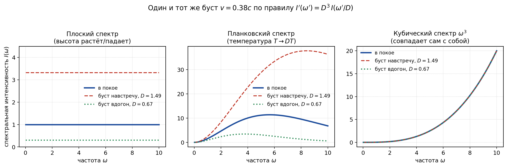

Последние 15–20 лет мейнстрим теоретической физики увлечённо переводит уравнения Эйнштейна на язык квантовой информации, кубитов и энтропии запутанности. Появились громкие заявления: *«Пространство-время — это код исправления ошибок»*, *«Гравитация — это энтропийная сила»* (привет Эрику Верлинде), а в AdS/CFT-соответствии сама геометрия объявляется производной от запутанности конформной теории поля на границе.

Почему эти модели так подозрительно легко «попадают» в формулы Общей теории относительности (ОТО)? Неужели Вселенная — это действительно просто квантовый компьютер?

Чтобы разобраться в этом без мистики, придётся спуститься на уровень ниже — в упругую континуальную среду (планковскую подложку) — и ввести базовое понятие, на котором держится вся магия. Это понятие — термостат. А дальше придётся сделать то, чего информационная физика обычно не делает: взять конкретную среду, конкретные два тела и посчитать силу между ними в лоб.

> Эти исследования во многом были мотивированы многолетними обсуждениями на форумах феноменов «энергии», «силы» и «энтропии», где автор видит эти феномены различными проявлениями одной и той же сущности, что и подтвердилось далее в расчётах, попутно замкнув несколько свободных параметров Стандартной модели друг на друга.

Эта статья — отчёт о том, что получается, если перестать верить словам и начать считать. Честный отчёт: половина красивых идей, с которых всё начиналось, не выдержала численных тестов, а то, что выжило, выглядит совсем не так, как ожидалось. Все числа ниже ведут на открытый репозиторий — главы книги и скрипты, которыми они получены.

<cut/>

### Карта статьи: что посчитано, что требуется от подложки, что открыто

Хабр часто читают по диагонали, поэтому **выложим карты на стол сразу**. Каждое утверждение далее помечено одним из трёх статусов. Ссылки вида [100.6.3] ведут на главы и подглавы книги в репозитории (глава 100 — рабочая ветка этого исследования), ссылки вида [T-49] — на пункты списка открытых задач.

**Посчитано** (скрипт или вывод, который можно повторить):

- $inline$m=E/c^2$inline$ для любого зацикленного возмущения — из доплеровского перекоса встречных волн, не опираясь на постулаты СТО ([100.12.2](https://github.com/dmitry-valyukov/TheoryOfAnything/blob/main/theory/100-ontologiya-energii-massy.md#100122-откуда-квадрат-инерция-зацикленной-волны));
- площадной закон энтропии на упругой сети, $inline$S\propto R^{2.00}$inline$, дважды — как энтропия запутанности и как взаимная информация по Вигнеру, отношение $inline$0.55$inline$ ([`EntanglementArea.py`](https://github.com/dmitry-valyukov/TheoryOfAnything/blob/main/simulations/python/EntanglementArea.py), [`WignerBridge.py`](https://github.com/dmitry-valyukov/TheoryOfAnything/blob/main/simulations/python/WignerBridge.py));
- сила между двумя включениями в среде: знак — притяжение, закон — ван-дер-ваальсовский $inline$D^{-7}$inline$, а не $inline$1/r$inline$; это теорема о показателе, а не подгонка ([`LatticePairForce.py`](https://github.com/dmitry-valyukov/TheoryOfAnything/blob/main/simulations/python/LatticePairForce.py), [`PairExponentFFT.py`](https://github.com/dmitry-valyukov/TheoryOfAnything/blob/main/simulations/python/PairExponentFFT.py));
- два «спасения» дальнодействия — дилатон и мгновенное давление — закрыты спектром и монополем ([100.12.4](https://github.com/dmitry-valyukov/TheoryOfAnything/blob/main/theory/100-ontologiya-energii-massy.md#100124-почему-гравитация-падает-как-c-4-податливость-среды), [100.11.8](https://github.com/dmitry-valyukov/TheoryOfAnything/blob/main/theory/100-ontologiya-energii-massy.md#100118-два-первых-теста-знак-и-монополь-не-величина));
- постньютоновский $inline$\beta=1$inline$ — точно, из одной экспоненты уровня; вписать энергию поля в источник второй раз — $inline$\beta=1.25$inline$, исключено локацией Луны ([100.6.2](https://github.com/dmitry-valyukov/TheoryOfAnything/blob/main/theory/100-ontologiya-energii-massy.md#10062-множитель-2-у-света-и-постньютоновские-betagamma--вывод-из-аксиомы-задание-автора));
- старение сети как источник $inline$\Lambda$inline$ — кандидат не прошёл расчёт: кинетика логарифмическая, $inline$\Gamma\propto1/t$inline$, откуда $inline$\rho_\Lambda\propto H^2$inline$ и $inline$w\approx0$inline$ — перенормировка $inline$G$inline$, а не ускорение, и величина в $inline$10^4$inline$ раз меньше наблюдаемой ([`AgingKinetics.py`](https://github.com/dmitry-valyukov/TheoryOfAnything/blob/main/simulations/python/AgingKinetics.py));
- амплитуда частицы-узла и иерархия коэффициентов его уравнения; локальная нелинейность среды как механизм самолокализации исключена с запасом в 44 порядка ([`KnotScaling.py`](https://github.com/dmitry-valyukov/TheoryOfAnything/blob/main/simulations/python/KnotScaling.py), [100.6.3](https://github.com/dmitry-valyukov/TheoryOfAnything/blob/main/theory/100-ontologiya-energii-massy.md#10063-t-34-как-ведомость-требований-к-узлу-амплитуда-иерархия-коэффициентов-препятствия-задание-автора));
- две альтернативы — «узел удерживает термостат» и «узел не излучает по геометрии» — проверены и не проходят: первая — против когерентности спина и стабильности атомных часов, вторая — у источника узла нет нулей на резонансной оболочке, $inline$\Gamma/\omega\sim1$inline$ ([`KnotRadiation.py`](https://github.com/dmitry-valyukov/TheoryOfAnything/blob/main/simulations/python/KnotRadiation.py), [100.6.3](https://github.com/dmitry-valyukov/TheoryOfAnything/blob/main/theory/100-ontologiya-energii-massy.md#10063-t-34-как-ведомость-требований-к-узлу-амплитуда-иерархия-коэффициентов-препятствия-задание-автора));

**Требование к подложке** (не выведено — из чего выводить, неизвестно; но из наблюдений следует, что среда обязана этим свойством обладать):

- сдвиговая жёсткость и несжимаемость, $inline$K/\mu\gtrsim10^{22}$inline$ ([T-3](https://github.com/dmitry-valyukov/TheoryOfAnything/blob/main/theory/98-todo.md#t-3));
- абсолютный уровень фона локально ненаблюдаем; то, что создаёт тяготение, — безмассовое скалярное поле уровня, источником которого служит плотность избытка; $inline$G=c^4/\mu a^2$inline$ замыкается на жёсткость ячейки ([100.6](https://github.com/dmitry-valyukov/TheoryOfAnything/blob/main/theory/100-ontologiya-energii-massy.md#1006-аксиома-неразличимого-фона-и-ведомость-требований-к-подложке-реверс-инжиниринг));
- размер узла в ячейках масштабируется как $inline$n^{-1/2}$inline$ — это и красное смещение, и $inline$\gamma=1$inline$, и множитель 2 у света одним показателем; коэффициенты уравнения узла обязаны идти с уровнем как $inline$c^1,c^2,c^3$inline$ ([100.6.2](https://github.com/dmitry-valyukov/TheoryOfAnything/blob/main/theory/100-ontologiya-energii-massy.md#10062-множитель-2-у-света-и-постньютоновские-betagamma--вывод-из-аксиомы-задание-автора));
- массовая щель поля узла (mass gap — минимальная частота линейных возбуждений поля, ниже которой состояний нет) зажата между $inline$0.511$inline$ и $inline$0.66$inline$ МэВ, и линейная ветвь выше щели обязана быть нераспространяющейся — иначе в этом окне масс существовала бы вторая частица, сильно связанная с электроном, — а её нет ([100.6.3](https://github.com/dmitry-valyukov/TheoryOfAnything/blob/main/theory/100-ontologiya-energii-massy.md#10063-t-34-как-ведомость-требований-к-узлу-амплитуда-иерархия-коэффициентов-препятствия-задание-автора)).

**Открыто** (честно: механизма нет):

- что именно в среде есть «уровень» — носитель скалярного поля ([100.20](https://github.com/dmitry-valyukov/TheoryOfAnything/blob/main/theory/100-ontologiya-energii-massy.md#10020-долги-и-вопросы-к-последовательному-исследованию-без-выводов), открытый вопрос 9);
- тензорный сектор — гравитационные волны с $inline$h\propto1/D$inline$ ([T-49](https://github.com/dmitry-valyukov/TheoryOfAnything/blob/main/theory/98-todo.md#t-49));
- почему $inline$\Lambda\ne0$inline$: нужен беспороговый дрейф уровня с темпом-константой среды ([100.17](https://github.com/dmitry-valyukov/TheoryOfAnything/blob/main/theory/100-ontologiya-energii-massy.md#10017-что-считать-мишень));
- механизм локализации одного кванта: он либо нелокален, либо вообще не сводится к нелинейности ([100.6.3](https://github.com/dmitry-valyukov/TheoryOfAnything/blob/main/theory/100-ontologiya-energii-massy.md#10063-t-34-как-ведомость-требований-к-узлу-амплитуда-иерархия-коэффициентов-препятствия-задание-автора), открытый вопрос 11 в [100.20](https://github.com/dmitry-valyukov/TheoryOfAnything/blob/main/theory/100-ontologiya-energii-massy.md#10020-долги-и-вопросы-к-последовательному-исследованию-без-выводов));
- квантовая нелокальность: область не исследована. Мгновенный канал давления в несжимаемой среде физичен и сигнала не передаёт (это теорема); усреднение по фазам термостата нарушения не даёт; механизм, выводящий корреляции на предел Цирельсона $inline$2\sqrt2$inline$ за счёт дальнодействия по общему фону, не выписан и не исключён (раздел 8).

## 1. Среда и термостат

Что такое термостат в модели физического вакуума? Это не «баня с температурой», к которой мы привыкли в быту. Термостат вакуума — это колоссальный резервуар быстрых, хаотических, некогерентных степеней свободы среды: непрекращающийся, однородный планковский рёв нулевых колебаний ($inline$u_{\rm zp}\sim10^{-35}$inline$ м). Он обладает уникальным спектром $inline$\omega^3$inline$ — единственным, который не меняется при равномерном движении наблюдателя. Здесь легко спутать этот шум с тепловым излучением, но тепловой спектр лоренц-инвариантным не является: наблюдатель, движущийся сквозь него, видит доплеровский перекос — спереди спектр «синеет» и горячее, сзади «краснеет». Для спектральной интенсивности любого изотропного излучения при бусте действует одно правило: в направлении с доплер-фактором $inline$D$inline$ наблюдатель видит $inline$I'(\omega')=D^3\,I(\omega'/D)$inline$ — множитель $inline$D^3$inline$ складывается из сдвига энергии и частоты квантов и аберрации телесного угла (это инвариант $inline$I/\omega^3$inline$ из теории переноса излучения). Для $inline$I\propto\omega^3$inline$ получается $inline$I'(\omega')=D^3(\omega'/D)^3=\omega'^3$inline$: сжатие частот ровно компенсируется тем, что на сдвинутой частоте фона изначально было в $inline$D^3$inline$ раз больше, — в любом направлении и при любой скорости. Плоский спектр при том же бусте поднялся бы в $inline$D^3$inline$ раз, планковский стал бы планковским с температурой $inline$DT$inline$, кубический совпадает сам с собой (рис. 1). Инвариантность шума здесь не постулат, а свойство спектра; инвариантность динамики самих узлов — отдельный вывод из волнового уравнения с одной $inline$c$inline$ (раздел 3), и точна она ниже обрезания спектра на шаге сети (см. «Коротко для критиков»). Этот термостат присутствует в каждой ячейке пространства: он задаёт локальный ход времени и скорость света.

*Рис. 1. Один и тот же буст $inline$v=0.38c$inline$ (навстречу $inline$D=1.49$inline$, вдогон $inline$D=0.67$inline$) по правилу $inline$I'(\omega')=D^3I(\omega'/D)$inline$: плоский спектр меняет высоту, планковский — температуру, кубический $inline$\omega^3$inline$ совпадает сам с собой. Скрипт — [`articles/img/spectrum_boost.py`](https://github.com/dmitry-valyukov/TheoryOfAnything/blob/main/articles/img/spectrum_boost.py).*

Для его существования потребовалось постулировать:

- **физичность вакуума** — это среда, а не пустота;
- **её сдвиговую жёсткость** — вакуум твёрдое тело, а не жидкость: без жёсткости на сдвиг в нём не было бы поперечных волн, то есть не было бы света;
- **её несжимаемость** — продольные волны заморожены, поэтому у среды одна предельная скорость: скорость поперечного звука, она же скорость света *c* (это уже не постулат, а следствие: $inline$c^2=\mu/\rho$inline$, модуль сдвига на плотность);
- **её беспокойство** — среда никогда не покоится: нулевое дрожание со спектром $inline$\omega^3$inline$, единственным лоренц-инвариантным; это и есть термостат;
- **возможность** наряду с бегущими возмущениями образования **устойчивых зацикленных конфигураций** — частиц.

Несжимаемость заслуживает отдельной оговорки, потому что первый вопрос грамотного читателя — «а продольная волна тогда мгновенная, и где причинность?». Ответ: в несжимаемой среде давление — не распространяющаяся мода, а множитель Лагранжа, который держит связь $inline$\nabla\cdot\mathbf u=0$inline$. На инженерном языке это реакция связи — как натяжение нерастяжимой нити или реакция опоры: у неё нет собственной динамики и собственной частоты, в каждый момент она равна ровно тому, что нужно, чтобы объём не менялся. Образ: несжимаемый стержень, в торец которого давят. Толчок появляется на дальнем конце в тот же миг — продольная скорость звука бесконечна, — но сдвигается стержень лишь настолько, насколько позволяет вся связанная с ним масса: давящий чувствует не упругость, а инерцию всего, что связь тянет за собой. В безграничной среде эта инерция конечна — среда обтекает тело, и присоединённая масса шара равна половине вытесненной, — поэтому мгновенность давления не делает тело бесконечно тяжёлым и не переносит сигнал: «мгновенно» здесь относится к реакции связи, а не к волне. В гамильтоновой классификации Дирака пара связей $inline$\nabla\cdot\mathbf u=0$inline$, $inline$\nabla\cdot\boldsymbol\pi=0$inline$ — второго рода: их скобка $inline$-\nabla^2\delta$inline$ не нуль, калибровочной свободы нет, продольное смещение не «нефизично», а строго равно нулю. Давление действительно устанавливается по объёму мгновенно — но сигнал по нему передать нельзя, наблюдаемые от этого не страдают, а сама классификация следует из одних канонических скобок и от вида упругой энергии не зависит ([1.6.2](https://github.com/dmitry-valyukov/TheoryOfAnything/blob/main/theory/01-6-mgnovennoe-pole-davleniya.md#162-давление-как-множитель-лагранжа), [1.6.6](https://github.com/dmitry-valyukov/TheoryOfAnything/blob/main/theory/01-6-mgnovennoe-pole-davleniya.md#166-классификация-связи-по-дираку)). Больше того, именно так и должно быть: эмерджентная лоренц-инвариантность требует, чтобы у всех сортов возбуждений был один световой конус, а продольная ветвь обычного кристалла его ломает; у несжимаемой среды продольная ветвь — не мода вовсе ([1.4.3](https://github.com/dmitry-valyukov/TheoryOfAnything/blob/main/theory/01-4-emergentnaya-lorenc-invariantnost.md#143-требование-универсальности-светового-конуса)). Что это значит для дальнодействия и для «квантовой нелокальности» — в разделах 5 и 8.

Любая элементарная частица в такой картине — это не «кусочек другого вещества», а упорядоченная, зацикленная волна — когерентный избыток над фоном, «рябь», — которая сидит поверх этого гигантского термостата и резонирует с ним на своих частотах. **Причём эта рябь в $inline$10^{23}$inline$ раз слабее самого фонового шума.**

> Оценка простая. Энергия электрона $inline$m_ec^2$inline$, размазанная по его комптоновскому объёму $inline$\bar\lambda_C^3$inline$ и колеблющаяся на его же частоте $inline$c/\bar\lambda_C$inline$ в среде планковской плотности $inline$\rho_P=m_P/l_P^3$inline$, требует амплитуды $inline$u$inline$ из $inline$\rho_P(c/\bar\lambda_C)^2u^2\bar\lambda_C^3=m_ec^2$inline$, откуда $inline$u=(m_e/m_P)\,l_P\approx4\cdot10^{-23}\,l_P$inline$; фон же дрожит с амплитудой порядка самой ячейки, $inline$\sim l_P$inline$ (это следует из нормировки $inline$\hbar=\rho a^4c$inline$; строго говоря, это критерий Линдемана — порог плавления, — и точный множитель остаётся открытым вопросом). Число $inline$10^{-23}$inline$ — просто отношение массы электрона к планковской, $inline$\sqrt{\alpha_G}$inline$.

Три масштаба, на которые дальше опирается каждое число статьи ([100.3](https://github.com/dmitry-valyukov/TheoryOfAnything/blob/main/theory/100-ontologiya-energii-massy.md#1003-масса--энергия-зацикленных-возмущений), [100.6.3](https://github.com/dmitry-valyukov/TheoryOfAnything/blob/main/theory/100-ontologiya-energii-massy.md#10063-t-34-как-ведомость-требований-к-узлу-амплитуда-иерархия-коэффициентов-препятствия-задание-автора)):

| что | амплитуда | в единицах ячейки | статус |
|---|---|---|---|
| фон: нулевое дрожание ячейки | $inline$\sim l_P$inline$ | $inline$\sim1$inline$ | следствие нормировки $inline$\hbar=\rho a^4c$inline$; множитель открыт (критерий Линдемана) |
| узел-электрон: смещение | $inline$l_P^2/\bar\lambda_C\approx7\cdot10^{-58}$inline$ м | $inline$4\cdot10^{-23}$inline$ | посчитано (из баланса с термостатом $inline$E=\hbar\Omega$inline$, раздел 3) |
| узел-электрон: деформация | $inline$(l_P/\bar\lambda_C)^2$inline$ | $inline$1.8\cdot10^{-45}=\alpha_G$inline$ | посчитано |
| гравитация Солнца на орбите Земли: сдвиг уровня (безразмерный потенциал $inline$U=GM/rc^2$inline$ — на сколько относительно отстают местные часы от далёких) | — | $inline$U\approx10^{-8}$inline$ | наблюдение |

Последняя строка — для масштаба: гравитационный потенциал в этой картине есть не амплитуда дрожания, а сдвиг его *уровня*, и он на 37 порядков больше собственной деформации частицы. Это не парадокс, это подсказка, и к ней статья вернётся в разделе 6: то, что называют тяготением, не может быть «избытком дрожания» второго порядка.

Здесь и кроется фундаментальный сдвиг парадигмы: **почему вакуумом приходится оперировать именно как физическим упругим телом с экстремальной сдвиговой жёсткостью?** Перевод ОТО на рельсы квантовой информации мейнстримом грешит идеализмом — он объявляет биты и кубиты первоосновой, забывая про бэкэнд. Но если вакуум — реальная упругая среда, то электродинамика перестаёт быть «набором рецептов» и выводится из механики сплошных сред, а у квантования появляется механизм-кандидат (раздел 8). Свободные уравнения Максвелла — макроскопическая запись баланса упругих деформаций, закон Гаусса — следствие несжимаемости, скорость света — скорость поперечного звука ([3.1](https://github.com/dmitry-valyukov/TheoryOfAnything/blob/main/theory/03-1-vyvod-maksvella.md)). В такой онтологии планковский термостат физичен и материален: это реальный механический рёв подложки Вселенной с лоренц-инвариантным спектром $inline$\omega^3$inline$.

**Итог раздела.** Пять постулатов, один термостат, три масштаба: фон $inline$\sim l_P$inline$, частица $inline$\sim10^{-23}\,l_P$inline$, её деформация $inline$\sim\alpha_G$inline$. Всё, что дальше, — попытка посчитать, что из этого следует, и честный список того, что не следует.

## 2. Два термина вместо одного: фон и избыток

Начнём с ошибки, о которую вычисления споткнулись поначалу и на которой, как выяснилось, стоит половина недоразумений «информационной физики». В исходной модели словом «энергия» назывались две разные вещи.

Первая — **фон**: однородное нулевое дрожание подложки. У него нет выделенной системы покоя, он задаёт $inline$c$inline$ и ход часов, и его абсолютный уровень локально принципиально ненаблюдаем: все местные линейки, часы и массы масштабируются вместе с ним. По построению, наблюдаемый показатель преломления невозмущённого фона $inline$n=1$inline$. Вторая — **избыток** над фоном: узел-частица, луч света, тепло, поле. У избытка есть система покоя, он различим от фона, и только он подчиняется силовому учёту. Тяготение создаёт не вся энергия, а только та, что выделяется над фоном, — сигнал, а не шум. Строго: мерой служит различимость $inline$D$inline$ — относительная энтропия состояния по отношению к фону; для гауссова фона это половина квадрата отношения сигнал/шум. Дальше в тексте «гравитирует» означает ровно это: создаёт тяготение, будучи различимым над фоном.

Операционный критерий, принятый после этого: **энергией в силовом смысле** называется то, что способно создать силу, то есть имеет градиент — пространственный или временной. Однородный фон силы не создаёт: в линейные уравнения упругой среды энергия входит только через силу, а у фона её нет. Фон сохраняется по Нётер, у него есть уравнение состояния $inline$p=-\varepsilon$inline$ (так требует лоренц-инвариантность), но единственный канал, через который однородный фон вообще может на что-то действовать, — глобальный: изменение состояния всей среды. В ОТО это и есть космологическая постоянная.

Самое важное здесь то, что это не гипотеза автора, а известный физический факт. Возьмите массивное тело с полостью в центре и посадите туда наблюдателя. Тяготения он не почувствует — теорема об оболочке у Ньютона, теорема Биркгофа в ОТО. Часы в полости идут медленнее далёких на $inline$GM/Rc^2$inline$, энергетический уровень сдвинут, но однороден. Наблюдательно это локальная позиционная инвариантность принципа эквивалентности: нуль-тесты красного смещения при годовом ходе солнечного потенциала ограничивают зависимость местной физики от уровня на $inline$10^{-6}$inline$–$inline$10^{-7}$inline$, а сама Земля находится в потенциалах Солнца, Галактики и Местного сверхскопления без каких-либо локально обнаружимых следствий. Числа здесь — безразмерный потенциал $inline$U=GM/rc^2$inline$, то есть на какую долю местные часы отстают от бесконечно далёких: от собственного поля Земли на её поверхности это $inline$7\cdot10^{-10}$inline$, от Солнца на земной орбите — $inline$10^{-8}$inline$, от Галактики — $inline$\sim v^2/c^2\approx10^{-6}$inline$ при орбитальной скорости $inline$220$inline$ км/с, от Местного сверхскопления — $inline$\sim10^{-5}$inline$. Уровень на Земле сдвинут на все эти доли сразу, и ни одна местная константа этого не чувствует — хотя точность, с которой их постоянство проверено, на порядки лучше самих сдвигов. Стоит задержаться на этом сравнении. Тяготение Земли мы чувствуем каждой клеткой, а вклад Земли в отставание наших часов — $inline$7\cdot10^{-10}$inline$ — на пять порядков меньше вклада сверхскопления, которого мы не чувствуем вовсе. Мы реагируем только на градиент: потенциал Земли меняется на масштабе её радиуса и порождает силу, а потенциал сверхскопления поперёк всей Солнечной системы меняется лишь на $inline$\sim10^{-16}$inline$ — и это однородный градиент, в котором система свободно падает целиком и который изнутри не виден; приливная, неоднородная часть — порядка $inline$10^{-26}$inline$. И мерим мы тоже градиент: часы на поверхности против часов на орбите GPS видят разность потенциалов Земли, $inline$5\cdot10^{-10}$inline$, а на пять порядков больший общий сдвиг от сверхскопления на той же базе не меняется и в сравнение не попадает. Сдвиг уровня в $inline$10^{-5}$inline$ существует, и он ненаблюдаем без выраженного градиента — это и есть содержание аксиомы, проверенное на нас самих.

Отсюда **аксиома**, которую модель обязана соблюдать: ни одно выражение для наблюдаемой величины не может содержать абсолютный уровень фона иначе, чем через его градиенты. Математически это калибровочная инвариантность по сдвигу уровня ([100.6](https://github.com/dmitry-valyukov/TheoryOfAnything/blob/main/theory/100-ontologiya-energii-massy.md#1006-аксиома-неразличимого-фона-и-ведомость-требований-к-подложке-реверс-инжиниринг)). Статус: для потенциала — наблюдение (полость, оболочка, локальная позиционная инвариантность); для плотности энергии фона — постулат онтологии модели. Ниже будет видно, что аксиома делает с гравитацией, а пока — что она делает с самым громким тупиком мейнстрима.

### Проблема космологической постоянной

Квантовая теория поля (КТП) честно суммирует энергию нулевых колебаний вакуума и получает «сверхтяжёлое» пространство, плотность энергии которого расходится с наблюдениями на 120–123 порядка. Мейнстрим считает это катастрофической ошибкой формул. В модели упругого вакуума расчёт КТП **верен**: это и есть фон, подложка, и у неё действительно колоссальная плотность внутренней энергии. Ошибка не в квантовом счёте, а в допущении, будто вся эта энергия обязана создавать тяготение. По аксиоме равномерный фон — не силовая энергия и не источник: тяготение создаёт только избыток. Для потенциала это теорема (полость, оболочка, локальная позиционная инвариантность); для плотности энергии фона — уже постулат модели, и ровно здесь она расходится с ОТО: ОТО велит однородной энергии вакуума создавать тяготение через уравнение Фридмана, а модель говорит «нет». Наблюдение, $inline$\Lambda\approx10^{-122}\rho_P$inline$, на стороне модели.

Но честность требует сказать и вторую половину: почему $inline$\Lambda$inline$ не ноль, модель пока не вывела. По аксиоме ненулевая $inline$\Lambda$inline$ может быть только градиентным эффектом — временным (дрейф уровня фона) или пространственным (неоднородность). Что с этим стало после расчётов — в разделе 7. Спойлер: первый кандидат, который можно было посчитать, не прошёл.

**Итог раздела.** Два термина вместо одного: фон (ненаблюдаемый уровень, силы не создаёт) и избыток (различим, создаёт тяготение). Аксиома сдвига уровня — наблюдение для потенциала; что плотность энергии фона не источник — постулат онтологии. Проблема $inline$\Lambda$inline$ раздваивается: «почему не $inline$10^{122}$inline$» снимается согласно онтологии модели — однородный фон тяготения не создаёт; «почему не ноль» — открыто.

## 3. Онтология триединства: энергия, сила и энтропия

В учебниках нас приучили раскладывать мир по изолированным ящикам: механическая работа, потенциальная энергия сжатой пружины, теплота и энтропия. Кажется, что это концептуально разные сущности. На уровне упругого континуума это разделение — бухгалтерский артефакт. Реальность едина, термины — проекции одного огрубления. Ниже четыре шага: одна энергия и $inline$m=E/c^2$inline$ (посчитано), сила как среднее по термостату (сформулировано), тождество Кирквуда — Цванцига (выводится), и бухгалтерия — что учитывается, чем, где в ней сила и где информация.

### Шаг 1: энергия избытка всего одна

Энергия — не набор сортов, а одна сущность: местная интенсивность беспокойного поперечного движения среды, «то, что не знает покоя». Сжатая пружина на уровне решётки не покоится: в ней действует неснятая сила давления, которую на микроуровне поддерживает непрерывный динамический процесс.

Масса покоя возникает как свойство **зацикленности** этого движения: когда волна бежит по кругу и «догоняет свой хвост», у конфигурации появляется система покоя. Массой обладает любое зацикленное возмущение — в том числе свет, пойманный в резонатор, — но из этого не следует, что масса «состоит из света»: свет лишь одна из конфигураций поперечного движения, электрон — другая, топологически замкнутая.

**Почему в знаменателе стоит именно $inline$c^2$inline$?** Простейшая зацикленная конфигурация — стоячая волна: две встречные бегущие волны с энергиями $inline$E/2$inline$ каждая. Бегущая волна несёт импульс $inline$E/c$inline$ на единицу энергии, и в покое импульсы $inline$\pm E/2c$inline$ гасятся. Сдвинем конфигурацию со скоростью $inline$v$inline$. Доплер делает энергии встречных компонент неравными:

$$display$$E_\pm=\frac E2\sqrt{\frac{1\pm v/c}{1\mp v/c}},\qquad E_++E_-=\gamma E,\qquad p=\frac{E_+-E_-}{c}=\gamma\frac{E}{c^2}\,v .$$display$$

Инертная масса $inline$E/c^2$inline$ — произведение двух множителей $inline$1/c$inline$: импульса на единицу энергии бегущей волны и доплеровской асимметрии $inline$v/c$inline$. Вывод не использует ничего, кроме волнового уравнения с одной скоростью $inline$c$inline$, поэтому $inline$m=E/c^2$inline$ верно для любой зацикленной конфигурации, а релятивистский рост массы — кинематика доплеровского перекоса встречных волн, а не «утяжеление». Масса покоя — это запертый циркулирующий импульс, делённый на $inline$c$inline$: в покое импульс не отсутствует, а уравновешен. (Исторически это ящик Эйнштейна 1906 года и теорема Лауэ 1911-го; новое здесь лишь то, что в модели это не аналогия, а прямое следствие первого постулата: всё наблюдаемое — энергия деформации подложки; вывод и оговорки — [100.12.2](https://github.com/dmitry-valyukov/TheoryOfAnything/blob/main/theory/100-ontologiya-energii-massy.md#100122-откуда-квадрат-инерция-зацикленной-волны).) **Статус: выведено** из постулата 1; открытый вопрос — универсальность $inline$c$inline$ для узлов любой топологии при упругой нелинейности.

### Шаг 2: сила как среднее по термостату

Представьте когерентный объект (солитон, частицу) с одной медленной координатой $inline$X$inline$ и миллиарды быстрых хаотических степеней свободы среды — термостат $inline$y$inline$. На микроуровне нет «макроскопической силы». Есть только микроскопические упругие силы $inline$-\partial H/\partial X$inline$ со стороны каждой ячейки в каждый момент. Макросила — строгое среднее микросилы по состояниям термостата при данном $inline$X$inline$:

$$display$$f(X)=\Big\langle-\frac{\partial H}{\partial X}\Big\rangle_X .$$display$$

Макросила — буквально «дальнее эхо миллиардов микрошумов». **Статус: сформулировано** ([100.11](https://github.com/dmitry-valyukov/TheoryOfAnything/blob/main/theory/100-ontologiya-energii-massy.md#10011-онтология-силы-среднее-микросилы-по-термостату)); это определение, а не вывод, и само по себе оно ещё ничего не предсказывает.

### Шаг 3: тождество Кирквуда — Цванцига

Заглянем под капот усреднения. По теореме о потенциале средней силы, если изолировать систему и зафиксировать полную энергию $inline$E$inline$, макросила выражается через полную энтропию:

$$display$$f=T\,\frac{\partial S_{\rm полн}}{\partial X}\Big|_E,\qquad \frac1T=\frac{\partial S_{\rm полн}}{\partial E}.$$display$$

Проверим на пружине с потенциалом $inline$U(X)$inline$ в термостате. Энергия, ушедшая в пружину, отнята у термостата, поэтому $inline$S_{\rm полн}=S_{\rm терм}(E-U(X))$inline$. Дифференцируем:

$$display$$\frac{\partial S_{\rm полн}}{\partial X}=\frac{1}{T}\big(-U'(X)\big)\quad\Rightarrow\quad f=-U'(X).$$display$$

Классическая «механическая» сила пружины получена из энтропии. Механическая сила — это скорость, с которой сдвиг $inline$X$inline$ меняет число доступных термостату микросостояний через обмен энергией. **Статус: выводится** (теорема о потенциале средней силы, [100.11.2](https://github.com/dmitry-valyukov/TheoryOfAnything/blob/main/theory/100-ontologiya-energii-massy.md#100112-три-записи-одной-величины)). Граница тождества: силы, не совершающие работы, в него не входят — об этом ниже.

### Бухгалтерия вместо онтологии: что учитывает энтропия и где в этом учёте сила

Вот место, которое стоит проговорить медленно, потому что здесь «информационная физика» чаще всего подменяет понятия.

**Что учитывается.** Только избыток над фоном. Фон не учитывается не потому, что его мало (его на $inline$10^{123}$inline$ больше), а потому, что он входит в любой счёт аддитивной константой: энтропия гауссова термостата зависит от общего уровня дрожания как $inline$N\ln(\text{уровень})$inline$, и от положения объекта $inline$X$inline$ эта константа не зависит. Это аксиома раздела 2 на языке энтропии: производная от однородного уровня по $inline$X$inline$ равна нулю тождественно, силы от фона нет. Полость в центре массивного тела — тот же факт со стороны силы.

**Что сохраняется.** Раз фон — аддитивная константа, энергия избытка сохраняется отдельно от него, и ровно тогда, когда фон стационарен: по Нётер сохранение следует из инвариантности по сдвигу времени, и избытку над неподвижным фоном всё равно, сколько энергии в самом фоне. Единственный канал, по которому избыток может не сохраняться, — зависимость уровня фона от времени. Запомните это место: «избыток не сохраняется» и «$inline$\Lambda\ne0$inline$» окажутся одним утверждением с двух сторон (раздел 7). Частица в балансе накачки из шума и излучения в среду — частный случай: её избыток постоянен, потому что приход равен уходу. Это равновесие энергетическое, оно задаёт энергию узла ($inline$E=\hbar\Omega$inline$, [2.10](https://github.com/dmitry-valyukov/TheoryOfAnything/blob/main/theory/02-10-termostat.md#210-термостат-как-правило-отбора-последний-кандидат)), но о том, что удерживает узел в пространстве, не говорит ничего — к этому статья вернётся в разделе 6.

**Чем учитывается.** Энтропия термостата $inline$S$inline$ — не энергия и не субстанция, а счётчик: логарифм числа конфигураций дрожания, совместимых с данным когерентным состоянием избытка. Она отвечает на вопрос «сколькими способами среда может нести этот избыток», а не «сколько в нём энергии». Полная бухгалтерия избытка —

$$display$$E=F+TS=k_BT\,D+TS:$$display$$

цена различимой части (информация $inline$D$inline$ в натах, умноженная на курс $inline$T$inline$) плюс связанная часть (кратность, умноженная на тот же курс). Курс у фона нулевых колебаний частотный — $inline$\hbar\omega/2$inline$ на нат; у теплового избытка — $inline$k_BT$inline$ ([100.5](https://github.com/dmitry-valyukov/TheoryOfAnything/blob/main/theory/100-ontologiya-energii-massy.md#1005-энтропия--учёт-избытка-над-фоном-сила--производная-этого-учёта-информация--различимость)).

**Где сила.** Сила на когерентный объект — производная учёта по положению. Когда термодинамика раскладывает

$$display$$F=U-TS\quad\Rightarrow\quad f=-\frac{\partial F}{\partial X}=-\frac{\partial U}{\partial X}+T\frac{\partial S}{\partial X},$$display$$

она делит одну производную одного счёта по двум статьям: «через энергию когерентной конфигурации» и «через кратность шума». Ньютоновская механика разделяет их только потому, что допускает умозрительную стерильную пустоту ($inline$T=0$inline$), где $inline$-\nabla U$inline$ стоит в одиночестве. Модель эту идеализацию запрещает: планковский рёв есть в каждой ячейке. Поэтому отдельной «чисто механической» силы в такой Вселенной нет — но и обратное утверждение, «всякая сила энтропийна», не онтология, а та же бухгалтерия, прочитанная с другого конца. Силы, не совершающие работы (магнитная, кориолисова), в этот аппарат не входят вовсе: это геометрический член реакции на медленную переменную (Берри — Роббинс).

**Где информация.** Информация здесь — не отдельная субстанция, а мера различимости возмущения от фонового шума: относительная энтропия $inline$D$inline$ (расстояние Кульбака — Лейблера) между состоянием и фоном; для когерентного сдвига $inline$(q_0,p_0)$inline$ на гауссовом фоне $inline$D=\tfrac12\big(q_0^2/\langle q^2\rangle+p_0^2/\langle p^2\rangle\big)$inline$ — половина квадрата отношения сигнал/шум. Для гауссова фона нулевых колебаний верно точное тождество

$$display$$E=\sum_k\frac{\hbar\omega_k}{2}\,D_k :$$display$$

энергия когерентного возбуждения равна его различимости, умноженной на цену ната на той же частоте. Состояние, неотличимое от фона ($inline$D=0$inline$), не несёт ни информации, ни тяготения — критерии «избыток над фоном» и «различимость от фона» совпадают. Один квант — порядка двух натов на своей частоте: частицы различаются частотой, а не объёмом информации, а $inline$\hbar$inline$ в этой картине — уровень нулевого шума среды. Важно не смешивать три разные «информации», все в натах: различимость $inline$D$inline$ (описывает объект), энтропию термостата $inline$S$inline$ (резервуар) и взаимную информацию через разрез (геометрию). Автор на этом один раз ошибся сам, прочитав линейный градиент энтропии термостата как «нат на радиан фазы» узла; различимость квадратична по сдвигу, и ошибка вскрылась ([100.14](https://github.com/dmitry-valyukov/TheoryOfAnything/blob/main/theory/100-ontologiya-energii-massy.md#10014-энергия-и-информация-различимость-от-фона)). **Статус:** тождество $inline$E=\sum(\hbar\omega/2)D$inline$ — выведено для линейных возбуждений гауссова фона; для нелинейного узла — проверить.

**Вопрос, который здесь обязан задать каждый, — и ответ на него и есть феномен силы: если избыток сохраняется, почему система вообще куда-то движется?** В учебниках сила — «мера интенсивности взаимодействия» или «обмен бозонами», но почему этот обмен порождает стремление сдвинуть координату — тишина. В среде ответ двусторонний. Механически: масса узла — его запертый циркулирующий импульс; на градиенте уровня этот импульс перестаёт быть уравновешенным, потому что $inline$c$inline$ на двух сторонах узла разная (эффект рефракции), и энергия покоя в единицах удалённого наблюдателя зависит от координаты. Сила — производная этой зависимости, $inline$f=-\nabla(E\,n^{-1/2})=-m\nabla\Phi$inline$. Тянуть некому: узел движется, потому что его собственный циркулирующий импульс в неоднородной среде больше не замыкается в нуль. **Масса и сила тяготения оказываются одной величиной в двух состояниях — уравновешенном и нет.** (Для других сил — электрической, например, — механизм дисбаланса должен быть свой, через дефект заряда; это в модели не показано и здесь не утверждается.) Статистически: то же $inline$f=T\,\partial S/\partial X$inline$ — при фиксированной полной энергии состояние с меньшим $inline$U$inline$ оставляет термостату больше микросостояний, и целое идёт к большей кратности. Обе стороны — одна производная одного учёта.

**Отсюда — принцип эквивалентности, и он для модели не постулат.** Инертная масса узла — коэффициент при доплеровском перекосе встречных волн, когда узел *разгоняют*: $inline$m=E/c^2$inline$. Гравитационная масса — коэффициент при том же перекосе, когда узел *стоит* в градиенте $inline$c$inline$. Это одна и та же величина, потому что это один и тот же запертый импульс $inline$E/c$inline$, и ничего другого в узле нет. Свободное падение — состояние, в котором два перекоса уравновешивают друг друга: узел ускоряется ровно так, чтобы его циркулирующий импульс снова замкнулся в нуль, и потому падает одинаково при любой энергии. Так в модели выглядит слабый принцип эквивалентности Эйнштейна — не как аксиома, а как следствие того, что масса и тяготение сделаны из одного импульса ([100.5](https://github.com/dmitry-valyukov/TheoryOfAnything/blob/main/theory/100-ontologiya-energii-massy.md#1005-энтропия--учёт-избытка-над-фоном-сила--производная-этого-учёта-информация--различимость)). **Статус:** для одного узла — следствие; универсальность для узлов любой топологии упирается в универсальность $inline$c$inline$ (открытый вопрос, [100.12.6](https://github.com/dmitry-valyukov/TheoryOfAnything/blob/main/theory/100-ontologiya-energii-massy.md#100126-вопросы-без-выводов)).

Две оговорки, чтобы не обещать лишнего:
- **Эквивалентность ускорения и градиента локальна** и касается «часовой» половины — ускоренная система в однородной среде воспроизводит красное смещение, но не сжатие линеек; это и есть причина, по которой один принцип эквивалентности даёт половину отклонения света, а вторую половину в разделе 6 приходится брать из закона сжатия узла. 
- **Термостат**. Ускоренный сквозь дрожание узел видит его тепловым (Унру — Бойер, раздел 4); видит ли то же самое узел, *стоящий* в градиенте уровня, зависит от того, в каком состоянии там находится само дрожание — покоится вместе с ячейками или «падает» вместе с волнами. Расчётом модель этого не решала; но согласованность с выводом Джекобсона (раздел 4), который строит локальные горизонты в свободно падающих системах, требует второго варианта: стоящий в градиенте узел видит температуру Унру, падающий — нет, как зависший у горизонта событий наблюдатель видит излучение Хокинга. Это требование к будущему расчёту спектра дрожания в среде с $inline$c(x)$inline$ ([100.13.3](https://github.com/dmitry-valyukov/TheoryOfAnything/blob/main/theory/100-ontologiya-energii-massy.md#100133-вопросы-без-выводов), пятый вопрос). Утверждается не то, что ускорение и градиент неразличимы для термостата, а то, что они неразличимы для импульса узла.

А вот чем сила **не** является — так это «стиранием информации», хотя ход соблазнителен. Сохраняется полная энергия, а не свободная: $inline$F=E-TS$inline$. Когда тело падает, избыток не стирается — он обратимо переходит из статьи «потенциальная» в статью «кинетическая»; тело так же и поднимается, орбита не затухает. Различимость узла при этом не убывает: в местных единицах его энергия та же, значит и $inline$D$inline$ тот же. Стирание — отдельный, необратимый шаг, который за силой *может* последовать (кинетическая энергия излучилась, излучение рассеялось по миллиардам мод — вот Ландауэр), а может и не последовать: Луна падает на Землю четыре с половиной миллиарда лет и ничего не стёрла. Если бы сила была стиранием, движение было бы необратимым, и тела тормозились бы, а не падали. И ещё одно, с цифрами наперёд: та сила, которую действительно рождает «тяга фазового объёма термостата» — стремление шума занять больше микросостояний, когда два избытка рядом, — существует, она посчитана, и она ван-дер-ваальсовская, $inline$D^{-7}$inline$. Гравитацией она не является. Об этом — следующий раздел.

**Чего этот аппарат не даёт.** У тяготения две половины, и выше получена только одна. Первая — *отклик*: как узел с данной энергией ведёт себя в заданном градиенте уровня; это сила $inline$f=-\nabla(E\,n^{-1/2})$inline$, универсальность падения и принцип эквивалентности — механизм силы расписан. Вторая — *источник*: каким законом масса создаёт вокруг себя перепад уровня, то есть $inline$n(r)$inline$, его $inline$1/r$inline$ и коэффициент $inline$G$inline$. Вот этой половины ни бухгалтерия избытка, ни термостат не производят, и это стоит сказать прямо до перехода к Джекобсону и Верлинде: правильная бухгалтерия говорит, что учитывать (избыток), чем (кратность по курсу фона), где сила (производная учёта) и где её нет (однородный уровень), — но не говорит, какой формы уровень вокруг массы. Откуда берётся $inline$1/r$inline$ — отдельный вопрос (раздел 6), и ответ на него автора удивил.

**Итог раздела.** Энергия одна, масса — её зацикленность ($inline$m=E/c^2$inline$ выведено из Доплера), сила — производная учёта избытка по положению, информация — различимость избытка от фона по курсу $inline$\hbar\omega/2$inline$. Фон в учёт не входит, избыток над стационарным фоном сохраняется. Аппарат говорит, *что* считать и *где* сила; закона тяготения он не производит.

## 4. Магия совпадений: почему информационные модели так легко «угадывают» ОТО

В 1995 году Тед Джекобсон взял термодинамическое тождество Клаузиуса $inline$\delta Q=T\,dS$inline$ и вывел из него уравнения Эйнштейна ([gr-qc/9504004](https://arxiv.org/abs/gr-qc/9504004)). В 2010-м Эрик Верлинде получил закон Ньютона из термодинамики голографических экранов ([1001.0785](https://arxiv.org/abs/1001.0785)). Почему это сработало? Потому что оба использовали три компонента, которые у лоренц-инвариантной среды с квантовым шумом есть «из коробки».

1. **Спектр шума $inline$\omega^3$inline$.** Единственный профиль случайного поля, одинаковый для всех инерциальных наблюдателей. Лоренц-инвариантность — не геометрия, а свойство термостата.

2. **Эффект Унру.** Для ускоренного с $inline$g$inline$ объекта тот же холодный классический спектр $inline$\omega^3$inline$ выглядит тепловым с температурой $inline$T_U=\hbar g/(2\pi c\,k_B)$inline$ (Бойер, 1980 — классический аналог Унру). Ускорение «зажигает» термостат — точнее, для ускоренной мировой линии часть фона становится различимой: раздел «фон/избыток» из раздела 2 зависит от мировой линии, и это бухгалтерия различимости, а не энергия, взятая у термостата: цену возбуждения оплачивает работа внешней силы, которая ускоряет узел.

3. **Площадной закон энтропии.** Корреляции шума через геометрический разрез растут как площадь поверхности разреза, а не как объём за ней: для шара радиуса $inline$R$inline$ — как сфера $inline$4\pi R^2$inline$, хотя узлов внутри $inline$\propto R^3$inline$. Причина — короткодействие корреляций нулевых колебаний: запутаны только пары мод по обе стороны границы, и их число пропорционально площади. На нашей спаянной сети это посчитано для шаров вокруг случайных центров — $inline$S\propto R^{2.00}$inline$, коэффициент $inline$c_A\approx4.1$inline$ ната на единицу площади в шагах сети (при $inline$T>0$inline$ к нему добавляется тепловой остаток, растущий уже как объём) — и посчитано дважды: как квантовая энтропия запутанности и как классическая взаимная информация по функции Вигнера. Закон тот же, множитель $inline$0.5$inline$–$inline$0.6$inline$ ([`EntanglementArea.py`](https://github.com/dmitry-valyukov/TheoryOfAnything/blob/main/simulations/python/EntanglementArea.py), [`WignerBridge.py`](https://github.com/dmitry-valyukov/TheoryOfAnything/blob/main/simulations/python/WignerBridge.py), разбор и четыре оговорки — [100.16.1](https://github.com/dmitry-valyukov/TheoryOfAnything/blob/main/theory/100-ontologiya-energii-massy.md#100161-мост-какая-энтропия-вигнер-против-запутанности-долг-5)). То есть классическая трактовка дрожания как термостата законна — в гауссовом секторе, где она и так работала. **Статус: посчитано**, в гауссовом секторе и только в нём.

Посадите макрообъект в такую среду с ускорением, свяжите его с геометрией через площадную энтропию и примените тождество средней силы $inline$f=T\nabla S$inline$ — и структура уравнений Эйнштейна получается сама. Это не откровение цифровой Вселенной; это свойства любого лоренц-инвариантного термостата. Побочная проверка, порадовавшая автора: если приравнять площадной коэффициент сети условию Джекобсона $inline$S/A=1/4l_P^2$inline$, шаг сети выходит $inline$0.85$inline$–$inline$1.14\,l_P$inline$ — порядок единицы, без подгонки ([100.13.3](https://github.com/dmitry-valyukov/TheoryOfAnything/blob/main/theory/100-ontologiya-energii-massy.md#100133-вопросы-без-выводов)). Совместимость, не доказательство: условие Джекобсона здесь — вход, а не результат.

Но заметьте, чего в этом списке нет: **ни одного вычисления силы между двумя конкретными телами**. Вся «магия» живёт на уровне тождеств. Было решено посчитать.

**Итог раздела.** Три ингредиента — спектр $inline$\omega^3$inline$, Унру — Бойер, площадной закон — у упругого термостата есть «из коробки», и площадной закон на сети посчитан дважды. Поэтому термодинамические выводы ОТО в такой среде *обязаны* получаться. Но это тождества, а не динамика: ни Джекобсон, ни Верлинде не считали силу между двумя телами, и что получится — заранее неизвестно.

## 5. Холодный душ вычислений: ловушка Ван-дер-Ваальса

У инженеров есть полезная профессиональная деформация: инженер не верит коду, пока не покроет его тестами, и не верит физической концепции, пока не запустит её численно в лоб. Была взята упругая сеть и честно посчитана вторая разность свободной энергии, энтропии и силы для пары дефектов — аналогов частиц:

$$display$$U_{\rm int}(D)=Q(\text{пара})-Q(c_1)-Q(c_2)+Q(\text{без включений}),\qquad Q\in\{E_{\rm zp},F,S\}.$$display$$

На неупорядоченной спаянной сети ($inline$N=1024$inline$, [`EntropyPairSign.py`](https://github.com/dmitry-valyukov/TheoryOfAnything/blob/main/simulations/python/EntropyPairSign.py)) сигнал утонул в разбросе по положению включения — честный методический провал, которому нужна на порядок большая статистика. На упорядоченной кубической решётке $inline$12^3$inline$ ([`LatticePairForce.py`](https://github.com/dmitry-valyukov/TheoryOfAnything/blob/main/simulations/python/LatticePairForce.py)) вторая разность — точная физика без шума. Потом то же самое повторили на настоящих нелинейных узлах — Q-шарах модели ([`QballPairForce.py`](https://github.com/dmitry-valyukov/TheoryOfAnything/blob/main/simulations/python/QballPairForce.py); разбор — [100.16.2](https://github.com/dmitry-valyukov/TheoryOfAnything/blob/main/theory/100-ontologiya-energii-massy.md#100162-тест-2-знак-пары-и-дальнодействие), [100.16.3](https://github.com/dmitry-valyukov/TheoryOfAnything/blob/main/theory/100-ontologiya-energii-massy.md#100163-долг-12-узкая-часть-пара-настоящих-узлов-вместо-возмущения-жёсткости)). Новости две: хорошая и катастрофическая.

### Хорошая новость: знак совпал

Два дефекта — неважно, зоны ужесточения или размягчения среды — притягиваются, и полная энтропия шума термостата при сближении растёт ($inline$\delta S>0$inline$). Именно этот знак нужен энтропийному чтению силы, и он подтвердился — на искусственных включениях и на физических Q-шарах.

Ходовое объяснение «возле частицы среде теснее, сближение освобождает фазовый объём термостату» при этом **не подтвердилось**: был измерен профиль дрожания вокруг одиночного включения, и у ужесточающего включения дрожание подавлено ($inline$\delta\langle u^2\rangle<0$inline$), а у размягчающего — усилено ($inline$\delta\langle u^2\rangle>0$inline$), тогда как притяжение в паре одинаково в обоих случаях. Притяжение здесь — общее свойство флуктуационных сил, а не следствие знака местной модуляции. Хороший пример того, как правдоподобный механизм проваливает численный тест, оставляя результат в силе. **Статус: посчитано** (на решётке и на Q-шарах; на неупорядоченной сети — не разрешено по статистике).

Отсюда же — неэкранируемость гравитации. Заряд двузначен, поэтому экранируем (дебаевское облако). Энергия в упругой среде квадратична по движению и деформации, то есть односигнальна: отрицательной массы нет, и гасить гравитацию встречным знаком нечем. Единственное «экранирование», которое существует, — суперпозиция: в полости массивного тела вектор силы гасится источниками с противоположной стороны, геометрией; а скаляр — уровень, ход часов — складывается всегда с одним знаком и не гасится ничем.

### Катастрофическая новость: дальнодействие умерло

Ньютону нужна сила $inline$\propto1/r^2$inline$, то есть потенциал $inline$\propto1/r$inline$. Честный расчёт показателя ([`PairExponentFFT.py`](https://github.com/dmitry-valyukov/TheoryOfAnything/blob/main/simulations/python/PairExponentFFT.py): функция Грина на решётке $inline$160^3$inline$ через БПФ, второй порядок теории возмущений, никакого конечного ящика) выдал безжалостный вердикт: это не Ньютон, это Ван-дер-Ваальс.

Упругая среда связана через производные (жёсткость связей), поэтому низкие частоты шума подавлены, и свободная энергия взаимодействия спадает как в законе Казимира — Полдера: $inline$D^{-7}$inline$ при $inline$T=0$inline$ (измерено $inline$-7.00$inline$ на $inline$D=8\ldots32$inline$) и $inline$D^{-6}$inline$ в классическом пределе. Даже запрещённый трансляционной инвариантностью «массовый» канал дал бы $inline$D^{-3}$inline$ и $inline$D^{-2}$inline$. Класс флуктуационных сил между избытками начинается с $inline$D^{-2}$inline$ и идёт вниз; $inline$D^{-1}$inline$ в нём нет.

Чтобы осознать масштаб пропасти: обычный упругий отклик на локальное включение спадает квадрупольно, $inline$\sim1/r^3$inline$. На одном метре от электрона ньютоновское поле должно быть сильнее этого отклика в $inline$(1\ \text{м}/l_P)^2\approx4\cdot10^{69}$inline$ раз. На семьдесят порядков. Никакой счёт коэффициентов не вытянет $inline$1/r$inline$ из казимировского шума решётки. Ход «энтропия флуктуаций узлов и есть гравитация» закрыт не измерением с погрешностью, а теоремой о показателе ([100.16.4](https://github.com/dmitry-valyukov/TheoryOfAnything/blob/main/theory/100-ontologiya-energii-massy.md#100164-долг-12-широкая-часть-показатель-в-безщелевом-секторе--теорема-о-показателе-а-не-фит)). **Статус: посчитано**, и это теорема о классе, а не свойство образца.

> Инженерный вопрос на стыке масштабов: не этот ли ван-дер-ваальсовский канал стоит за короткодействующими ядерными силами? В КХД остаточное взаимодействие нуклонов и вправду принято описывать по аналогии с силами Ван-дер-Ваальса между нейтральными молекулами, а расчёт на Q-шарах дал экспоненциальный спад $inline$e^{-2\sqrt\lambda D}$inline$ — юкавской формы. Но автор держит себя за руку: скорость экспоненты $inline$2\sqrt\lambda$inline$ задана щелью самой модели узла, а не выведена, пион в мейнстриме — голдстоун киральной симметрии, и «мезон = затухание флуктуаций» — пока перебор, а не результат. Записано как вопрос.

### Два «архитектурных спасения», которые тоже не выжили

Два изящных выхода напрашивались сами, и оба закрыты расчётами. Это стоит рассказать, потому что ровно их предложит каждый второй читатель.

**Дилатон заклинивания.** Идея: маргинальная упаковка у порога заклинивания масштабно-инвариантна, её голдстоун — безмассовый скаляр с градиентным лагранжианом $inline$\mu a^2(\nabla\varphi)^2$inline$, то есть сразу уравнение Пуассона. Не сработало трижды. Теорема Голдстоуна требует симметрии гамильтониана, а у упаковки есть явные масштабы — диаметр и контактный закон; у точки заклинивания есть скейлинг корреляций, но это не симметрия динамики, и любая «дилатационная» мода там щелевая. В спектре сети такой ветви нет: кумулятивная плотность состояний идёт как $inline$N(\omega)\propto\omega^{2.25}$inline$ (акустика дала бы $inline$3$inline$, безмассовая ветвь с $inline$\omega\propto k^2$inline$ — $inline$1.5$inline$), и $inline$D(\omega)/\omega^2$inline$ имеет максимум, а не расходимость ([100.12.4](https://github.com/dmitry-valyukov/TheoryOfAnything/blob/main/theory/100-ontologiya-energii-massy.md#100124-почему-гравитация-падает-как-c-4-податливость-среды)). И главное — масштабный фильтр: чтобы маргинальность объясняла несжимаемость $inline$K/\mu\sim1/\alpha_G$inline$, расстояние до заклинивания должно быть $inline$\Delta z\sim\alpha_G\sim10^{-45}$inline$, а тогда порог Иоффе — Регеля поперечных волн ложится ровно на $inline$511$inline$ кэВ — среда рассеивала бы любой фотон жёстче полумегаэлектронвольта в пределах длины волны. Гамма-астрономия от МэВ до ПэВ закрывает это сразу. Общее условие даже жёстче: продольный конус должен быть выше $inline$\gamma$inline$ любого нуклона космических лучей, а бозонный пик — выше его доплеровски сдвинутых внутренних частот; вместе это $inline$\gamma^2<\bar\lambda_C/a$inline$, то есть меньше $inline$3.5\cdot10^{18}$inline$ эВ на нуклон во всей Вселенной. Событие Оже $inline$1.6\cdot10^{20}$inline$ эВ: протон исключает маргинальность в 30 раз, железо — на самом краю. Фальсифицируемое утверждение о составе ультравысокоэнергичных лучей — для линии «маргинальность объясняет несжимаемость»; у базовой упаковки, на которой считалось всё остальное, бозонный пик лежит на $inline$10^{26}$inline$–$inline$10^{27}$inline$ эВ и лучам не мешает. **Статус: не прошло спектральный тест на образце и наблюдательный фильтр.**

**Мгновенное давление нелокального фона.** Среда несжимаема, давление — множитель Лагранжа — подчиняется уравнению Пуассона с $inline$1/r$inline$-функцией Грина. Источник давления — двойная дивергенция, и у локализованного источника монополь нуль; надежда была на то, что узел модулирует фон «до бесконечности», и источник не локализован. Условие выписано точно: конечный монополь требует хвоста модуляции ровно $inline$\propto r^{-1}$inline$, а конечная энергия узла требует спада быстрее $inline$r^{-3}$inline$ — несовместимо. Потом нашёлся класс, который этот довод не ловит: хвосты, различимые от фона при нулевой энергии (перераспределение направлений дрожания). Их закрыл не бюджет, а перенос: у стационарного узла возмущены только исходящие лучи в телесном угле $inline$(R/r)^2$inline$, то есть $inline$r^{-2}$inline$ — ровно то, что измерено. Давление носителем не оказалось ([100.11.8](https://github.com/dmitry-valyukov/TheoryOfAnything/blob/main/theory/100-ontologiya-energii-massy.md#100118-два-первых-теста-знак-и-монополь-не-величина)). **Статус: исключено расчётом** — конечностью энергии и переносом, без обращения к образцу.

**Итог раздела.** Знак силы между избытками — притяжение, закон — ван-дер-ваальсовский $inline$D^{-7}$inline$; это теорема о показателе. Ни флуктуационный канал, ни давление, ни дилатон упаковки не дают $inline$1/r$inline$. После всех расчётов у модели не оставалось ни одного проверенного носителя ньютоновского потенциала. И тут выяснилось, что носителя искали не там.

## 6. Где живёт $inline$1/r$inline$: аксиома неразличимого фона

Вернёмся к полости в центре массивного тела. Наблюдатель там не чувствует силы — но его часы идут медленнее далёких. Уровень сдвинут и однороден. Это означает, что гравитационный потенциал в среде — не избыток энергии (в полости избытка нет), а **уровень фона**: локальная интенсивность планковского рёва вакуума, она же локальный модуль сдвига, она же местный ход часов. Его однородная часть ненаблюдаема по аксиоме, а градиент — и есть поле тяготения ([100.6](https://github.com/dmitry-valyukov/TheoryOfAnything/blob/main/theory/100-ontologiya-energii-massy.md#1006-аксиома-неразличимого-фона-и-ведомость-требований-к-подложке-реверс-инжиниринг)). **Статус:** что уровень существует и невидим изнутри — наблюдение; что именно в среде им является — требование к подложке, носитель не назван.

Посмотрите, что из аксиомы следует сразу, без модели среды.

**Безмассовость по симметрии.** Если уровень входит в наблюдаемое только через $inline$\partial\varphi$inline$, то лагранжиан поля уровня может зависеть только от градиентов — массового члена $inline$m^2\varphi^2$inline$ нет, и не потому, что он подогнан к нулю, а потому, что он нарушил бы аксиому: однородный сдвиг уровня стоил бы энергии и был бы наблюдаем. Это же — условие существования механизма «гравитация как рефракция»: волна замедляется и доворачивает в сторону искривления только там, где у уровня есть градиент, иначе однородный фон преломлял бы сам себя. Для статического отклика это ровно то, что показывает наблюдение: от $inline$5\cdot10^{-5}$inline$ м (Эт-Уош) до $inline$\sim10^{14}$inline$ м (эфемериды, Кассини, двойные пульсары) у закона тяготения нет собственного масштаба.

**Сборка Ньютона.** В трёх измерениях минимальная форма, совместимая с аксиомой и связью с сохраняющейся плотностью избытка, единственна:

$$display$$\nabla^2\varphi=\frac{4\pi}{\mu a^2}\,\delta\varepsilon,\qquad\varphi=-\frac{E}{\mu a^2\,r}$$display$$

(безмассовое скалярное поле с градиентным лагранжианом и связью с плотностью избытка; сам лагранжиан и вывод — [100.6.1](https://github.com/dmitry-valyukov/TheoryOfAnything/blob/main/theory/100-ontologiya-energii-massy.md#10061-сборка-1r2-из-аксиомы-что-собрано-что-нет-три-вопроса-автора)).

Сила на второй узел берётся из того, что его энергия покоя зависит от уровня — а по той же симметрии зависимость может быть только экспонентой от $inline$\varphi$inline$ (то есть степенью масштаба $inline$n$inline$), $inline$E_2\propto e^{\kappa\varphi}$inline$. Отсюда $inline$F=-\kappa E_1E_2/(\mu a^2r^2)=-Gm_1m_2/r^2$inline$ при $inline$G=\kappa c^4/\mu a^2$inline$. Уравнение Эйнштейна в единицах среды — закон Гука: кривизна равна плотности энергии, делённой на жёсткость одной ячейки $inline$\mu a^2=c^4/G$inline$, планковскую силу. Абсолютный уровень выпал по построению, полость даёт нуль автоматически. И источник обязан быть именно абсолютным избытком, а не отношением к фону: связь через $inline$\delta\varepsilon/\varepsilon_{\rm фон}$inline$ сделала бы массу узла функцией ненаблюдаемого уровня. **Статус: собрано** из аксиомы и условия сохраняющегося источника; $inline$G$inline$ не предсказан, а замкнут на жёсткость ячейки — одной свободной величиной меньше.

### Децибелы, а не метры: почему уровень — экспонента

Прежде чем проверять постньютоновские поправки, надо понять одну вещь про сам уровень фона, и она проще, чем кажется.

Уровень — это не «сколько энергии», а «во сколько раз». Поднялись по потенциалу — все местные часы пошли быстрее *в* какое-то число раз, все линейки стали длиннее *в* какое-то число раз. Это как громкость: вы не прибавляете децибелы к амплитуде, вы умножаете амплитуду, а децибелы — складываете. Сдвиги уровня складываются, а сам уровень как масштаб перемножается. Между «складывается» и «перемножается» ровно одно отображение — экспонента. Значит, связь поля $inline$\varphi$inline$ (то, что складывается, то, у чего есть градиент) с масштабом $inline$n$inline$ (то, на что умножаются часы и линейки) может быть только такой:

$$display$$n=e^{\kappa\varphi},\qquad\text{а не}\qquad n=1+\kappa\varphi .$$display$$

В слабом поле разницы не видно. Разложим экспоненту в ряд: $inline$e^{x}=1+x+\tfrac12x^2+\tfrac16x^3+\ldots$inline$ Первое слагаемое — единица, фон. Второе, $inline$x$inline$, — **первый порядок**: это и есть Ньютон, сила, пропорциональная потенциалу. Третье, $inline$\tfrac12x^2$inline$, — **второй порядок**: поправка, пропорциональная *квадрату* потенциала. Насколько она мала? У Земли на орбите $inline$U=GM_\odot/rc^2\approx10^{-8}$inline$, значит второй порядок — $inline$10^{-16}$inline$ от фона и $inline$10^{-8}$inline$ от Ньютона. Линейная формула $inline$1+\kappa\varphi$inline$ и экспонента $inline$e^{\kappa\varphi}$inline$ совпадают в нулевом и первом порядке и расходятся ровно во втором — у линейной его просто нет. Ньютоновская механика Солнечной системы второй порядок не видит, а вот три вещи видят: прецессия перигелия Меркурия, задержка Шапиро на пролёте сигнала мимо Солнца и лунная локация с её $inline$10^{-4}$inline$ точностью по энергии связи. Это и называется постньютоновскими тестами: измерением коэффициентов при $inline$U^2$inline$. Их два, $inline$\beta$inline$ и $inline$\gamma$inline$, и это юнит-тесты модели.

### Юнит-тест №1: параметр $inline$\beta$inline$

В постньютоновском разложении временна́я компонента метрики пишется как $inline$g_{00}=1-2U+2\beta U^2+\ldots$inline$, где $inline$U=GM/rc^2$inline$, а $inline$\beta$inline$ — тот самый параметр, который говорит, «насколько нелинейна гравитация». В ОТО $inline$\beta=1$inline$. Локация Луны измеряет его через эффект Нордтведта (падает ли Земля с её гравитационной энергией связи так же, как Луна) и даёт $inline$|\beta-1|<10^{-4}$inline$.

Что даёт модель? Ход часов на уровне $inline$n$inline$ — это $inline$n^{-1/2}$inline$, а закон поля модели даёт $inline$\kappa\varphi=-2U$inline$. Подставляем в экспоненту и раскладываем:

$$display$$g_{00}=\big(n^{-1/2}\big)^2=e^{-2U}=1-2U+2U^2-\ldots$$display$$

Сравниваем со вторым членом: $inline$2\beta U^2=2U^2$inline$, то есть $inline$\beta=1$inline$. Точно, без подгонки, из одной экспоненты. То, что в ОТО называют «энергия поля сама гравитирует» и получают через нелинейность уравнений Эйнштейна, здесь — просто второй член разложения экспоненты. Уровни от двух тел перемножаются, $inline$e^{-U_1}\cdot e^{-U_2}$inline$, и перекрёстный член $inline$U_1U_2$inline$ — это и есть «гравитация энергии связи» ([100.6.2](https://github.com/dmitry-valyukov/TheoryOfAnything/blob/main/theory/100-ontologiya-energii-massy.md#10062-множитель-2-у-света-и-постньютоновские-betagamma--вывод-из-аксиомы-задание-автора)). **Статус: выведено.**

### Грабли: не считать энергию поля дважды

Соблазн очевиден: у поля уровня есть градиентная энергия $inline$\mu a^2(\nabla\varphi)^2/8\pi$inline$, по словарю это избыток, а избыток гравитирует — давайте впишем его в источник. Нельзя. Если вписать с той же связью, второй порядок даёт

$$display$$\beta=1+\tfrac14=1.25,$$display$$

и локация Луны закрывает это на четыре порядка. Нелинейность уже сидит в экспоненте; вписать энергию поля ещё и в источник — значит посчитать её дважды. Это грабли того же сорта, что двойной `release` в lock-free коде: каждая операция по отдельности выглядит законной, вместе они ломают инвариант. Итог: «энергия поля гравитирует» в модели означает «уровни перемножаются», и ничего сверх того.

### Юнит-тест №2: параметр $inline$\gamma$inline$, или часы против линейки

Теперь спустим в потенциальную яму наблюдателя с двумя приборами — часами и линейкой — и будем смотреть на него издалека.

* **Часы.** Они замедлились в $inline$n^{1/2}$inline$ раз. Это гравитационное красное смещение, измерено (Паунд — Ребка, GPS) и в модели это вход: часы — фазовые циклы узла.
* **Линейка.** А вот с ней вопрос. Сжалась она или нет?

Координатная скорость света, которую видит далёкий наблюдатель, — это «линейка делить на часы». Если линейка не изменилась, свет замедлился в $inline$n^{1/2}$inline$ раз — ровно настолько, насколько замедлились часы. Если линейка сжалась в $inline$n^{1/2}$inline$ раз, свет замедлился в $inline$n$inline$ раз — вдвое сильнее (в логарифме), чем часы. Отклонение света около Солнца — это и есть измерение того, насколько замедлился свет. Эйнштейн в 1911 году, учтя только часы, получил $inline$0.87''$inline$; в 1915-м, добавив сжатие линеек («кривизну пространства»), — $inline$1.75''$inline$. Эддингтон в 1919-м увидел вторые. Сегодня это параметр $inline$\gamma$inline$: $inline$g_{ij}=-(1+2\gamma U)\delta_{ij}$inline$, Кассини даёт $inline$\gamma-1=(2.1\pm2.3)\cdot10^{-5}$inline$. $inline$\gamma=1$inline$ означает: линейка сжалась ровно в $inline$n^{1/2}$inline$ раз. $inline$\gamma=0$inline$ — линейка не сжалась, половина отклонения, теория Нордстрёма.

Из аксиомы это не следует. Аксиома говорит, что уровень невидим изнутри, но не говорит, как именно размер узла зависит от уровня. Зато она говорит, *чему* это равно в модели: линейка — это сам узел, его размер в ячейках. И здесь есть ловушка, в которую легко попасть, — автор в неё попал.

Посчитаем в единицах ячеек. Уровень — это модуль сдвига, свет в яме замедлен в $inline$n$inline$ раз. Часы узла — его частота, $inline$\omega=c/L$inline$, где $inline$L$inline$ — размер узла. Если узел «привязан к ячейке» и его размер не меняется, то замедление часов равно замедлению света: в $inline$n$inline$ раз. Но измерено (Паунд — Ребка, GPS) замедление в $inline$n^{1/2}$inline$ раз. Значит, узел обязан сжиматься ровно в $inline$n^{1/2}$inline$ раз — и тогда линейка сжимается на столько же, и $inline$\gamma=1$inline$ выходит автоматически. Красное смещение и отклонение света — **одно условие** на один показатель, и оба указывают на одно и то же: размер узла задан не ячейкой, а уровнем. Узел, привязанный к ячейке, проваливает оба теста сразу: даёт вдвое большее красное смещение *и* половину отклонения.

> Требование к частице: на градиенте уровня узел сжимается как $inline$n^{-1/2}$inline$ в ячейках. Его размер задаёт не решётка, а уровень. Баланс с термостатом — накачка дрожанием против излучения — задаёт энергию узла и через неё показатели, но узел не удерживает; чем он удержан, открыто.

Вот тут честность важнее красоты. Половину этого теста можно сделать без всякой симуляции — теоремой подобия: у кубично-квинтического солитона размер $inline$L^2=c^2h/g^2$inline$, а вся его форма задаётся одним числом $inline$\Lambda=\lambda h/g^2$inline$. Если узел чисто упругий — все его коэффициенты пропорциональны модулю, — то $inline$\Lambda$inline$ и размер в ячейках не зависят от уровня вовсе, а частота идёт как $inline$c$inline$: ловушка в чистом виде, вдвое большее красное смещение и $inline$\gamma=0$inline$. Это не «не сошлось», это теорема. Чтобы узел сжимался как $inline$n^{-1/2}$inline$, его щель $inline$m^2$inline$ должна масштабироваться как $inline$c$inline$, а не как $inline$c^2$inline$, а насыщающий член $inline$h$inline$ — как $inline$c^3$inline$ (при балансе накачки и излучения с нормировкой $inline$\hbar=\rho a^4c$inline$); каждый — на одну степень $inline$c$inline$ в сторону от упругого. То есть щель и насыщение узла обязаны чувствовать уровень фона не как модуль, а как модуль, умноженный или делённый на скорость звука. Откуда у узла щель и насыщение — в книге не выведено, а проверка показала, что выводить их из свойств среды нельзя в принципе (ведомость требований — [100.6.3](https://github.com/dmitry-valyukov/TheoryOfAnything/blob/main/theory/100-ontologiya-energii-massy.md#10063-t-34-как-ведомость-требований-к-узлу-амплитуда-иерархия-коэффициентов-препятствия-задание-автора), [`KnotScaling.py`](https://github.com/dmitry-valyukov/TheoryOfAnything/blob/main/simulations/python/KnotScaling.py)): амплитуда электрона $inline$10^{-23}$inline$ ячейки из раздела 1 делает любую локальную нелинейность среды меньше нужной на 44 порядка; коэффициенты узла обязаны составлять $inline$(m^2,g,h)=\omega_P^2(\alpha_G,1,1/\alpha_G)$inline$ — та же прогрессия, что показатели $inline$c^1,c^2,c^3$inline$, — а устойчивость вакуума загоняет массовую щель в окно $inline$0.511$inline$–$inline$0.66$inline$ МэВ (при положении электрона в семействе масс по [2.9.6](https://github.com/dmitry-valyukov/TheoryOfAnything/blob/main/theory/02-9-okno-chastot.md)), где линейная ветвь поля обязана быть нераспространяющейся. Две очевидные альтернативы нелинейности — «узел держит термостат» и «узел не излучает по геометрии, как анаполь» — тоже проверены и не проходят: первая требует обмена с термостатом порядка собственной частоты, что исключено когерентностью спина и стабильностью атомных часов на двадцать порядков; у второй источник узла не имеет нулей на резонансной оболочке, излучение порядка собственной частоты ([`KnotRadiation.py`](https://github.com/dmitry-valyukov/TheoryOfAnything/blob/main/simulations/python/KnotRadiation.py)). Это требования, не предсказания; любой кандидат на механизм проверяется ими раньше, чем чем-либо ещё. Если они не выполнятся, модель разойдётся с Кассини и с GPS одновременно. Это стоит сказать вслух до публикации, а не после.

**Итог постньютоновского блока.** Три наблюдаемых — $inline$\beta$inline$, $inline$\gamma$inline$ и множитель 2 у света — и два свойства модели — экспонента уровня и закон сжатия узла — сводятся к одному свободному показателю и одному запрету. Экспонента взята из аксиомы, запрет — из локации Луны, показатель — требование к узлу. Структура ровно как у поляризуемого вакуума Дикке — Путхоффа, и граница та же: скалярный сектор воспроизводит постньютоновскую статику, но не тензорные волны и не гравимагнетизм. Об этом — следующий подраздел.

### Самая неприятная находка: собственная ошибка

Пока шёл поиск носителя $inline$1/r$inline$, выяснилось, почему его не было видно. В исходной модели гравитация — и статическое поле, и гравитационная волна — была положена во **второй** порядок: в избыток дрожания $inline$\delta\langle u_iu_j\rangle$inline$ над некогерентным фоном. Сектор первого порядка (смещения, где живёт $inline$1/r$inline$ Кельвина) занят светом и имеет не тот источник (сила, а не энергия) и не ту поляризацию (векторную, тогда как GW170817 отвергает её против тензорной). Во втором порядке над некогерентным фоном перекрёстные члены зануляются, и всё локализованное переносится как интенсивность — $inline$1/r^2$inline$ для статики (это и было измерено) и $inline$1/D^2$inline$ для волны, против стандартной сирены GW170817 с её $inline$1/D$inline$.

Хуже с энергетикой. Если поле Солнца у Земли — избыток $inline$2\cdot10^{-8}$inline$ от линдемановского уровня планковского дрожания, то при планковской плотности это $inline$\sim10^{104}$inline$ Дж/м³ против $inline$2\cdot10^4$inline$ Дж/м³ у $inline$(\nabla\Phi)^2/8\pi G$inline$ в ОТО; волна $inline$h=10^{-21}$inline$ несла бы $inline$10^{99}$inline$ Вт/м² против $inline$0.05$inline$ у GW170817. Разумеется, это цена одного прочтения — «избыток колеблется на частотах фона и считается силовой энергией». Если $inline$\delta\langle u^2\rangle$inline$ — квазистатический узор, расхождение $inline$10^8$inline$; если это сдвиг **уровня** по словарю раздела 2 — расхождения нет вовсе, остаётся только градиентный член. Тождество $inline$\rho_Pl_P^2=c^2/G$inline$ говорит, какое поле по энергии равно гравитационному в ОТО: первопорядковое с планковской нормировкой. Гравитационная волна с $inline$h=10^{-21}$inline$ — это смещение среды на $inline$10^{-22}$inline$ планковских длины, а не модуляция рёва на $inline$10^{-21}$inline$. Слово «энергия» для фона и избытка — ровно та подмена, с которой началась статья. **Статус: открыто** — тензорный сектор, то есть чем в среде является первопорядковая волна с $inline$h\propto1/D$inline$ и тензорной поляризацией, не описан ([T-49](https://github.com/dmitry-valyukov/TheoryOfAnything/blob/main/theory/98-todo.md#t-49), карта секторов — [100.12.7](https://github.com/dmitry-valyukov/TheoryOfAnything/blob/main/theory/100-ontologiya-energii-massy.md#100127-карта-секторов-где-1r-структурно-невозможен-и-что-остаётся)).

**Итог раздела.** $inline$1/r$inline$ живёт не в кратности шума, а в уровне фона: безмассовое скалярное поле, собранное из аксиомы, даёт Ньютона с $inline$G=c^4/\mu a^2$inline$ и $inline$\beta=1$inline$ точно. $inline$\gamma=1$inline$, множитель 2 и красное смещение — одно требование к узлу (сжатие как $inline$n^{-1/2}$inline$), и это требование уже исключило чисто упругий узел и любую локальную нелинейность среды как его механизм. Гравитационные волны в этой картине — сектор первого порядка, который модель пока не описывает.

## 7. Космологическая постоянная: что осталось честного

Если $inline$\Lambda$inline$ — не вес вакуума, а градиентный эффект, то естественный кандидат — временной градиент: медленный дрейф уровня фона. Различимость двух состояний фона, разделённых временем $inline$\delta t$inline$, квадратична по изменению (информация Фишера), и если темп дрейфа $inline$\Gamma$inline$, цена этой различимости на планковской моде — $inline$\rho_P(\Gamma t_P)^2=\Gamma^2/G$inline$. При $inline$\Gamma\sim H_0$inline$ это $inline$\sim H_0^2/G\sim\rho_c$inline$ — наблюдаемый порядок, $inline$10^{-122}\rho_P$inline$. Та же оценка есть у Воловика для равновесного вакуума ([100.12.3](https://github.com/dmitry-valyukov/TheoryOfAnything/blob/main/theory/100-ontologiya-energii-massy.md#100123-c2-как-свойство-среды-масса-покоя-и-масса-фона)). Заметьте, что это ровно тот единственный канал, по которому избыток может не сохраняться (раздел 3): дрейф уровня — источник, и «$inline$\Lambda\ne0$inline$» означает «фон нестационарен».

Дальше — фильтры, и они жёсткие.

**Если дрейфует $inline$G$inline$.** Запишем $inline$\dot G/G=\kappa H$inline$. Наблюдаемому $inline$\Omega_\Lambda=0.69$inline$ отвечает $inline$\kappa\approx0.3$inline$. Лазерная локация Луны допускает $inline$\kappa\lesssim10^{-3}$inline$. Значит, из дрейфа $inline$G$inline$ выходит не более $inline$10^{-5}$inline$ наблюдаемого. Медленность сама по себе не порок — порок в том, чтобы получать $inline$\Lambda$inline$ из того самого дрейфа, который замораживают. Выход один: дрейфовать должен локально ненаблюдаемый абсолютный уровень при неизменных безразмерных отношениях, тогда $inline$G$inline$, $inline$\alpha$inline$ и часы не дрейфуют и локация Луны ничего не ограничивает.

**Если темп дрейфа следует за возрастом.** $inline$\Gamma\propto1/t$inline$ даёт $inline$\rho_\Lambda\propto H^2\propto\rho_{\rm полн}$inline$ — это перенормировка $inline$G$inline$, ускорения нет, исключено. Темп должен быть константой среды.

**Первая величина, которую можно было посчитать.** У спаянной сети есть собственный механизм дрейфа — старение: у маргинальной упаковки нет щели у нуля в распределении зазоров, дрожание замыкает почти-контакты, замкнувшийся контакт остаётся связью. Кинетика посчитана ([`AgingKinetics.py`](https://github.com/dmitry-valyukov/TheoryOfAnything/blob/main/simulations/python/AgingKinetics.py), [100.16.5](https://github.com/dmitry-valyukov/TheoryOfAnything/blob/main/theory/100-ontologiya-energii-massy.md#100165-темп-старения-gamma-как-константа-среды-в-линии-lambda-кинетика)): за каждый период дрожания пара с зазором $inline$h$inline$ замыкается с вероятностью $inline$\tfrac12\,\mathrm{erfc}(h/s\sqrt2)$inline$, где $inline$s$inline$ — относительное смещение пары по модам гессиана при спектре нулевого дрожания; до $inline$10^{61}$inline$ периодов — возраста Вселенной в планковских. Кинетика логарифмическая, как у любого порогового процесса под гауссовым шумом: координация растёт как $inline$\ln n$inline$, а темп

$$display$$\Gamma t=(2.4\pm0.7)\cdot10^{-3}\ \ \text{при}\ n=10^{61},\qquad\Gamma\propto t^{-1.011\pm0.006}$$display$$

— одинаково для амплитуд от $inline$10^{-3}$inline$ до $inline$3\cdot10^{-2}$inline$ диаметра, для всех расстояний до заклинивания и для обоих спектров. Вердикта два, оба отрицательные. По величине — $inline$\Omega_\Lambda\approx5\cdot10^{-5}$inline$, недостача $inline$10^4$inline$. По времени — $inline$\Gamma\propto1/t$inline$: ровно исключённый случай. Самое досадное: логарифмическое старение само объясняет совпадение «$inline$\Gamma\sim H_0$inline$ сегодня» — любой пороговый процесс стареет как $inline$1/t$inline$, — но той же ценой лишает $inline$\Lambda$inline$ уравнения состояния ($inline$w\approx0$inline$ вместо $inline$-1$inline$). Механизм, снимающий проблему совпадения, убивает тёмную энергию. Это свойство класса, а не образца; ни амплитуда, ни размер сети, ни спектр его не изменят. Старение как источник $inline$\Lambda$inline$ расчёт не прошло; требование к подложке — беспороговый дрейф с темпом, не привязанным к возрасту. **Статус:** оценка через информацию Фишера — посчитано (порядок); темп-константа — требование; механизм — открыто.

Побочный результат, неожиданно полезный для космологии модели: за последний $inline$e$inline$-fold космического времени старение сдвигает модуль на $inline$0.24\,\%$inline$. Этот двигатель не может быть двигателем позднего красного смещения (нужно в 300 раз больше), зато он не конфликтует с постоянством безразмерных констант. Поздняя эпоха — кинематика в неподвижной среде.

**Итог раздела.** По $inline$\Lambda$inline$ модель утверждает проверяемое: это не вес вакуума, а градиентный эффект — нестационарность фона — с $inline$w=-1$inline$ только при темпе-константе среды. Первый вычислимый механизм (старение сети) даёт верный порядок совпадения $inline$\Gamma\sim H_0$inline$ и неверное уравнение состояния; числа у модели нет.

## 8. Квантовая нелокальность и мгновенное давление: осторожно

В несжимаемой среде продольные волны заморожены ($inline$c_{\rm long}\to\infty$inline$ при $inline$\nu=1/2$inline$), а поле связи — давление — подчиняется эллиптическому уравнению Пуассона, то есть распространяется мгновенно. Это соблазнительный кандидат на механизм квантовых корреляций: теорема Белла предполагает локальность скрытых параметров, а узлы, посаженные на общий несжимаемый фон, локальными не являются.

Первым делом был проверен самый соблазнительный ход: усреднить по фазам термостата произведение откликов двух узлов $inline$\cos(\phi_0-\alpha)\sin(\phi_0-\beta)$inline$ и получить квантовый коррелят $inline$-\cos2(\alpha-\beta)$inline$. Не получается: этот интеграл равен $inline$\tfrac12\sin(\alpha-\beta)$inline$, амплитуда $inline$\tfrac12$inline$, и такая корреляция даёт в CHSH не больше $inline$\sqrt2$inline$ — никакого нарушения. Это стоит сказать, потому что ровно такой «вывод» регулярно встречается в текстах про стохастическую электродинамику; в книге квадрупольный мгновенный канал разобран отдельно ([9.2](https://github.com/dmitry-valyukov/TheoryOfAnything/blob/main/theory/09-2-kvadrupolnyy-kanal-i-bell.md), [`BellQuadrupole.py`](https://github.com/dmitry-valyukov/TheoryOfAnything/blob/main/simulations/python/BellQuadrupole.py)), и статус там трезвый: принципиальный запрет на нелокальную модель снят (канал физичен, в линейном порядке сигнала не передаёт — это теорема, а не постулат, [1.6](https://github.com/dmitry-valyukov/TheoryOfAnything/blob/main/theory/01-6-mgnovennoe-pole-davleniya.md)), а величина сведена к одному числу — видимости $inline$V$inline$ косинусной корреляции, $inline$S=2\sqrt2\,V$inline$ (предел Цирельсона достигается при $inline$V=1$inline$); механизм, дающий $inline$V=1$inline$ при реальном шуме термостата, не выписан. Опыт при этом уже стоит за границей, доступной любому классическому полю с положительной функцией Вигнера: антигруппировка, неделимость фотона на светоделителе, провал Хонга — У — Манделя выше $inline$90\,\%$inline$, CHSH $inline$2.42\pm0.20$inline$ без лазеек (Хенсен и др., 2015). Всё с положительной функцией Вигнера классическое случайное поле с нулевыми колебаниями воспроизводит точно; отрицательный сектор — та развилка, где модель либо воспроизведёт квантовую теорию поля через нелинейные неделимые пакеты, либо нет. Это открыто, и автор не притворяется, что закрыто.

Требование, которое при этом держится: мгновенный канал меняет взаимную корреляцию, но не локальную интенсивность шума, и чтобы увидеть нарушение неравенств, экспериментаторам всё равно нужно сравнить логи по световому каналу. Причинность для макронаблюдателя цела.

**Итог раздела.** Эта область не исследована, а не закрыта: у модели есть дальнодействующий канал по общему фону, есть теорема о его непередаче сигнала, есть сведение задачи к одному числу — и нет расчёта, который это число даёт. Усреднение по фазам, которое обычно выдают за ответ, ответом не является. **Статус: открыто.**

## Коротко для критиков

Четыре вопроса, которые задают всегда, с координатами ответов.

**«Среда — значит, дисперсия света и нарушение лоренц-инвариантности; где ограничения?»** Дисперсия поперечной ветви посчитана на упаковке до $inline$N=32768$inline$ ([1.12.2](https://github.com/dmitry-valyukov/TheoryOfAnything/blob/main/theory/01-12-dispersiya-i-probeg.md), [`Dispersion.py`](https://github.com/dmitry-valyukov/TheoryOfAnything/blob/main/simulations/python/Dispersion.py), [`DispersionLarge.py`](https://github.com/dmitry-valyukov/TheoryOfAnything/blob/main/simulations/python/DispersionLarge.py)): линейного члена нет, первая поправка квадратичная, $inline$\Omega=ck\,[1+\xi_2(kl_P)^2]$inline$ с $inline$\xi_2\approx+0.2$inline$–$inline$1.6$inline$ — сверхсветовой знак, порядок единицы. Астрофизические границы на квадратичный член (гамма-всплески, Черенков в вакууме) допускают $inline$|\xi_2|\lesssim10^{14}$inline$–$inline$10^{16}$inline$: запас четырнадцать порядков. Это предсказание, а не оговорка: знак и порядок заданы.

**«Решётка — значит, выделенные направления».** Решётки нет: среда — аморфная заклиненная упаковка ([1.5](https://github.com/dmitry-valyukov/TheoryOfAnything/blob/main/theory/01-5-struktura-sredy.md)), и пространственная анизотропия обнуляется усреднением по ориентациям уже на масштабе нескольких шагов. Бустовый сектор аморфность не трогает; его сигнатура — годовая модуляция от движения Земли, $inline$v/c\approx1.2\cdot10^{-3}$inline$, и это отдельное, проверяемое ограничение ([1.4](https://github.com/dmitry-valyukov/TheoryOfAnything/blob/main/theory/01-4-emergentnaya-lorenc-invariantnost.md)).

**«Космические лучи на $inline$10^{20}$inline$ эВ всё это должны были бы видеть».** Должны, и видят: продольный конус выше $inline$\gamma$inline$ любого нуклона, бозонный пик выше его доплеровски сдвинутых внутренних частот. Для базовой упаковки ($inline$\Delta z\approx1.5$inline$) бозонный пик стоит на $inline$10^{26}$inline$–$inline$10^{27}$inline$ эВ — лучам не мешает. Ограничение бьёт только по линии «маргинальность объясняет $inline$K/\mu$inline$»: там нужно $inline$\Delta z\sim\alpha_G$inline$, и событие Оже $inline$1.6\cdot10^{20}$inline$ эВ закрывает её для протона в 30 раз (раздел 5).

**«$inline$\Delta z=1.46$inline$ — это подгонка?»** Это вход, а не результат: расстояние упаковки до порога заклинивания задаёт образец, на котором считались площадной закон, знак пары, показатель и кинетика старения. Что от него зависит, а что нет, проверялось по-разному: показатель $inline$D^{-7}$inline$ — теорема о классе, образца не требует; кинетика старения считалась при $inline$\Delta z$inline$ от $inline$0.4$inline$ до $inline$2.8$inline$ и от него не зависит; площадной закон посчитан на одном образце, и его зависимость от $inline$\Delta z$inline$ не проверялась. То, что от $inline$\Delta z$inline$ зависит заведомо — порог Иоффе — Регеля, бозонный пик, — в тексте помечено как свойство образца.

## 9. Заключение: истинная роль информации

Главный вывод реверс-инжиниринга упругой среды звучит отрезвляюще: информация — не замена физики.

Попытки объявить, что «мира нет, есть только биты», путают интерфейс с бэкэндом. Пространство-время — не информационная матрица, а реальная подложка, несжимаемая по объёму и мягкая по сдвигу. Информация в ней — строгий язык различимости состояния от однородного фона, а энергия, масса и геометрия — разные способы измерить, насколько локальная конфигурация выделяется над планковским рёвом. Микроинформация сохраняется по Лиувиллю; при аннигиляции $inline$e^+e^-\to2\gamma$inline$ два узла по два ната на частоте $inline$\omega_C$inline$ переходят в два фотона на той же частоте — различимость сохраняется, меняется только конфигурация, зацикленная становится свободной. «Стирание» по Ландауэру наступает позже, когда рассеяние фотонов размазывает эти наты по множеству мод, откуда их не собрать без работы.

Информационный мейнстрим так часто попадает в верные уравнения ОТО не потому, что Вселенная сделана из кубитов, а потому, что любая сила, погружённая в неустранимый лоренц-инвариантный шум, обязана подчиняться термодинамике. Но та же бухгалтерия показывает и границу: энтропия флуктуаций не производит $inline$1/r$inline$. Закон тяготения живёт не в кратности шума, а в уровне фона — в величине, которую мейнстрим не различает, потому что называет её тем же словом «энергия», что и избыток.

Если из этой работы останется одна мысль, пусть будет эта. Расчёт КТП по вакуумной энергии верен; верна и ОТО в своей области; расходятся они в одном месте — в том, создаёт ли тяготение однородная энергия фона. Либо будет показано, что мейнстрим здесь смешивает два разных понятия и их надо разделить, либо модель ввела границу применимости ОТО. И то и другое — результат, если его довести до числа. А метод один: не выводить подложку — выводить её не из чего, — а собирать требования к ней из известных законов и смотреть, замыкаются ли свободные величины друг на друга. Пока замкнулись три: $inline$G$inline$ на жёсткость ячейки, $inline$\beta$inline$ на экспоненту уровня, множитель 2 у света на закон сжатия узла. Последнее замыкание — требование, а не расчёт: показано, каким узел быть не может (упругим, с локальной нелинейностью среды), и не показано, каков он. Это следующая работа.

### Таблица статусов

| утверждение | статус | где |
|---|---|---|
| $inline$m=E/c^2$inline$ для любого зацикленного возмущения | выведено | раздел 3, [100.12.2](https://github.com/dmitry-valyukov/TheoryOfAnything/blob/main/theory/100-ontologiya-energii-massy.md#100122-откуда-квадрат-инерция-зацикленной-волны) |
| сила $inline$=T\,\partial S/\partial X$inline$, бухгалтерия избытка | сформулировано; закона тяготения не даёт | раздел 3, [100.5](https://github.com/dmitry-valyukov/TheoryOfAnything/blob/main/theory/100-ontologiya-energii-massy.md#1005-энтропия--учёт-избытка-над-фоном-сила--производная-этого-учёта-информация--различимость) |
| площадной закон $inline$S\propto R^{2.00}$inline$, Вигнер/запутанность $inline$0.55$inline$ | посчитано (гауссов сектор) | раздел 4, [100.16.1](https://github.com/dmitry-valyukov/TheoryOfAnything/blob/main/theory/100-ontologiya-energii-massy.md#100161-мост-какая-энтропия-вигнер-против-запутанности-долг-5) |
| сила пары: притяжение, $inline$D^{-7}$inline$ | посчитано, теорема о показателе | раздел 5, [100.16.4](https://github.com/dmitry-valyukov/TheoryOfAnything/blob/main/theory/100-ontologiya-energii-massy.md#100164-долг-12-широкая-часть-показатель-в-безщелевом-секторе--теорема-о-показателе-а-не-фит) |
| дилатон, давление как носители $inline$1/r$inline$ | не прошли тест / исключено | раздел 5 |
| уровень фона — безмассовый скаляр, $inline$G=c^4/\mu a^2$inline$ | требование; носитель открыт | раздел 6, [100.6](https://github.com/dmitry-valyukov/TheoryOfAnything/blob/main/theory/100-ontologiya-energii-massy.md#1006-аксиома-неразличимого-фона-и-ведомость-требований-к-подложке-реверс-инжиниринг) |
| $inline$\beta=1$inline$ | выведено | раздел 6 |
| $inline$\gamma=1$inline$, множитель 2, красное смещение | одно требование к узлу; упругий узел исключён | раздел 6, [100.6.2](https://github.com/dmitry-valyukov/TheoryOfAnything/blob/main/theory/100-ontologiya-energii-massy.md#10062-множитель-2-у-света-и-постньютоновские-betagamma--вывод-из-аксиомы-задание-автора) |
| механизм узла: локальная нелинейность, термостат как удержание, неизлучающая конфигурация | исключены по величине | [100.6.3](https://github.com/dmitry-valyukov/TheoryOfAnything/blob/main/theory/100-ontologiya-energii-massy.md#10063-t-34-как-ведомость-требований-к-узлу-амплитуда-иерархия-коэффициентов-препятствия-задание-автора) |
| гравитационные волны (тензорный сектор) | открыто | [T-49](https://github.com/dmitry-valyukov/TheoryOfAnything/blob/main/theory/98-todo.md#t-49) |
| $inline$\Lambda$inline$: градиентный эффект, темп-константа | требование; старение не прошло | раздел 7 |
| нарушение неравенств Белла | не исследовано | раздел 8, [9.2](https://github.com/dmitry-valyukov/TheoryOfAnything/blob/main/theory/09-2-kvadrupolnyy-kanal-i-bell.md) |

---

*Расчёты, на которые ссылается текст, лежат в [`simulations/python`](https://github.com/dmitry-valyukov/TheoryOfAnything/blob/main/simulations/python) книги: `EntanglementArea.py`, `WignerBridge.py`, `EntropyPairSign.py`, `LatticePairForce.py`, `QballPairForce.py`, `PairExponentFFT.py`, `AgingKinetics.py`, `KnotScaling.py`, `KnotRadiation.py`, `Dispersion.py`. Подробный разбор с открытыми вопросами и оговорками — рабочая ветка, [глава 100](https://github.com/dmitry-valyukov/TheoryOfAnything/blob/main/theory/100-ontologiya-energii-massy.md); список открытых пунктов — [98-todo](https://github.com/dmitry-valyukov/TheoryOfAnything/blob/main/theory/98-todo.md).*
