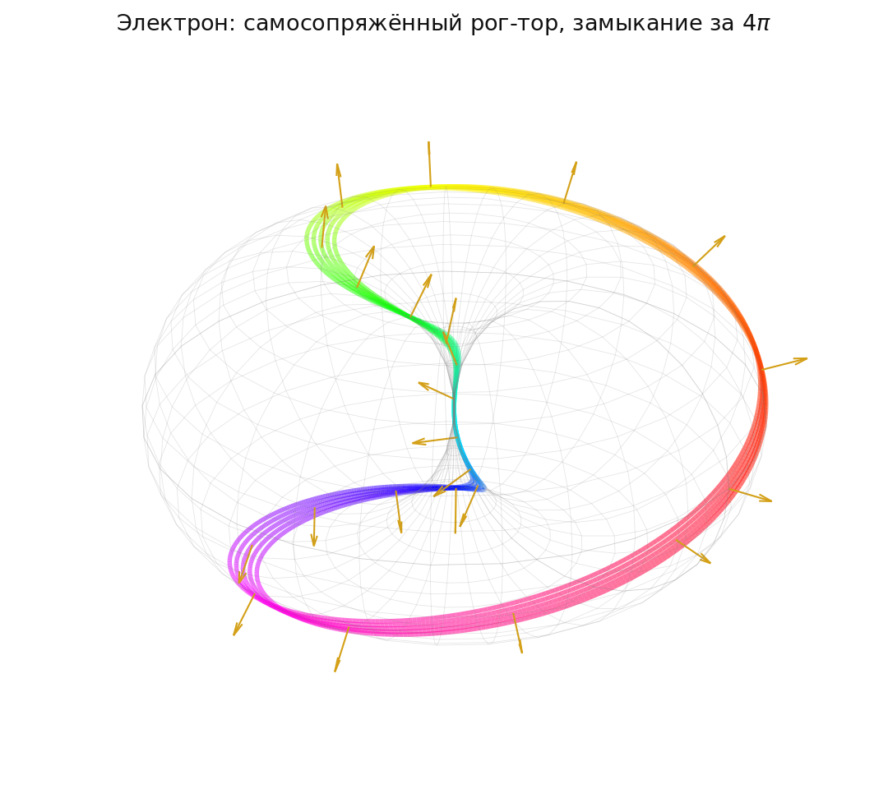

# 2.1 Расслоение Хопфа как механизм генерации массы покоя

*[← Глава 2](02-topologiya-i-massa.md) · [Оглавление](index.md)*

## Постановка задачи: проблема удержания энергии

Свободные акустические возмущения упругого кристалла пространства стремятся рассеяться во все стороны в виде волн, уходящих на бесконечность со скоростью поперечного звука среды $c$. Для описания частицы с ненулевой массой покоя требуется механизм, физически запрещающий такое рассеяние. В настоящей модели этим механизмом является топологическое запирание: внутренняя структура бариона заперта геометрическим механизмом **расслоения Хопфа**

$$\pi: S^3 \to S^2$$

## Топологический запрет на радиальный уход энергии

Расслоение Хопфа нетривиально: его инвариант (индекс Хопфа) отличен от нуля,

$$H \neq 0$$

Следствием нетривиальности является невозможность непрерывно и без сингулярностей определить глобальное поле нормалей на сфере $S^2$ — это содержание теоремы о причёсывании ежа (об отсутствии всюду ненулевого непрерывного касательного векторного поля на чётномерной сфере).

Физическая интерпретация этого топологического факта: энергия деформации вакуума не может уйти на бесконечность по кратчайшему радиальному пути, поскольку соответствующая непрерывная деформация конфигурации поля потребовала бы расцепления зацепленных слоёв расслоения, что топологически запрещено. Геометрия узла заставляет энергию вечно циркулировать по замкнутым тороидальным траекториям Лиссажу.

Тем самым локализация энергии обеспечивается не потенциальной ямой и не внешним удерживающим полем, а топологией самой конфигурации деформации.

## Инерция как упругое сопротивление среды

Инерция (масса покоя $M$) определяется как мера возвратного упругого сопротивления жёсткого вакуумного кристалла попытке изменить пространственно-фазовое состояние или скорость зацепленного топологического узла как целого.

Ключевым геометрическим параметром узла является радиус горловины тора $r$. Связь комптоновского масштаба частицы с этим радиусом выводится геометрически:

$$M \propto \frac{\hbar}{c \cdot r}$$

Соотношение имеет прозрачный механический смысл: чем меньше радиус горловины тора $r$, тем выше градиент локальной кривизны решётки в ядре солитона, и тем больше инертное сопротивление среды внешнему сдвигу. Массивная частица — это туго затянутый узел; лёгкая — рыхлый.

**Чем тор не является.** Тороидальная структура солитона есть структура **фазы**, а не распределение заряда. Прочтение её как формфактора заряда немедленно вступает в конфликт с опытом: рассеяние ограничивает размер электрона на семь-восемь порядков жёстче комптоновского масштаба. Комптоновская длина здесь — амплитуда дрожания (Zitterbewegung), присущая и обычному дираковскому электрону; формфактором она не является, и точечность электрона в рассеянии ей не противоречит (разбор — подглава [4.12](04-12-elektron-v-atome.md)).

## Следствие: масса без бозона Хиггса

Масса покоя в данной модели порождается без привлечения бозона Хиггса. Она является прямым следствием энергии локальной упругой связи вакуумного кристалла, формирующей топологический дефект массы. Механизм спонтанного нарушения электрослабой симметрии с соответствующими юкавскими константами связи, каждая из которых в Стандартной модели подгоняется под эксперимент независимо, здесь заменяется геометрическим параметром — радиусом горловины тороидального узла, который сам определяется резонансными условиями среды (см. подглаву [1.3](01-3-einstein-cartan.md) и главу [4](04-zaryad-i-leptony.md)).

Топологическое граничное условие зацепления Хопфа является одновременно тем условием, которое фиксирует фазовый набег Берри при факторизации волнового оператора и порождает массовый член $M$ в уравнении Дирака (см. подглаву [1.2](01-2-clifford-dirac.md)). Таким образом, «топологическая» и «динамическая» формулировки происхождения массы в модели совпадают.

## Итоговые соотношения

$$\pi: S^3 \to S^2, \qquad H \neq 0$$

$$M \propto \frac{\hbar}{c \cdot r}$$

## Замечание о смысле радиуса

Соотношение $M \propto \hbar/(c\,r)$ требует уточнения: **чему именно равен $r$** — радиусу горловины тора как независимой геометрической величине, или приведённой комптоновской длине, определяемой самой массой?

Различие не схоластическое. Подглава [4.7](04-7-geometriya-pokoleniy.md) показывает, что настоящее соотношение, закон масс $m \propto n^2$ (подглава [4.5](04-5-spektr-na-setke-polyarizacii.md)) и кинематика стоячей волны $E \propto \hbar c\,n/R$ **попарно совместимы, но втроём — нет**. Если $r$ есть независимый радиус, противоречие реально; если $r$ есть комптоновская длина, соотношение обращается в тождество и содержания не несёт. Пункт [T-17](98-todo.md#t-17).

## Статус условия $4\pi$: вывод или анзац

Период $4\pi$ здесь получается через расслоение Хопфа. Подглава [2.4](02-4-sushchestvovanie-solitona.md) показывает, что есть более элементарный и более устойчивый маршрут: параметр порядка среды есть репер Картана, то есть элемент $SO(3)$, а $\pi_1(SO(3)) = \mathbb{Z}_2$ — отсюда спинорный подъём возвращается только после $4\pi$. Утверждение **кинематическое**: оно не зависит ни от вида нелинейности, ни от уравнения движения, ни от размера ячейки, и никакой симуляции для него не требуется.

Там же показано, что **вечное самоколебание не является дополнительным допущением**: теорема Деррика запрещает статические локализованные решения в трёх измерениях, поэтому солитон обязан быть нестатическим. Что действительно не установлено — существование решения: кубическая нелинейность в $D = 3$ надкритична и даёт коллапс, а насыщающий член в модели не выписан ([T-34](98-todo.md#t-34)).

## Как это выглядит

Мёбиусов шаг $\varphi = \theta/2$ и замыкание только при $4\pi$. Разбор рисунка и оговорка о его статусе (визуализация анзаца, а не решение уравнений) — в подглаве [10.3](10-3-atlas-solitonov.md).
