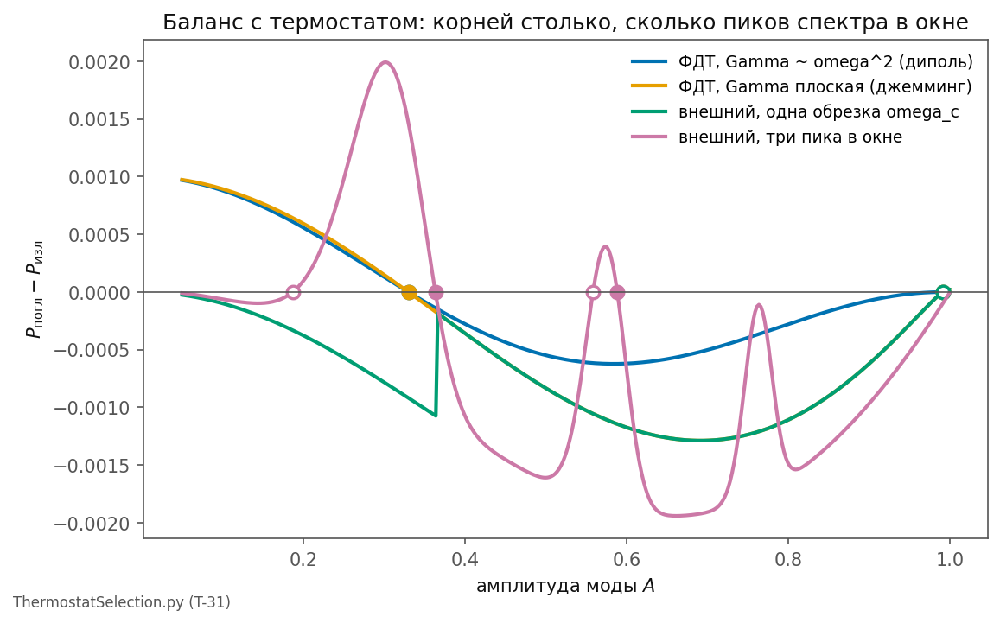

# 2.10 Термостат как правило отбора: последний кандидат

*[← Глава 2](02-topologiya-i-massa.md) · [Оглавление](index.md)*

> **Коротко:** баланс накачки из шума и излучения в среду ([T-31](98-todo.md#t-31)) выписан для нелинейной моды с амплитудно-зависимой частотой и проверен численно. Термостат **собственного** шума среды (ФДТ, $T = 0$) даёт ровно один уровень — $E = \hbar\Omega$, — причём закон затухания из ответа выпадает: это баланс Бойера, известный итог стохастической электродинамики. Дискретный **набор** уровней возникает только тогда, когда в окно частот моды вписаны пики **внешнего** спектра — а спектр среды в модели таких пиков не имеет, и взяться им неоткуда, кроме как от самих лептонов. Как правило отбора трёх поколений термостат закрыт; как механизм существования основного состояния — подтверждён и передаётся в [T-29](98-todo.md#t-29). Последний динамический кандидат на различие поколений исчерпан.

Расчёты — `simulations/python/ThermostatSelection.py`.

## 2.10.1 Что проверяется

После [2.9](02-9-okno-chastot.md) правило отбора уровней могло жить только вне кривой одиночного солитона — в его обмене энергией со средой. Солитон есть незатухающее самоколебание в ванне поперечных фононов: он излучает (сток $\Gamma(\omega)$) и поглощает из шума на собственной частоте (накачка со спектром $S_F(\omega)$). Стационарен уровень, на котором

$$P_{\text{погл}}(A) = P_{\text{изл}}(A).$$

Вопрос [T-15](98-todo.md#t-15)/[T-31](98-todo.md#t-31): даёт ли это уравнение **дискретный набор** корней по амплитуде — то есть по энергии — и от чего зависит их число.

## 2.10.2 Баланс на нелинейной моде

Мода — тот же кубично-квинтический осциллятор, что и солитон ([2.5](02-5-nasyshchayushchiy-chlen.md), [2.8](02-8-vetv-arnolda.md)), с частотой, зависящей от амплитуды: $\Omega = \Omega(A)$, убывающей от $\Omega_0$ на дне до нуля у края ямы — это и есть окно частот на языке [2.9](02-9-okno-chastot.md). Усреднённые по циклу мощности:

$$P_{\text{изл}} = \tfrac12\, m\,\Gamma(\Omega_A)\,\Omega_A^2 A^2, \qquad P_{\text{погл}} = \frac{S_F(\Omega_A)}{2m},$$

сток растёт как $A^2$, накачка ланжевеновского шума от амплитуды не зависит (диффузия энергии $D = S_F/2m$). Стационарность даёт уравнение на амплитуду:

$$A^2 = \frac{S_F(\Omega_A)}{m^2\,\Gamma(\Omega_A)\,\Omega_A^2}. \tag{$*$}$$

**Собственный шум среды.** Если ванна — сама среда при $T = 0$, флуктуационно-диссипационная теорема связывает накачку со стоком: $S_F = 2\hbar\omega\, m\,\Gamma(\omega)$. Тогда $\Gamma$ **сокращается**, и ($*$) сворачивается в

$$A^2 = \frac{2\hbar}{m\Omega_A} \qquad\Longleftrightarrow\qquad E = \tfrac12 m\Omega_A^2A^2 = \hbar\,\Omega(A).$$

Один корень. Не зависит от того, диполен ли излучатель ($\Gamma \sim \omega^2$) или среда имеет плоскую плотность состояний джемминга ($\Gamma \sim \omega^0$). Это в точности баланс Бойера (1975), которым СЭД получила боровский радиус без квантования, — и в точности с тем же итогом: **основное состояние есть, дискретных возбуждённых нет.**

**Внешний спектр.** Если накачка идёт от поля с независимым спектром $J(\omega)$, корней у ($*$) столько, сколько раз функция $S_F(\Omega_A)/(\Gamma\,\Omega_A^2)$ пересекает $m^2A^2$. Гладкий спектр с одной обрезкой — ни одного внутреннего корня. Три уровня требуют **трёх максимумов** $S_F$ внутри окна частот моды.

## 2.10.3 Численно

При $g = 2$, $h = 1$, $\hbar = 0.05$ (уровень $E = \hbar\Omega$ обязан лежать внутри окна амплитуд):

| накачка | закон затухания | внутренних корней | устойчивых |
|---|---|---|---|
| ФДТ, $T = 0$ | диполь $\Gamma\sim\omega^2$ | 1 | 1: $E = 0.046 \approx \hbar\Omega$ |
| ФДТ, $T = 0$ | плоская ПС (джемминг) | 1 | тот же |
| внешний, одна обрезка $\omega_c$ | плоская | 0 | — |
| внешний, три пика в окне | плоская | 4 | 2 |

(корень у самого края $A \to A_{\max}$ — артефакт: там $\Omega \to 0$ и обе мощности зануляются, это край ямы, а не уровень)

Число подтверждает аналитику: ФДТ-термостат — один уровень, одинаковый для обоих законов затухания; уровней становится несколько только там, где в окно вписаны пики спектра.

## 2.10.4 Откуда взяться трём пикам

Правило отбора термостатом — не свойство солитона: это **структура спектра среды**, перенесённая на солитон. Что модель знает о спектре среды: плато плотности состояний маргинального джемминга — один максимум у нижней границы ([1.5.7](01-5-struktura-sredy.md)); край щели рождения пар $2m_ec^2$ с накоплением у него (каскад [1.7.7](01-7-nulevye-kolebaniya.md)); планковская обрезка на шаге упаковки ([1.8](01-8-parametry-sredy.md)). В области лептонных масс у спектра одна структура — край щели. Трёх пиков нет.

Взяться им можно только от самих лептонов: спектр поляризации вакуума имеет пороги ровно на $2m_lc^2$ каждого заряженного лептона — это измеримо, изломы бега $\alpha$ стоят на массах ([4.10](04-10-audit-alpha-i-beg.md)). Но самосогласование «уровни задают спектр, спектр отбирает уровни» — задача с неподвижной точкой **без внутреннего масштаба**: любая тройка масс порождает спектр с порогами на себе и тем самым себя воспроизводит. Схема ложится на любые три массы — ровно то, что [T-20](98-todo.md#t-20) установил для лестницы.

## 2.10.5 Итог по T-31 и по механизму поколений

Двойной вердикт. **Как правило отбора трёх уровней** термостат закрыт: собственный шум даёт один уровень, внешний — столько, сколько пиков, а пиков у среды нет. **Как механизм существования основного состояния** — подтверждён: $E = \hbar\Omega$ из баланса, без квантования, независимо от закона затухания; это прямая передача в [T-29](98-todo.md#t-29) — квант действия как результат баланса, а не постулат.

Ряд кандидатов на **динамическое** происхождение различия поколений теперь исчерпан целиком: подбор номеров ([4.5](04-5-spektr-na-setke-polyarizacii.md)), радиальные узлы ([T-7](98-todo.md#t-7)), поляризация ([2.5.7](02-5-nasyshchayushchiy-chlen.md)), топологические семейства ([2.8.5](02-8-vetv-arnolda.md)), ориентиры кривой ([2.9](02-9-okno-chastot.md)), термостат. Отношения масс лептонов в этой модели — **не** следствие солитонной динамики и **не** следствие обмена со средой. Если они выводимы, то из зарядового сектора — оттуда же, откуда получено их **число** ([4.14.11](04-14-puti-k-alpha.md)), причём не из энергетики дефекта в узле (она контактна и без иерархии, [3.6.7](03-6-zaryad-kak-defekt.md)), а из структуры бега $\alpha$; иначе они остаются калибровочным входом, как $\alpha$ в пути 12 ([4.14.9](04-14-puti-k-alpha.md)). Это честная граница модели на сегодня, и она проведена расчётом, а не оговоркой.

## Итоговые соотношения

$$A^2 = \frac{S_F(\Omega_A)}{m^2\Gamma(\Omega_A)\Omega_A^2} \qquad \xrightarrow{\ \text{ФДТ},\ T=0\ } \qquad E = \hbar\,\Omega(A)\ \ \text{— один уровень, } \Gamma \text{ выпадает}$$

$$\#\{\text{уровней}\} = \#\{\text{пиков } J(\omega) \text{ в окне}\}, \qquad \text{у среды в окне пиков нет}$$

$$\text{T-31: отбор} \to \text{закрыт}; \quad \text{существование } E=\hbar\Omega \to \text{T-29}$$
