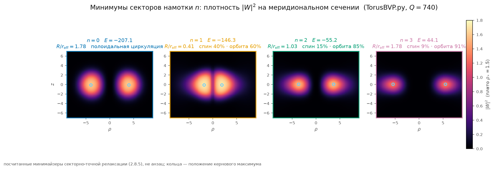
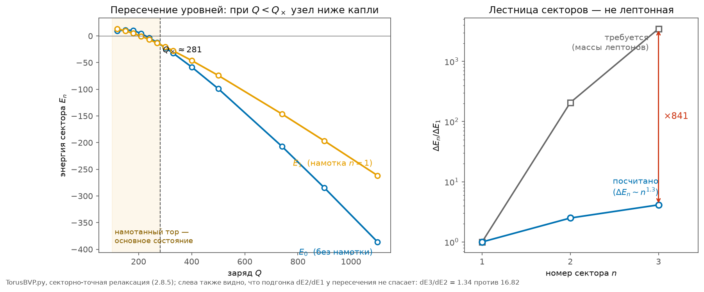

# 2.8 Ветвь Арнольда и первый счёт на семействе орбит

*[← Глава 2](02-topologiya-i-massa.md) · [Оглавление](index.md)*

> **Коротко:** развилка [2.7.5](02-7-geometriya-solitona.md) закрыта — солитон живёт на ветви Арнольда, и не по выбору, а по необходимости: локализованных полей Бельтрами не существует (теорема Лиувилля), а путь релаксации к ним (сценарий Тейлора) требует диссипации, которой в среде нет. Попутно выяснилось, **почему** солитон вообще устойчив: несжимаемость замораживает объём носителя и тем самым включает нижнюю границу Арнольда для упругой энергии. Цена намотки минимальна на рог-торе $R = r$ — постулат впервые получает расчётное основание. Выполнен и первый прямой счёт задачи [T-42](98-todo.md#t-42): релаксация кубично-квинтического функционала для векторного соленоидального поля.

Расчёты — `simulations/python/BeltramiVsWinding.py` (T-43) и `simulations/python/TorusBVP.py` (T-42); иллюстрации к решениям рендерит `simulations/python/TorusBVPViz.py`.

## 2.8.1 Ветвь Бельтрами пуста: кинематический запрет

Поле Бельтрами $\nabla\times\mathbf u = \lambda\mathbf u$ с постоянной $\lambda \neq 0$ в $\mathbb R^3$, обладающее конечной энергией (или убывающее быстрее $1/|x|$), тождественно равно нулю — теорема Лиувилля для течений Бельтрами (Надирашвили, 2014; Чае — Константин, 2015). Сферомак из [2.7.6](02-7-geometriya-solitona.md) существует только благодаря **стенке** — проводящей границе, держащей поле. У вакуумной среды стенки нет.

Для младшей моды $l = 1$ это проверяется на руках. Поле Чандрасекара — Кендалла в шаре радиуса $a$ имеет на границе нормальную компоненту $\propto j_1(x)/x$ и касательные $\propto \psi(x) = j_0(x) - j_1(x)/x$, где $x = \lambda a$. Продолжение нулём наружу требует общего корня $j_1$ и $\psi$. Но в нуле $j_1$ выполняется $\psi = j_1'$ (из $j_1' = j_0 - 2j_1/x$), а $j_1$ и $j_1'$ обнулиться одновременно не могут — единственность решения уравнения Бесселя. Численно: по первым двенадцати нулям $j_1$ минимум $|\psi|$ равен $0.0255$ и отделён от нуля.

## 2.8.2 Динамический запрет — и настоящая причина устойчивости солитона

Даже если бы минимум Бельтрами был геометрически доступен, к нему нет дороги. Плазма приходит к состоянию Бельтрами через релаксацию Тейлора: **реконнекция** уничтожает все топологические инварианты, кроме полной спиральности, и система скатывается к минимуму энергии при фиксированном $H$. Реконнекция — диссипативный процесс. В вакуумной среде ниже порога расклинивания диссипации нет ([7.2](07-2-bezdissipativnoe-dvizhenie.md)). Следовательно:

- реконнекция запрещена — топология **каждой** линии поля вморожена, а не только полная спиральность;
- доступные движения суть сохраняющие объём диффеоморфизмы (несжимаемость), поэтому **объём носителя** $V$ сохраняется;
- расползание, которое обесценило бы энергию при фиксированной спиральности, требует роста $V$ — и потому запрещено;
- на листе вмороженной топологии работает нижняя граница Арнольда для **упругой** энергии:

$$E_{\text{упр}} = \frac{\mu}{2}\int|\nabla\times\mathbf u|^2\,dV \;\ge\; \frac{\mu}{2}\,\frac{x_1}{a}\,|H|, \qquad a = \left(\frac{3V}{4\pi}\right)^{1/3},\quad x_1 = 4.49341,$$

где $H = \int\mathbf u\cdot(\nabla\times\mathbf u)\,dV$. Соответствие с магнитной релаксацией точное: $\mathbf B \leftrightarrow \nabla\times\mathbf u$, $\mathbf A \leftrightarrow \mathbf u$, магнитная энергия $\leftrightarrow$ упругая, магнитная спиральность $\int\mathbf A\cdot\mathbf B$ $\leftrightarrow$ $H$. Минимайзер листа стационарен и не-бельтрамиев, и по структурной теореме Арнольда ([2.7.5](02-7-geometriya-solitona.md)) его носитель расслоён на инвариантные **торы**.

Отсюда — ответ на вопрос, который модель до сих пор не задавала себе явно: **почему топологический солитон в этой среде вообще устойчив против расползания.** При раздувании $x \to \lambda x$ с сохранением $H$ упругая энергия падает как $1/\lambda$: без дополнительного запрета солитон растёкся бы, и никакая топология его бы не удержала. Запрет даёт несжимаемость: раздувание требует роста объёма носителя, а объём вморожен. **Устойчивость частиц — прямое следствие маргинального джемминга.** Это второе место после [1.5.7](01-5-struktura-sredy.md), где несжимаемость не мешает модели, а строит её: она же даёт поперечность (из которой вся глава [2.7](02-7-geometriya-solitona.md)), она же удерживает солитон от расползания.

## 2.8.3 Цена намотки и происхождение $R = r$

Насколько регулярная намотка дороже недостижимого минимума Волтьера? Мера:

$$\kappa(A) = \frac{a\int|\nabla\times\mathbf u|^2dV}{x_1\,|H|} \;\ge\; 1,\qquad A = R/r,$$

с равенством только на поле Бельтрами. Для тороидальной трубки (полоидаль из векторного потенциала плюс тороидаль, соленоидальная проекция точная, сетка $96^3$):

| $A = R/r$ | 1.0 | 1.25 | 1.5 | 2.0 | 2.5 | 3.0 | 4.0 | 5.0 | 6.5 |
|---|---|---|---|---|---|---|---|---|---|
| $\kappa$ | **2.50** | 2.57 | 2.82 | 3.30 | 3.80 | 4.27 | 5.25 | 6.25 | 7.74 |

Рост монотонный, почти линейный по $A$; минимум — на границе $A = 1$, то есть на **рог-торе** (при $A < 1$ трубка самопересекается, тора нет). Компактный тор платит за единицу спиральности втрое меньше тонкого кольца.

До сих пор $R = r$ для электрона было чистым постулатом ([2.6.6](02-6-mehanika-elektrona.md), пункт б). Теперь у него есть расчётное основание: **при фиксированной спиральности упругая энергия минимальна у предельно компактного тора.**

## 2.8.4 Первый прямой счёт T-42: постановка

Задача [T-42](98-todo.md#t-42) в уточнённой постановке [2.7.10](02-7-geometriya-solitona.md): минимизировать

$$E[\mathbf W] = \int\left[|\nabla\mathbf W|^2 - \frac{g}{2}|\mathbf W|^4 + \frac{h}{3}|\mathbf W|^6\right]dV,\qquad \nabla\cdot\mathbf W = 0,\qquad Q = \int|\mathbf W|^2dV = \text{const},$$

где $\mathbf W$ — комплексное трёхкомпонентное поле, физическое смещение $\mathbf u = \mathrm{Re}[\mathbf W e^{-i\omega t}]$, а $\omega$ — множитель Лагранжа ($\mu = dE/dQ$).

Намотка задаётся **точно, по построению**: поле ищется в виде

$$\mathbf W = \left[V_\rho(\rho,z)\,\hat e_\rho + V_\varphi\,\hat e_\varphi + V_z\,\hat e_z\right]e^{in\varphi}$$

— три комплексные функции на **двумерной** сетке $(\rho, z)$, ровно та размерность, что была обещана в [2.6.5](02-6-mehanika-elektrona.md). Число $n$ нумерует сектор полного момента $J_z = n$: орбитальная намотка и поляризация складываются, и внутри сектора спуск свободен перераспределять момент между ними — это в точности «наложение мод простого вращения и тороидально-полоидального», о котором шла речь при постановке раунда [2.7](02-7-geometriya-solitona.md).

Урок, оплаченный счётом: первая, трёхмерная декартова версия расчёта сектор **не удержала** — машинный шум $\sim10^{-16}$ засевает чужие секторы, мнимое время усиливает его как $e^{|\mu|T}$, и любое $n$ за тысячи шагов скатывается в основное состояние. Секторную задачу надо решать в секторно-точном представлении; иное — самообман.

Метод — полуявная схема по мнимому времени: векторный лапласиан с центробежными членами $(n^2{+}1)/\rho^2$, связью $\pm2in/\rho^2$ между $V_\rho$ и $V_\varphi$ и штрафом $\beta|\nabla\cdot\mathbf W|^2$ в неявной матрице (разреженное $LU$, факторизация один раз), нелинейность явно, перенормировка на $Q$ каждый шаг. Сетка $88\times120$, шаг $0.15$; $g = 2$, $h = 1$ (плато плотности $\rho_\ast = 3g/4h = 1.5$, ширина стенки $\approx 0.6$); невязка соленоидальности контролируется ($\lesssim 10^{-2}$ в норме градиента). Затравки двух типов — гирационная трубка $F(s)(\hat e_\rho + i\hat e_z)e^{in\varphi}/\sqrt2$ и спин-шар $f(r)(\hat e_\rho + i\hat e_\varphi)e^{in\varphi}/\sqrt2$ — чтобы отличать минимум сектора от случайного локального.

Оговорка о статусе: градиентный спуск — релаксация тейлоровского типа, он **не** сохраняет вмороженную топологию (спиральность может стекать). Поэтому найденные состояния — минимумы секторов $J_z$, то есть нижние границы для истинных состояний с вмороженной намоткой. Для вопроса «даёт ли семейство отношения $206.8$ и $3477.2$» этого достаточно: если даже нижние границы растут медленно, семейство закрыто.

## 2.8.5 Результаты релаксации

**Дискретное семейство существует.** В каждом секторе $n = 0\ldots3$ спуск сходится к связанному состоянию, причём обе затравки — трубка и спин-шар — приходят к **одному и тому же** минимуму (энергии совпадают до пятого знака). Ответ на вопрос (в) из [2.6.6](02-6-mehanika-elektrona.md): да, семейство по намотке есть.

При $Q = 740$ (толстостенный режим, плотность на плато $\rho_\ast = 1.5$):

| $n$ | $E_n$ | $\mu_n$ | $\Delta E_n = E_n - E_0$ | $\Delta E_n/\Delta E_1$ | $S_z/Q$ | $L_z/Q$ | $R$ | $R/r_{\rm eff}$ |
|---|---|---|---|---|---|---|---|---|
| 0 | $-207.1$ | $-0.477$ | — | — | 0 | 0 | 3.97 | 1.78 |
| 1 | $-146.3$ | $-0.382$ | 60.8 | 1.00 | 0.40 | 0.60 | 1.88 | 0.41 |
| 2 | $-55.2$ | $-0.335$ | 151.9 | 2.50 | 0.31 | 1.69 | 3.67 | 1.03 |
| 3 | $+44.1$ | $-0.213$ | 251.3 | 4.13 | 0.27 | 2.73 | 5.47 | 1.78 |

Лестница возбуждений почти линейна: $\Delta E_n \sim n^{p}$ с $p = 1.32$ (по $n=2$) и $1.29$ (по $n=3$) — в точности в полосе $0.75\ldots1.3$, предсказанной бюджетом показателя [2.7.8](02-7-geometriya-solitona.md), и на порядок ниже требуемых $7.6$ (нумерация номером) или $3.8$ (нумерация индексом).

Попутные результаты, каждый со своим весом:

**(а) Основное состояние — тоже тор.** Минимум сектора $n = 0$ — не шар, а полоидальная циркуляция с керновым кольцом $R = 3.97$ и $R/r_{\rm eff} = 1.78$: соленоидальность не оставляет «шару» иного устройства (невязка $\nabla\cdot\mathbf W$ у этого состояния — машинный нуль). Прямое динамическое подтверждение [2.7.3](02-7-geometriya-solitona.md): даже без намотки несжимаемый минимайзер тороидален.

**(б) Момент делится между спином и орбитой.** В секторе $n=1$ минимайзер несёт $40\%$ момента в поляризации (локальная гирация, «простое вращение») и $60\%$ в орбитальной намотке; с ростом $n$ спиновая доля падает ($0.40 \to 0.31 \to 0.27$). Движение действительно «наложение мод», и минимайзер сам выбирает пропорцию — [T-35](98-todo.md#t-35) и [T-36](98-todo.md#t-36) получают первый количественный материал.

**(в) Частота ползёт по окну $Q$-шара.** $|\mu_n|$ монотонно убывает с $n$: семейство намоток отображается в положение частоты в окне. Механизм различия состояний в итоге живёт в частотном окне — мост к [T-15](98-todo.md#t-15).

**Пересечение уровней: намотка становится основным состоянием.** Скан по заряду обнаружил, что при $Q_\times \approx 285$ уровни $n=0$ и $n=1$ пересекаются: при $Q < Q_\times$ **намотанный тор лежит ниже нулевого сектора** ($Q=270$: $E_1 = -13.3$ против $E_0 = -12.3$; $Q=240$: $-6.7$ против $-3.5$). При малых зарядах среда предпочитает узел. Это первое динамическое основание того, что лёгкая устойчивая частица модели — намотанный тор, а не безмоментная капля.

**Решающий тест поколений — и его отрицательный итог.** Вблизи пересечения $\Delta E_1 \to 0$, поэтому отношение $\Delta E_2/\Delta E_1$ пробегает все значения, включая требуемое $206.77$ — один свободный параметр ($Q$) всегда подгонит одно отношение. Честная проверка — вторая наблюдаемая при том же $Q$:

$$\frac{\Delta E_3}{\Delta E_2}\bigg|_{\rm требуется} = \frac{3477.2}{206.77} = 16.82, \qquad \frac{\Delta E_3}{\Delta E_2}\bigg|_{Q=270} = \frac{68.6}{51.1} = 1.34.$$

Расхождение в $12.5$ раза. Та же логика «один параметр, две наблюдаемые», которой [T-7](98-todo.md#t-7) закрыл радиальные узлы, закрывает и намотку: **семейство существует, но лестница его энергий не лептонная.**

## 2.8.6 Что это закрывает

| результат | статус |
|---|---|
| ветвь Бельтрами | **закрыта** — Лиувилль + бездиссипативность ([T-43](98-todo.md#t-43)) |
| устойчивость солитона против расползания | **объяснена** — вмороженный объём + граница Арнольда |
| $R = r$ (рог-тор) | постулат $\to$ **вывод из минимума** $\kappa(A)$ |
| вопрос (а) из 2.6.6 | заменён и решён: намотка против Бельтрами |
| вопрос (б) из 2.6.6: $R/r$ из минимума | посчитан: $\kappa$ минимальна при $A=1$; аспекты секторов $0.4\ldots1.8$ |
| вопрос (в) из 2.6.6: дискретное семейство | **да, существует** — но лестница $p \approx 1.3$ |
| поколения как топологическое семейство | **закрыто** прямым счётом: $\Delta E_3/\Delta E_2 = 1.34$ против $16.82$ |
| механизм различия поколений | остаётся один кандидат: правило отбора частоты ([T-15](98-todo.md#t-15)) |

Осталось в [T-42](98-todo.md#t-42): вмороженно-топологическая версия релаксации (спуск, сохраняющий спиральность, — мнимое время её стекает, найденные $E_n$ суть нижние границы секторов) и связь $Q$ с физическим зарядом. Задача перестала быть «не поставленной» — она поставлена, решена в первом приближении и дала ответ по существу.

## Итоговые соотношения

$$\text{локализация} + \text{Бельтрами} \Rightarrow \mathbf u \equiv 0 \qquad \text{(Лиувилль)}$$

$$\text{нет диссипации} \Rightarrow \text{нет реконнекции} \Rightarrow \text{топология и } V \text{ вморожены}$$

$$E_{\text{упр}} \ge \frac{\mu}{2}\frac{x_1}{a}|H| \qquad \text{— устойчивость солитона из несжимаемости}$$

$$\kappa(A)\ \text{минимальна при } A = R/r = 1 \qquad \text{— рог-тор выведен, а не постулирован}$$

---

*[⬆](02-topologiya-i-massa.md) · [🏠](index.md)*
