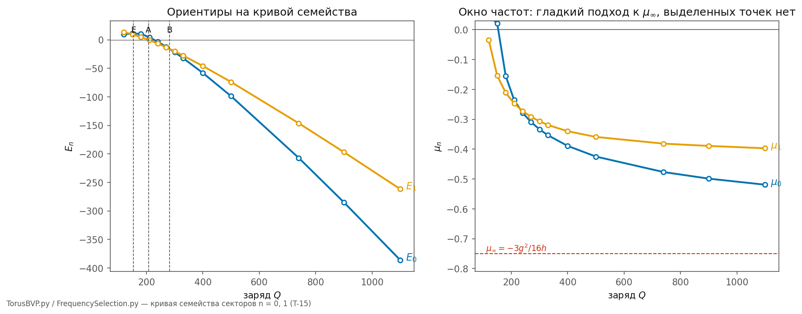

# 2.9 Окно частот: где не живёт правило отбора

*[← Глава 2](02-topologiya-i-massa.md) · [Оглавление](index.md)*

> **Коротко:** после [2.8](02-8-vetv-arnolda.md) правило отбора частоты ([T-15](98-todo.md#t-15)) осталось единственным кандидатом на механизм различия поколений — и здесь проверен первый вычислимый носитель этого правила: кривая семейства солитонов $E(Q)$, $\mu(Q)$ во всём окне. Итог отрицательный и от этого ценный: кривая гладкая, складок нет, естественных ориентиров на ней три, и их отношения — числа порядка единиц. **Правило отбора не живёт на кривой одиночного солитона.** Чтобы выделить в окне три точки с отношениями $1 : 207 : 3477$, нужен внешний масштаб — спектр самой среды; кандидат ровно один: баланс с шумовым термостатом ([T-31](98-todo.md#t-31)). Попутно найден новый порог: ниже $Q \approx 154$ локализуется **только намотанный тор** — капля без намотки не связывается вовсе.

Расчёты — `simulations/python/FrequencySelection.py` (кривая набирается решателем `TorusBVP.py`).

## 2.9.1 Постановка

Семейство солитонов сектора $n$ — однопараметрическая кривая: заряд $Q$, энергия $E_n(Q)$, частота $\mu_n(Q) = dE/dQ$. Аналитические якоря при $g = 2$, $h = 1$:

$$\rho_d = \frac{3g}{4h} = 1.5, \qquad \mu_\infty = -\frac{3g^2}{16h} = -0.75, \qquad \mu \in (\mu_\infty,\, 0),$$

и в толстостенном пределе $E/Q \to \mu_\infty$ (нулевое давление капли). Если правило отбора частоты — свойство самой солитонной динамики, оно обязано указывать на **выделенные точки** этой кривой. Вопрос ставится честно: перечислить все естественные ориентиры и проверить, дают ли их энергии лептонные отношения $206.77$ и $3477.23$.

## 2.9.2 Кривая во всём окне

Скан $Q = 120\ldots1100$ (13 точек на сектор, секторно-точная релаксация [2.8.4](02-8-vetv-arnolda.md)):

Свойства кривой, каждое проверено по данным:

- **обе ветви гладкие и монотонные**; критерий Вахитова — Колоколова не срабатывает — $dQ/d\mu$ знака не меняет, складки нет, устойчивая ветвь одна;
- **подход к $\mu_\infty$ медленный**: даже при $Q = 1100$ частота $\mu_0$ прошла лишь $69\%$ глубины окна, $\mu_1$ — $53\%$ (поверхностные поправки $\sim Q^{-1/3}$);
- порядок порогов при росте $Q$: сначала локализуется **намотанный тор**, потом капля.

## 2.9.3 Три ориентира — и только три

| ориентир | $Q$ | $E_1$ | $E_0$ | $\mu_1/\mu_\infty$ |
|---|---|---|---|---|
| E: локализация капли ($\mu_0 = 0$) | 153.7 | $+9.1$ | $+10.8$ | 21 % |
| A: порог связывания ($E_1 = 0$) | 207.1 | $0$ | $+5.0$ | 32 % |
| B: пересечение уровней ($E_1 = E_0$) | 281.4 | $-16.0$ | $-16.0$ | 40 % |

Ориентир E — новый и сам по себе содержательный: **при $Q < 154$ конфигурация без намотки не локализуется вовсе** ($\mu_0 > 0$), тогда как намотанный тор уже связан ($\mu_1 = -0.16$). Вместе с пересечением уровней из [2.8.5](02-8-vetv-arnolda.md) это выстраивает цепочку: при малых зарядах узел не просто выгоднее капли — он единственное локализованное состояние среды.

Лестница секторов при фиксированном $Q = 740$ ложится в окно монотонно: $\mu_n/\mu_\infty = 64\%,\ 51\%,\ 45\%,\ 28\%$ для $n = 0\ldots3$ — гладкая последовательность без выделенных сгущений.

## 2.9.4 Решётка отношений: провал

Все попарные отношения энергий в ориентирах (заряд с энергией несоизмерим и в решётку не входит; обрезки скана — тоже):

$$\frac{|E_0|_A}{|E|_B} = 3.22,\qquad \frac{|E_0|_A}{|E_0|_E} = 2.18,\qquad \frac{|E|_B}{|E_1|_E} = 1.76,\ \ldots$$

Ближайшее из всех к какой-либо лептонной цели ($206.77$, $3477.23$ или их отношению $16.82$) промахивается в **5.2 раза**; остальные — в 8–10 и хуже. Никакая пара естественных точек однопараметрического семейства лептонных отношений не даёт, и это не вопрос точности счёта — на гладкой кривой с тремя ориентирами просто **нет места** для иерархии $1 : 207 : 3477$.

## 2.9.5 Что это означает для T-15

Проверено и закрыто третье направление поиска правила отбора: после свободного подбора номеров ([4.5](04-5-spektr-na-setke-polyarizacii.md)) и топологических семейств ([2.8.5](02-8-vetv-arnolda.md)) — теперь и **ориентиры кривой одиночного солитона**.

Оставшийся кандидат конкретизировался до уравнения. Солитон живёт в шумовом термостате нулевых колебаний ([1.7](01-7-nulevye-kolebaniya.md)); стационарен тот уровень, на котором приток энергии из шума равен утечке в излучение:

$$\Gamma_{\text{погл}}(\mu;\, J) = \Gamma_{\text{изл}}(\mu),$$

где $J(\omega)$ — спектр среды. Это в точности [T-31](98-todo.md#t-31), и только такой механизм способен внести в окно масштабы, которых нет у самой капли: у среды спектр обрезан упаковкой и порогом рождения пар, то есть **внешние** частотные метки в модели есть. Дорожная карта сужается до одной развилки: либо баланс с термостатом расставляет в окне три уровня с нужными отношениями, либо у механизма поколений в модели не остаётся ни одного кандидата.

## 2.9.6 $\Lambda$ вдоль семейства: калибровка по форме ([T-34](98-todo.md#t-34))

Радиальная задача [2.5](02-5-nasyshchayushchiy-chlen.md) имеет единственный безразмерный параметр $\Lambda = \lambda h/g^2$ с окном $0<\Lambda<3/16$; в секторной модели ($g=2$, $h=1$) это $\Lambda = -\mu/4$, и вдоль семейства узлов $n=1$ он пробегает $\Lambda(Q)$. Три физических масштаба (длина, время, амплитуда) фиксируются свойствами среды, форма семейства от них не зависит: любое **безразмерное** отношение узла — функция одного $Q$. Расчёт — `simulations/python/LambdaCalibration.py`.

| $Q$ | $\Lambda$ | $\Lambda/\Lambda_{\max}=\mu/\mu_\infty$ | $S_z/Q$ | $L_z/Q$ | $R_{\rm core}$ | ширина стенки (FWHM) | $R/\delta$ |
|---|---|---|---|---|---|---|---|
| 154 (E) | 0.040 | 0.21 | 0.40 | 0.60 | 1.27 | 2.7 | 0.47 |
| 207 (A) | 0.061 | 0.33 | 0.42 | 0.58 | 1.27 | 2.9 | 0.45 |
| 281 (B) | 0.074 | 0.40 | 0.43 | 0.57 | 1.27 | 3.2 | 0.40 |
| 740 | 0.095 | 0.51 | 0.40 | 0.60 | 1.88 | 4.5 | 0.42 |
| 1100 | 0.099 | 0.53 | 0.33 | 0.67 | 2.17 | — | — |

Три чтения.

**Где стоит электрон.** $\Lambda(Q)$ монотонна и подходит к $3/16$ медленно (при $Q=1100$ — половина окна; тонкостенный предел далеко). Узел ниже пересечения уровней — единственный кандидат в основное состояние ([2.8.5](02-8-vetv-arnolda.md), [2.12](02-12-kvazinormalnye-mody.md)) — стоит при $\Lambda_e \approx 0.05\ldots0.075$: его частота сдвинута от линейной ветви на $27$–$40\,\%$ глубины окна, **не на дно**. Это и есть калибровка по форме: без единого числа среды семейство фиксирует положение электрона на шкале нелинейности. Форма узла при этом жёсткая: $S_z/Q = 0.40$–$0.43$, $L_z/Q=0.57$–$0.60$, $R/\delta \approx 0.4$–$0.47$ — толстостенный тор ($R<\delta$), спин и орбита делят $J_z=Q$ почти в постоянной пропорции $2:3$ по всему семейству. Калибровать этими отношениями нечего — они не меняются; зато они **предсказания**: любая физическая величина, чувствительная к доле спина в $J$, обязана дать $\approx0.42$.

**Словарь $g,h \leftrightarrow$ закон деформирования.** Если амплитуда поля узла есть деформация $\varepsilon$ среды, плотность энергии $W(\varepsilon) = \tfrac12\mu_s\varepsilon^2 - \tfrac{g'}{4}\varepsilon^4 + \tfrac{h'}{6}\varepsilon^6$, и тогда: плато $\varepsilon_*^2 = 3g'/4h'$ — **одна амплитуда у всех узлов** (электрон при $\rho_{\rm peak}/\rho_* = 0.87\ldots1.0$ практически на плато); окно частот $|\mu| < 3g'^2/16h'$ — сдвиг вниз от линейной ветви, ограниченный глубиной размягчения модуля на плато ($\delta\mu_s/\mu_s = g'\varepsilon_*^2/4\mu_s$, окно — $3/4$ этой глубины); электрон при $\Lambda_e\sim0.06$ сидит на $\sim0.1$ глубины размягчения. Знаки **обязательны**: квартичный член — размягчающий ($g'>0$), иначе фокусировки и локализованного узла нет; секстический — упрочняющий ($h'>0$). Отсюда важное для [T-34](98-todo.md#t-34): экспоненциальный слом Гука [3.4](03-4-uf-rashodimosti.md) — упрочнение, он даёт $h$, **но не $g$**. Размягчение в модели есть в другом месте — гравитация как размягчение среды ([7](07-gravitaciya.md)), подплавление у заряда ([4.14](04-14-puti-k-alpha.md), путь 10), дрожание ([T-4](98-todo.md#t-4)); $g'$ — коэффициент этого размягчения по амплитуде. Численные $g', h'$ требуют закона размягчения по амплитуде, который в модели не выписан; но два безразмерных отношения формой семейства уже зафиксированы: $\varepsilon_e/\varepsilon_* \approx 0.93\ldots1.0$ и $\mu_e/\mu_\infty \approx 0.3\ldots0.4$.

**Что это даёт T-34.** Пункт сужается до одного входа: закон размягчения $\mu_s(\varepsilon)$ на амплитуде $\varepsilon_*$. Всё остальное — окно, плато, положение электрона, доля спина — форма семейства уже дала.

## Итоговые соотношения

$$\mu \in \left(-\tfrac{3g^2}{16h},\ 0\right), \qquad \text{складок нет},\qquad \text{ориентира три: } Q = 154,\ 207,\ 281$$

$$Q < 154:\ \text{локализован только намотанный тор}$$

$$\min_{\text{пары}} \left|\ln\frac{r_{ij}}{r_{\text{лепт}}}\right| = \ln 5.2 \qquad \Longrightarrow \qquad \text{T-15} \to \text{T-31}$$

$$\Lambda_e \approx 0.05\ldots0.075,\qquad S_z/Q = 0.42,\qquad g'>0\ (\text{размягчение}),\ h'>0\ (\text{упрочнение})$$

---

*[⬆](02-topologiya-i-massa.md) · [🏠](index.md)*
