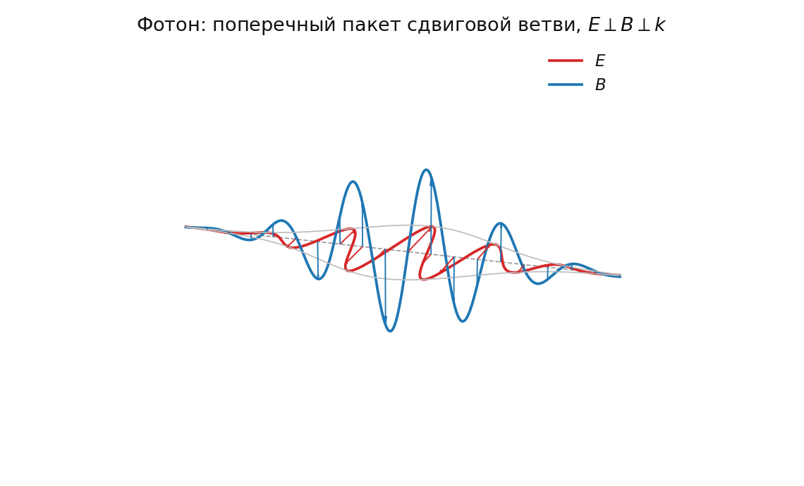

# 3.5 Аудит электродинамики: поля, фотон и предел классического поля

*[← Глава 3](03-elektrodinamika.md) · [Оглавление](index.md)*

Здесь глава 3 проходит такую же механическую проверку, какую прошли главы 4 и 5: каждое утверждение подглав [3.1](03-1-vyvod-maksvella.md)–[3.4](03-4-uf-rashodimosti.md) либо воспроизводится численно, либо признаётся несостоятельным, либо помечается как невыведенное. Расчёты — `simulations/python/Maxwell.py`.

Метод: строится явное поле смещений упругой среды (суперпозиция поперечных плоских волн — точное решение волнового уравнения), все производные берутся конечными разностями четвёртого порядка, и считаются невязки всех четырёх уравнений Максвелла. Проверяется не «похоже ли», а буквально выполняется ли равенство.

## 3.5.1 Отождествление должно идти по смещению, а не по потенциалу

Естественный кандидат на отождествление — векторный потенциал сдвига $\mathbf{\Psi}$ с $\mathbf{E} \sim \partial\mathbf{\Psi}/\partial t$, $\mathbf{B} \sim \nabla\times\mathbf{\Psi}$. Эта запись имеет два дефекта.

**Дефект 1: смешаны смещение и вращение.** В этой записи $\mathbf{v} = \partial\mathbf{u}/\partial t = \nabla\times(\partial\mathbf{\Psi}/\partial t)$, откуда $\mathbf{u} = \nabla\times\mathbf{\Psi}$. Но тогда $\mathbf{B} = \nabla\times\mathbf{\Psi} = \mathbf{u}$, то есть магнитная индукция равна **смещению**, а не вращению ячеек — прямо вопреки онтологии модели. Величины $\mathbf{u}$ (длина) и $\mathbf{\Omega}$ (безразмерный поворот) оказываются отождествлены друг с другом.

**Дефект 2: пропущен знак.** Знак «$\sim$» скрывает обязательный минус. При $\mathbf{E} = +\partial\mathbf{\Psi}/\partial t$ численная проверка даёт относительную невязку $2.000$ для закона Фарадея и для закона Ампера — то есть левая часть в точности равна минус правой. Утверждение «автоматически и строго даёт полную систему» в такой записи не выполняется.

**Верная запись.** Отождествлять нужно на уровне самого смещения:

$$\mathbf{A} \ \propto \ \mathbf{u}, \qquad \mathbf{E} = -\frac{\partial\mathbf{u}}{\partial t} = -\mathbf{v}, \qquad \mathbf{B} = \nabla\times\mathbf{u}$$

Тогда всё встаёт на место без единой оговорки:

- $\mathbf{E}$ буквально есть скорость сдвига решётки — ровно то, что заявлено онтологией;
- $\mathbf{B}$ буквально есть удвоенный локальный поворот ячейки, $\nabla\times\mathbf{u} = 2\boldsymbol{\omega}$ — тоже ровно то, что заявлено;
- кулоновская калибровка $\nabla\cdot\mathbf{A} = 0$ выполняется не по договорённости, а потому что $\nabla\cdot\mathbf{u} = 0$ есть несжимаемость.

Численная проверка при этом отождествлении:

| уравнение | относительная невязка |
|---|---|
| $\nabla\cdot\mathbf{E} = 0$ | $2.7\cdot10^{-10}$ |
| $\nabla\cdot\mathbf{B} = 0$ | $7.4\cdot10^{-14}$ |
| $\nabla\times\mathbf{E} = -\partial\mathbf{B}/\partial t$ | $8.5\cdot10^{-14}$ |
| $\nabla\times\mathbf{B} = c^{-2}\partial\mathbf{E}/\partial t$ | $4.0\cdot10^{-10}$ |

Все четыре выполняются с точностью разностной схемы, и знаки получаются сами, без подбора. Вывод главы 3 состоятелен — именно в этой записи, принятой в подглаве [3.1](03-1-vyvod-maksvella.md).

## 3.5.2 Закон Гаусса есть несжимаемость среды

Это главный положительный результат аудита.

Прочтение $\nabla\cdot\mathbf{E} = 0$ как «кулоновской калибровки с материальным смыслом», то есть как следствия условия $\nabla\cdot\mathbf{\Psi} = 0$, результат занижает: при отождествлении по смещению это не калибровка, а материальная связь:

$$\nabla\cdot\mathbf{E} = 0 \quad \Longleftrightarrow \quad \nabla\cdot\mathbf{u} = 0 \quad \Longleftrightarrow \quad \frac{\delta V}{V} = 0 \quad \Longleftrightarrow \quad K_{\text{bulk}} \to \infty$$

Отсутствие свободных зарядов в вакууме — это в точности сохранение объёма при деформации. Не аналогия, а тождество.

**Проверка от противного.** Добавим в поле одну продольную волну ($\mathbf{e} \parallel \mathbf{k}$) — то самое, что запрещено пределом несжимаемости:

| уравнение | невязка с продольной модой |
|---|---|
| $\nabla\cdot\mathbf{E} = 0$ | $0.403$ — **сломано** |
| $\nabla\cdot\mathbf{B} = 0$ | $9.2\cdot10^{-14}$ — держится |
| $\nabla\times\mathbf{E} = -\partial_t\mathbf{B}$ | $8.8\cdot10^{-14}$ — держится |
| $\nabla\times\mathbf{B} = c^{-2}\partial_t\mathbf{E}$ | $0.272$ — **сломано** |

Ломаются **два** уравнения, а не одно: закон Ампера тоже, поскольку $\nabla\times\nabla\times\mathbf{u} = \nabla(\nabla\cdot\mathbf{u}) - \nabla^2\mathbf{u}$, и при $\nabla\cdot\mathbf{u}\neq0$ появляется лишний градиентный член. Причём в тесте продольная волна взята даже с той же скоростью $c$; при реальном $c_L \neq c_T$ разрушение сильнее.

Значит, несжимаемость в модели — не отдельное допущение, введённое ради гравитации ([7.1](07-1-sbros-stressa.md)) и конфайнмента ([6.1](06-1-effekt-puassona.md)), а **условие существования электродинамики**. Три разных мотива сходятся к одному постулату; это и есть самосогласованность в буквальном смысле.

## 3.5.3 Где же заряд: источники не выводятся

Обратная сторона предыдущего результата — тяжёлая.

Если $\nabla\cdot\mathbf{u} \equiv 0$ во всей области, то $\nabla\cdot\mathbf{E} \equiv 0$ **всюду и всегда**, и уравнение Гаусса с источником

$$\nabla\cdot\mathbf{E} = \frac{\rho_q}{\epsilon_0}$$

для гладких полей попросту невозможно. Глава 3 выводит только **свободные** уравнения Максвелла и в такой форме запрещает те самые заряды, которым посвящена глава 4.

Выход внутри онтологии есть, и он естественный: заряд обязан быть **дефектом**, в ядре которого линейная несжимаемая теория неприменима. Подглава [3.4](03-4-uf-rashodimosti.md) уже утверждает ровно это — на планковском масштабе закон Гука ломается, $\sigma \sim \exp(\epsilon)$. Тогда:

- вне ядра $\nabla\cdot\mathbf{u} = 0$, и поле бездивергентно;
- поток $\oint \mathbf{u}\cdot d\mathbf{S}$ через любую поверхность, охватывающую ядро, не равен нулю и не зависит от формы поверхности;
- этот поток есть топологический инвариант дефекта — прямой аналог вектора Бюргерса дислокации;
- закон Гаусса $\oint\mathbf{E}\cdot d\mathbf{S} = q/\epsilon_0$ превращается в утверждение о числе намотки, что и нормируется в [4.1](04-1-normirovka-zaryada.md).

Квантование заряда в такой картине не постулируется, а следует из целочисленности топологического инварианта. Это красиво — но **не сделано**. Ни в главе 3, ни в главе 4 переход от «дефект с целым индексом» к «$\rho_q$ в правой части уравнения Максвелла» не выписан. Вынесено как [T-27](98-todo.md#t-27).

## 3.5.4 Калибровочной инвариантности нет — и это обязательство, а не свобода

В стандартной электродинамике $\mathbf{A}$ определён с точностью до $\nabla\chi$ и ненаблюдаем. Здесь $\mathbf{u}$ — реальное смещение вещества, наблюдаемое в принципе. Калибровочной свободы у модели **нет**.

Модель обычно подаёт это как достоинство: калибровочная инвариантность из принципа превращается в артефакт описания. Но у отказа есть цена, и её надо назвать. В стандартной теории калибровочная инвариантность обеспечивает две вещи:

1. **Сохранение заряда** (теорема Нётер). У модели должен быть свой источник — и он есть: топологический инвариант дефекта из §3.5.3 сохраняется по топологическим причинам. Замена равноценная, хотя и не доведённая до формул.
2. **Строгую безмассовость фотона.** Здесь замена нужна отдельно, и она разобрана ниже.

Формально: у модели $\mathbf{A}$ имеет три компоненты со связью $\nabla\cdot\mathbf{A} = 0$, то есть две динамические степени свободы — столько же, сколько у калибровочно-инвариантной теории после фиксации калибровки. Число степеней свободы сходится. Разница в том, что там это результат сокращения, здесь — результат материальной связи.

## 3.5.5 Почему фотон безмассов

Без калибровочной инвариантности наивно ожидать, что радиационные поправки на решётке с планковским обрезанием сгенерируют фотону массу порядка обрезания. У модели есть ответ, и он не заимствован.

Поперечная ветвь упругой среды — это **голдстоуновская мода спонтанно нарушенной трансляционной симметрии**. Однородная среда нарушает непрерывные трансляции; акустические ветви обязаны быть бесщелевыми, $\omega = c_T k$ при $k\to0$, и щель не может быть сгенерирована ни в каком порядке, пока среда однородна. Безмассовость фотона в модели защищена теоремой Голдстоуна, а не калибровочной симметрией.

Это сильный результат, и он выдерживает проверку на прочность: экспериментальная граница на массу фотона ($m_\gamma \lesssim 10^{-27}$ эВ по магнитному полю галактик) требует защиты на десятки порядков, и Голдстоун её даёт точно, а не приближённо.

**Ограничение защиты.** Голдстоун гарантирует $\omega \to 0$ при $k \to 0$, но не гарантирует **изотропии** светового конуса и не запрещает поправок вида $\omega^2 = c^2k^2(1 + \xi_2 (k\,l_{\text{Pl}})^2)$. То есть безмассовость защищена, а лоренц-инвариантность — нет; это в точности [T-1](98-todo.md#t-1) и [T-2](98-todo.md#t-2). Разделение полезное: два вопроса, которые обычно смешивают, у модели имеют разный статус — один закрыт, другой открыт.

## 3.5.6 Разделение $\epsilon_0$ и $\mu_0$ не выведено

Подглава [3.2](03-2-konstanty-sredy.md) записывает $\mu_0 \sim \rho$, $\epsilon_0 \sim 1/G_{\text{shear}}$. Проверим, следует ли это из чего-нибудь.

Пусть $\mathbf{A} = \kappa\,\mathbf{u}$ с пока не фиксированной нормировкой $\kappa$. Тогда $\mathbf{E} = -\kappa\mathbf{v}$, $\mathbf{B} = \kappa\nabla\times\mathbf{u}$, и сопоставление плотностей энергии даёт

$$\frac{\epsilon_0}{2}E^2 = \frac{\rho}{2}v^2 \ \Longrightarrow\ \epsilon_0 = \frac{\rho}{\kappa^2}, \qquad \frac{1}{2\mu_0}B^2 = \frac{G}{2}|\nabla\times\mathbf{u}|^2 \ \Longrightarrow\ \mu_0 = \frac{\kappa^2}{G}$$

(Обе записи упругой энергии — через $|\nabla\times\mathbf{u}|^2$ и через $u_{ij}u_{ij}$ — численно совпадают в среднем для бездивергентного поля: проверено, отношение $1.005$ при статистике $6\cdot10^4$ точек; равнораспределение кинетической и сдвиговой энергии — $1.005$.)

Произведение от $\kappa$ не зависит:

$$\epsilon_0\mu_0 = \frac{\rho}{G_{\text{shear}}}$$

— мостик [3.2](03-2-konstanty-sredy.md) верен. А вот разделение зависит целиком:

| выбор $\kappa$ | $\epsilon_0$ | $\mu_0$ | |
|---|---|---|---|
| $\kappa = 1$ (то есть $\mathbf{E}$ буквально есть скорость) | $\rho$ | $1/G$ | **противоположно записи 3.2** |
| $\kappa = \sqrt{\rho G} = \rho c$ (акустический импеданс) | $1/G$ | $\rho$ | как в 3.2 |

Здесь и обнаруживается внутреннее натяжение главы. Онтология [3.1](03-1-vyvod-maksvella.md) («$\mathbf{E}$ — скорость сдвига, $\mathbf{B}$ — вращение ячеек») требует $\kappa = 1$ и даёт разделение, **обратное** тому, которое отвечает выбору $\kappa = \rho c$ в [3.2](03-2-konstanty-sredy.md). Обе версии одновременно верными быть не могут: разделение есть выбор нормировки, а не вывод.

Правильная формулировка: **модель фиксирует только произведение $\epsilon_0\mu_0$; разделение по отдельности есть выбор нормировки $\kappa$, а не следствие.** Приведённое в 3.2 объяснение («магнитный отклик инерционен, электрический — податливостный») является не выводом, а истолкованием сделанного выбора. Чтобы разделение стало выводом, $\kappa$ нужно зафиксировать независимо — например, требованием, чтобы интеграл Черна — Саймонса ([2.2](02-2-chern-simons.md)) квантовался правильно. Вынесено как [T-28](98-todo.md#t-28).

## 3.5.7 Вейлевская калибровка тождественно равна единице

Мостик к размерному потенциалу в подглаве [3.3](03-3-kalibrovka-veyla-tenzor-koshi.md) естественно искать в виде вейлевской калибровки

$$\mathbf{A}_{\text{phys}} = \sqrt{\frac{\rho c^2}{G_{\text{shear}}}}\cdot\mathbf{\Psi}$$

Но в той же главе установлено $c^2 = G_{\text{shear}}/\rho$. Подстановка даёт

$$\frac{\rho c^2}{G_{\text{shear}}} = \frac{\rho}{G_{\text{shear}}}\cdot\frac{G_{\text{shear}}}{\rho} = 1$$

**тождественно, при любых значениях $\rho$ и $G$.** Проверено численно на трёх парах значений, включая $\rho = 10^{97}$, $G = 10^{113}$: множитель равен $1$ во всех знаках. Калибровка не делает ничего и, в частности, не может превратить безразмерное $\mathbf{\Psi}$ в размерный потенциал.

**Размерно состоятельный мостик.** Единственная комбинация материальных констант, дающая верную размерность, есть

$$\boxed{\ \mathbf{A}_{\text{phys}} = \sqrt{\mu_0\,G_{\text{shear}}}\cdot\mathbf{u}\ }$$

Размерность проверена: $[\sqrt{\mu_0 G}] = \text{кг}\cdot\text{с}^{-2}\cdot\text{А}^{-1} = $ Тесла, а $[\text{Тл}\cdot\text{м}] = [\mathbf{A}]$. Совпадает точно.

У этого выбора есть бонус: при $\kappa = \sqrt{\mu_0 G}$ **обе** плотности энергии совпадают почленно, без остатка:

$$\frac{1}{2\mu_0}B^2 = \frac{G}{2}|\nabla\times\mathbf{u}|^2 \quad \text{(тождественно)}, \qquad \frac{\epsilon_0}{2}E^2 = \frac{\rho}{2}v^2 \quad \Longleftrightarrow \quad \epsilon_0\mu_0 = \frac{\rho}{G}$$

то есть магнитная энергия совпадает с упругой автоматически, а электрическая — ровно при выполнении мостика 3.2. Это делает $\kappa = \sqrt{\mu_0 G}$ выделенным выбором, хотя и не единственно возможным ([T-28](98-todo.md#t-28)).

## 3.5.8 Масштабный множитель $K$ размерно несостоятелен

Там же, в [3.3](03-3-kalibrovka-veyla-tenzor-koshi.md), записан мостик $\sigma_{ij}^{\text{elastic}} = K\cdot T_{ij}^{\text{EM}}$ с

$$K = \frac{1}{\mu_0 e^2}\left(\frac{\Delta x_0}{l_{\text{planck}}}\right)^2$$

Поскольку $\sigma_{ij}$ и $T_{ij}^{\text{EM}}$ измеряются в одних единицах (Па $=$ Дж/м³), множитель $K$ обязан быть безразмерным. Проверка в базисе (кг, м, с, А):

$$[\mu_0 e^2] = \text{кг}\cdot\text{м}, \qquad [K] = \text{кг}^{-1}\cdot\text{м}^{-1} \ \neq \ \text{безразмерно}$$

Формула в записанном виде неверна. Отношение $(\Delta x_0/l_{\text{planck}})^2$ безразмерно и положения не спасает. Вынесено как [T-30](98-todo.md#t-30).

Отдельно — утверждение той же подглавы, что $[\mathbf{E}\cdot\mathbf{B}] = $ Дж/м³. В СИ:

$$[\mathbf{E}\cdot\mathbf{B}] - [\text{Дж}/\text{м}^3] = \text{кг}\cdot\text{м}^2\cdot\text{с}^{-3}\cdot\text{А}^{-2} = \text{Ом}$$

то есть $[\mathbf{E}\cdot\mathbf{B}] = (\text{Дж}/\text{м}^3)\cdot\text{Ом}$. Утверждение верно в гауссовой системе и неверно в СИ. Дефект мягкий — достаточно оговорить систему единиц, — но оговорка нужна, иначе интеграл спиральности из [2.2](02-2-chern-simons.md) наследует ту же неоднозначность.

## 3.5.9 Как выглядит фотон

Вопрос распадается на две части, и у модели разный статус ответа на каждую.

**Что модель даёт уверенно.** Фотон есть поперечное возмущение сдвиговой ветви. Отсюда без дополнительных допущений:

- ровно **две** независимые поляризации — свойство $s$-волны в изотропном теле;
- круговые комбинации несут угловой момент, то есть спиральность $\pm1$ — структура спина 1 воспроизводится;
- строгая безмассовость (§3.5.5);
- отсутствие продольного фотона — продольная ветвь вырождена в связь ([1.1](01-1-uravnenie-lame.md));
- дисперсии первого порядка нет, $n = 1$ ([3.2](03-2-konstanty-sredy.md)).

Это полный набор классических свойств света. Ни одно не постулировано.

**Чего модель не даёт: самого кванта.** Здесь развилка, и обе ветви имеют цену.

*Ветвь A: фотон — локализованный объект (солитон).* Так его рисует `simulations/python/Photon.py` — каплевидная огибающая с поджатым хвостом. В линейной среде такой пакет в трёх измерениях неизбежно расплывается дифракцией; удержать его может только нелинейность. Но нелинейность разрушает суперпозицию, а вместе с ней — интерференцию, то есть самое проверенное свойство света. Ветвь A требует объяснить, как нелинейный объект даёт линейную интерференционную картину. Существующая огибающая в `Photon.py` — иллюстрация, а не решение уравнения удержания: механизма, который её стягивает, в модели нет.

*Ветвь B: фотон — не объект, а мода; квантуется не поле, а излучатель.* Узел Хопфа может менять своё топологическое состояние только целыми шагами ([2.2](02-2-chern-simons.md)), поэтому обмениваться энергией со средой он способен только порциями. Поле при этом остаётся строго классическим и линейным, интерференция сохраняется, а «квант» есть свойство перехода в источнике, а не сущность в пространстве. Ветвь B естественнее для этой онтологии и объясняет фотоэффект и спектр чёрного тела.

Цена ветви B известна и высока: полуклассическая теория излучения исторически падает на антигруппировке фотонов ($g^{(2)}(0) < 1$) и на фотонных тестах неравенств Белла. Модель обязана либо воспроизвести эти данные, либо объяснить их иначе. Существенно, что у неё есть заготовленный для этого механизм — продольный акустический канал главы [9](09-nelokalnost.md), — и уже есть счётный инструмент, `simulations/python/CHSH.ipynb`. То есть вопрос не риторический, а прямо поставленный внутри проекта.

**Оценка.** Модель выводит классический свет целиком и не выводит квант излучения. Ветвь B согласована с остальной онтологией лучше, но переводит долг в главу 9, где он становится жёстким и проверяемым. Вынесено как [T-29](98-todo.md#t-29).

## 3.5.10 Предел классического поля: у модели он лёгкий

Вопрос «есть ли выход на классические поля» для этой модели устроен зеркально по отношению к стандартной теории поля, и это стоит проговорить.

В стандартной КТП фундаментален квантованный оператор поля, а классическое поле Максвелла — предел: когерентное состояние с большим числом квантов, где относительные флуктуации подавлены как $1/\sqrt{N}$. Переход нетривиален и требует отдельной техники.

Здесь наоборот. Фундаментальна классическая упругая среда, и классические уравнения Максвелла — не предел, а точное следствие: они выводятся, как показано в §3.5.1, без всякого предельного перехода и без больших чисел. Никакого «выхода на классические поля» модели не требуется — она с них начинает.

Трудным становится противоположный переход. Модель обязана объяснить не классику, а квант: дискретность излучения, статистику фотонов, интерференцию одиночных квантов. Соответственно и распределение долгов иное: у стандартной теории проблема — классический предел и онтология, у этой модели — квантование и статистика.

Это, пожалуй, честнейшая формулировка статуса главы 3. Она не «выводит электродинамику лучше, чем стандартная теория» — она выводит **другую половину** электродинамики.

## 3.5.11 Сводка

| Утверждение | Статус после аудита |
|---|---|
| Свободные уравнения Максвелла | **выводятся точно** (при $\mathbf{A} \propto \mathbf{u}$) |
| $\nabla\cdot\mathbf{E} = 0$ есть несжимаемость | **выводится**: материальная связь, а не калибровка |
| Продольная мода запрещена самой электродинамикой | **выводится** (ломает Гаусса и Ампера) |
| Две поляризации, спиральность $\pm1$, $n = 1$ | **выводятся** |
| Безмассовость фотона | **выводится** (теорема Голдстоуна) |
| Изотропия светового конуса | не выводится — [T-1](98-todo.md#t-1), [T-2](98-todo.md#t-2) |
| $\epsilon_0\mu_0 = \rho/G$ | **выводится** |
| Разделение $\epsilon_0$ и $\mu_0$ по отдельности | **не выводится** — зависит от $\kappa$, [T-28](98-todo.md#t-28) |
| Уравнения с источниками ($\rho_q$, $\mathbf{j}$) | **не выводятся** — [T-27](98-todo.md#t-27) |
| Квантование заряда через топологию | намечено, не доведено — [T-27](98-todo.md#t-27) |
| Квант излучения $\hbar\omega$ | **не выводится** — [T-29](98-todo.md#t-29) |
| Вейлевская калибровка 3.3 | **опровергнута**: множитель $\equiv 1$; состоятельный мостик — $\sqrt{\mu_0 G}\,\mathbf{u}$ |
| Масштабный множитель $K$ | **опровергнут по размерности** — [T-30](98-todo.md#t-30) |
| $[\mathbf{E}\cdot\mathbf{B}] = $ Дж/м³ | верно только в гауссовой системе |
| Конечность энергии заряда ([3.4](03-4-uf-rashodimosti.md)) | не проверялось численно; зависит от [T-27](98-todo.md#t-27) |

Из четырнадцати позиций семь выводятся, четыре не выводятся, две опровергнуты, одна отложена.

## Как это выглядит

Оговорка к рисунку существенна: огибающая нарисована гауссовой, но механизма, удерживающего пакет от расплывания в трёх измерениях, у модели нет — это и есть развилка §3.5.9 и [T-29](98-todo.md#t-29). См. [10.3](10-3-atlas-solitonov.md).

## Численная проверка

Все числа воспроизводятся скриптом `simulations/python/Maxwell.py` (`python Maxwell.py`). Скрипт не использует символьных вычислений: поле задаётся явно, производные берутся конечными разностями, невязки считаются напрямую. Размерный анализ выполняется над векторами показателей в базисе (кг, м, с, А).

---

*[⬆](03-elektrodinamika.md) · [🏠](index.md)*
