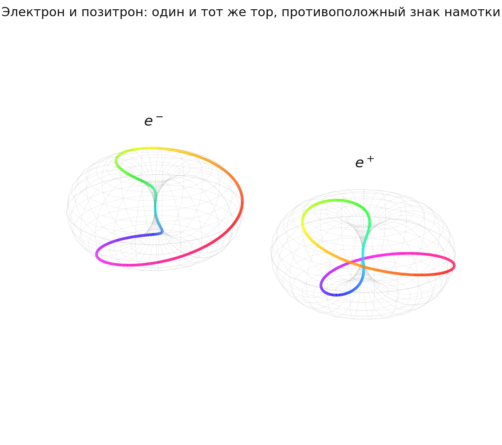

# Глава 4. Электрический заряд и спектр масс лептонов

*[← Оглавление](index.md) · [← Предыдущая](03-elektrodinamika.md) · [Следующая →](05-cvet-i-adrony.md)*

> **Коротко:** заряд в этой модели — не «количество электричества», а целое число: топологический индекс точечного дефекта в центре узла, и целым он оказывается по той же причине, по какой не бывает полутора зацеплений. Число поколений — ровно три — модель выводит, читая измеренный бег постоянной тонкой структуры собственными зарядами; а вот сами массы мюона и тау-лептона и само число $1/137$ ей вывести не удалось: лестница обертонов оказалась подгонкой, «геометрический» вывод $\alpha$ — круговым, и оба результата здесь честно закрыты. Что осталось: структура бега $\alpha$ выводится, её нормировка сведена к одному числу — доле размягчения заклиненной среды, — а слабый сектор впервые получил вход: ток $V-A$ следует из того, что аромат есть поляризация.

## Заряд как счёт, а не как вещество

Спор о том, что считать элементарным зарядом — $e$ электрона или $e/3$ кварка, — в стандартной физике решается конвенцией: первым измерили электрон, его и назначили единицей. Модель утверждает, что за этой конвенцией стоит геометрия и что заряд — вообще не «количество» чего бы то ни было, а целое число, характеризующее конфигурацию поля смещений среды. Целое — не потому, что кто-то так постановил, а потому, что число зацеплений замкнутых траекторий не бывает дробным.

Отправная точка та же, что и у массы в главе [2](02-topologiya-i-massa.md): странность спина $\tfrac12$. Электрон нужно повернуть не на $360^\circ$, а на $720^\circ$, чтобы его волновая функция вернулась к себе: за первый оборот она меняет знак, $\psi \to -\psi$, и лишь за второй восстанавливается. В квантовой механике это принимают как свойство спиноров. В упругой онтологии период $4\pi$ выводится кинематически: репер среды — элемент группы вращений, а у этой группы петля в $2\pi$ не стягивается в точку, тождество наступает лишь через $4\pi$ ([2.4](02-4-sushchestvovanie-solitona.md)). Аналогия — лента Мёбиуса: пройдя один круг, вы оказываетесь на «другой стороне», и только второй возвращает вас в начало. Именно этот $4\pi$-цикл, замкнутый обход узла, принимается за единицу топологического веса $\pm1e$; знак задаёт направление обхода, обратный обход — античастица ([4.1](04-1-normirovka-zaryada.md)).

При ближайшем рассмотрении оказалось, что носитель этого целого числа устроен точнее, чем «оборот волны вокруг узла».

**Намотка заряда не несёт.** Прямой счёт на посчитанном узле дал теорему: намотанная мода любого сектора имеет тождественно нулевой поток смещения через любую замкнутую поверхность, а самоколебание стационарного источника не создаёт вовсе. Значит, заряд не может быть ни намоткой, ни колебанием — только особенностью поля смещений: точечным центром дилатации с целым индексом. Зато такой дефект даром даёт закон Гаусса, кулоновский хвост $u \propto \hat r/r^2$ (единственное сферически-симметричное соленоидальное поле — то самое, которое глава 2 отбросила как нелокализуемое) и квантование по целочисленности индекса. Электрон оказывается двумя носителями в одной точке: дефект-заряд на оси и спиновая гирация узла вокруг него; дефект в центре узла связан, сидит там глубже всего ([3.6](03-6-zaryad-kak-defekt.md), [T-27](98-todo.md#t-27)). Существование самого узла при этом установлено — кубично-квинтический функционал даёт решение при любых положительных коэффициентах ([2.5](02-5-nasyshchayushchiy-chlen.md), [T-34](98-todo.md#t-34)).

**Тор — не размер заряда.** Картинка бублика провоцирует ошибку, и её надо оговорить сразу: если бы заряд был размазан по кольцу радиусом в комптоновскую длину, $386$ фм, электрон имел бы формфактор, а опыты по рассеянию и аномальный магнитный момент ограничивают его структуру величиной меньше $10^{-5}$ фм — на семь-восемь порядков жёстче. Противоречия нет: тор изображает структуру фазы, амплитуду дрожания, присущую и обычному дираковскому электрону, а заряд сидит в точке ([4.12](04-12-elektron-v-atome.md), [У-2](98-todo.md#u-2)). Отдельно и радиус $193$ фм из [4.11](04-11-ontologiya-ekranirovaniya.md) — это размер поляризационной шубы виртуальных пар, а не размер электрона.

## Откуда тогда дробные заряды

Если целое число обходов даёт целый заряд, откуда у кварков $+2/3$ и $-1/3$? Ответ модели: дробных зарядов как самостоятельных объектов не существует. Внутри протона нет трёх отдельных частиц — есть один волновой пакет, тороидальный «шланг», внутри которого циркулируют три моды одного поля, и полный $4\pi$-период этого единого поля раскладывается на три суб-шага. Знаменатель три при этом не подобран: условие замыкания цветового контура при конечной скорости передачи цвета даёт набег фазы на одно ребро $\delta\varphi = 4\pi/3$, то есть одно ребро контура есть ровно треть полного спинорного обхода, а число рёбер совпадает с числом цветов и с размерностью пространства ([5.11](05-11-deficit-obhoda.md), [5.1](05-1-su3-iz-3d-geometrii.md)). Сумма трёх вкладов обязана быть целой, иначе трубка не замкнётся и стоячей волны не будет; это условие целочисленности и есть то, что не даёт кварку существовать поодиночке — механическая формулировка конфайнмента ([4.1](04-1-normirovka-zaryada.md), глава [6](06-konfaynment-i-kvantovanie.md)). Какая мода в скольких плоскостях крутится — $u$ в двух, $d$ в одной, и заряд есть доля занятых плоскостей $|q| = n_\Pi/3$ — разбирается в [5.2](05-2-drobnyy-zaryad.md); само разделение мод на лептонные и кварковые введено как рабочая гипотеза, а не как долг модели ([У-1](98-todo.md#u-1)).

Эти дроби пригодятся ниже дважды: из них считается число поколений, и на них держится единственный найденный вход в слабый сектор.

## Откуда берётся 137 — и почему пока не берётся

Самое соблазнительное утверждение главы состояло бы в том, что постоянная тонкой структуры $\alpha \approx 1/137$ вычисляется из чистой геометрии, без единого измеренного числа. Идея выглядит так: конформный обход трёх ортогональных осей при двойном полоидальном обороте в фазовом объёме сферы Римана даёт $\alpha_0 = 1/(3\cdot2\cdot8\pi) = 1/(48\pi) \approx 1/151$ — уже близко; разницу должны добрать деформация тороидальной каустики от увлечения вакуумного шума (механический родственник швингеровской поправки) и интеграл перекрытия фаз, показывающий, какая доля вихревой энергии уходит в радиальное поле ([4.2](04-2-postoyannaya-tonkoy-struktury.md)).

Цепочку проверили числами, и вот что выяснилось.

**Арифметика сходится, физика — нет.** Первые три шага воспроизводятся точно, и в цепочке нет ни подгоночных величин, ни измеренной $\alpha$ на входе — цикличности в этом смысле нет ([4.10](04-10-audit-alpha-i-beg.md)). Более того, при записи $\alpha = \alpha_0(1+\Gamma)^2$ заявленное значение интеграла $\Gamma = 0.048287$ даёт $1/\alpha = 137.224$, промах $0.14\%$. Но само это число ниоткуда не выводится: коническая функция Лежандра, из которой оно якобы получено, вычислена двумя независимыми способами, и интеграл в стандартной нормировке равен $0.48$, а не $0.048$; заявленный корень $\tau_1 = \sqrt2$ корнем не является (первый нуль лежит при $1.036$); гипотезы об иной нормировке, о подгонке под $\alpha$ и об ином пределе интегрирования проверены по одной и закрыты ([4.2](04-2-postoyannaya-tonkoy-struktury.md), [T-6](98-todo.md#t-6)). Хуже того, каустика выражена через сам $\alpha_0$ — тождество $96\pi^2 \equiv 2\pi/\alpha_0$ означает, что второй шаг переписывает первый ([4.9](04-9-audit-podgonki.md)). И наконец, аргумент знака: $\alpha$ растёт с энергией и замерзает ниже массы электрона, поэтому $\alpha(0) = 1/137.036$ — абсолютный минимум бегущей константы, а $\alpha_0 = 1/150.8$ лежит ниже него и не может быть значением константы связи ни при какой энергии; переход требует усиления в $1.1004$ раза, которое взять неоткуда ([4.10](04-10-audit-alpha-i-beg.md)). Спектральный путь к $\alpha$ закрыт как круговой ([4.14](04-14-puti-k-alpha.md)).

**Вопрос поставлен заново и шире.** Раз готовый вывод не спасается, спрашивать надо иначе: какими вообще способами безразмерное число $1/137.036$ может возникнуть в механике сплошной среды. Ключевое упрощение — цель допускает несколько равносильных записей, $\alpha = r_e/\bar\lambda_C = \bar\lambda_C/a_0 = \pi f$, и достаточно вычислить любую одну: не «константу связи», а одну длину относительно другой. Составлен перечень из тринадцати путей, и часть его уже пройдена ([4.14](04-14-puti-k-alpha.md)). Путь «полюс Ландау на масштабе ячейки» — единственный безпараметрический — закрыт окончательно: он даёт $1/87.5$ вместо $137$, а требуемый коэффициент бега получается нецелым. Подбор числового выражения, дающего $137.036$, отвергнут как класс: пространство коротких формул из $\pi$ и целых чисел так плотно, что попадание в шесть знаков ничего не сообщает; тот же урок дал перебор соотношения Коиде, где троек с точностью $3\cdot10^{-5}$ нашлось двадцать девять тысяч ([4.6](04-6-koide-i-otbor-urovney.md)). Отсюда ворота для любого будущего вывода: определение фиксируется до сравнения, выходов больше входов, контрольный тест обязателен, а совпадение двух несвязанных путей на нужном числе — диагностика подгонки, а не подтверждение.

**Самый живой путь — бег как размягчение.** Постоянная связи содержит скорость волны, $\alpha \propto 1/c$. Если вблизи заряда среда подплавлена собственной энергией поля, локальная скорость поперечной волны там ниже, а $\alpha$ выше, — и чем ближе к заряду, то есть чем выше энергия зондирования, тем сильнее. Это и есть наблюдаемый бег, причём знак сходится не тавтологически: при другой фиксированной величине среды $\alpha$ падала бы с энергией, и путь закрылся бы сразу; единственная премисса — постоянство нормировки между смещением и потенциалом ([T-28](98-todo.md#t-28)). Возражение «гравитация даёт $1/r$, а бег — логарифм» снято: первое — зависимость от положения, второе — от масштаба зондирования, разные сечения одной среды. Обычный кристалл этот путь исключает: дебаевская дисперсия набирает всё в последней октаве перед ячейкой и отстаёт от логарифма на двадцать порядков; логарифм требует критической среды — а маргинально заклиненная упаковка в модели уже постулирована ([1.5](01-5-struktura-sredy.md)). Задача свелась к одному числу без упоминания квантовой электродинамики: на какую долю $s$ падает скорость поперечной волны заклиненной упаковки при увеличении волнового числа в $e$ раз; нужно $s = 2\alpha/3\pi = 1.55\cdot10^{-3}$, и точность переносится один к одному. Попутно полюс Ландау получил механический смысл — это критерий плавления среды вокруг заряда, недостижимый потому, что лежит на сотни порядков ниже ячейки; а классический радиус электрона стал границей расплава, так что задача об $\alpha$ и задача о коэффициенте гравитации ([T-4](98-todo.md#t-4)) оказались одной задачей с двумя проверками ([4.14](04-14-puti-k-alpha.md), [T-6](98-todo.md#t-6)).

**А если $\alpha$ — вход?** Рассмотрен и такой вариант, и он законен: у Стандартной модели девятнадцать свободных параметров. Но безразмерную $\alpha$ в единицу не обратить никаким выбором единиц, значит она несёт содержание, и объявлять её входом можно лишь при условиях: список входов объявлен заранее, наблюдаемых больше входов, и список короче списка Стандартной модели. Последнее сегодня не выполняется — раз массы лептонов не выводятся, они входят как входы, и ароматный сектор обходится не дешевле, чем в СМ; выигрыши модели структурные, а не числовые. Что при этом получено даром: сила гравитации входом не является — она тождественно равна квадрату отношения $m_e/m_{\text{Pl}}$, раз ячейка планковская; а путь размягчения связывает $\alpha$ с тем же отношением через одно число $\delta_{\max} \approx 0.08$ — долю пути к плавлению, которую среда проходит от комптоновской длины до ячейки, — так что калибровка одного предсказывает второе ([4.14](04-14-puti-k-alpha.md)). И совпадение, которое стоило зафиксировать отдельно: у маргинально заклиненной упаковки безразмерных параметров почти нет, а предел «модуль сдвига много меньше объёмного» тождественно даёт коэффициент Пуассона $\tfrac12$ — то есть несжимаемость, введённая в главе [1](01-uprugiy-vakuum.md) отдельным постулатом, оказывается тем же самым условием, что и заклинивание. Если бы среда сидела ровно в критической точке и $\delta_{\max}$ было универсальным числом, $\alpha$ следовала бы из $D=3$ плюс заклинивание; если нет — это один объявленный вход. Развилка решена расчётом на заклиненном образце — мягких сферах, сжатых до порога и сдвигаемых с размыканием контактов ([1.10](01-10-zakon-razmyagcheniya.md), [T-44](98-todo.md#t-44)) — и решена не в пользу сильной ставки: размягчение у заклиненной среды есть, с нужным знаком и без масштаба, как и требует логарифм, но именно поэтому у него нет универсальной глубины — доля потерянного модуля зависит от отношения амплитуды к деформации перехода, а та обращается в нуль в самой критической точке. Число требует двух входов вместо нуля; путь 10 остаётся связью бега с размягчением, а не выводом $\alpha$.

## Бег константы: структура выводится, нормировка — нет

Что модель умеет уже сейчас — так это сказать, как $\alpha$ меняется с энергией. Однопетлевой бег определяется суммой $\sum N_c Q_f^2$ по всем заряженным частицам, и модель, независимо от $\alpha$, даёт оба множителя: заряды $\pm2/3$, $\mp1/3$ ([5.11](05-11-deficit-obhoda.md)) и три цвета из трёхмерности пространства ([5.1](05-1-su3-iz-3d-geometrii.md)). Отсюда вклад одного поколения считается точно и без единого параметра:

$$b_{\text{пок}} = 1 + 3\cdot\tfrac49 + 3\cdot\tfrac19 = \tfrac83$$

Вместе с ним выводятся все девять ступеней порогов — от нуля ниже массы электрона до восьми выше массы $t$-кварка — и лептонная часть сдвига при массе $Z$-бозона, которая считается точно и данных не требует; однопетлевое $1/\alpha(m_Z) = 128.94$ против измеренных $127.95$ — обычная точность одной петли ([4.10](04-10-audit-alpha-i-beg.md)). Не выведен множитель $1/3\pi$ перед логарифмом — та самая нормировка бега, за которую и отвечает доля размягчения $s$ ([T-21](98-todo.md#t-21)). Допустимая сегодня формулировка: модель выводит структуру бега — какие частицы вносят вклад и с каким весом, — но не его нормировку.

**Почему бег замирает ниже массы электрона.** Это отдельный и приятный результат: наблюдения требуют, чтобы сама решётка не поляризовалась, иначе $\alpha$ бежала бы и ниже $m_e$. Оказалось, что это не дополнительное требование, а следствие: невозмущённая упаковка топологически тривиальна и заряда не несёт, разделять в ней нечего, а единственный способ получить разделённые заряды — родить пару узел–антиузел ценой $2m_ec^2 = 1.022$ МэВ. Вакуум оказывается диэлектриком со щелью, а замирание бега — обычным поведением диэлектрика ниже щели ([4.11](04-11-ontologiya-ekranirovaniya.md)). Оттуда же — верхняя граница на число поколений: у модели есть собственное физическое обрезание, планковская ячейка, и полюс Ландау обязан лежать выше него, иначе теория несостоятельна внутри своей области; это даёт $n_f \le 5$, причём тройка проходит с запасом в пятнадцать порядков.

## Три поколения: число выведено, массы — нет

Электрон, мюон, тау-лептон — три копии одной частицы, отличающиеся только массой: мюон тяжелее электрона в $207$ раз, тау — в $3477$. Зачем природе такое дублирование, Стандартная модель не объясняет: и число поколений, и их массы — свободные параметры.

**Число поколений — три, и оно выведено.** Ход обратный привычному: не выводить $\alpha$ из спектра, а прочесть спектр по измеренному бегу $\alpha$, ведь каждая заряженная частица даёт излом кривой на своей массе — измеренный бег есть спектроскопия вакуума. Полный измеренный коэффициент бега равен $8$; вклад одного поколения, посчитанный выше собственными зарядами модели, равен $8/3$; отсюда $N = 8/(8/3) = 3$ ровно ([4.14](04-14-puti-k-alpha.md), [T-22](98-todo.md#t-22)). Совпадение не автоматическое: при зарядах кварков $\pm\tfrac12$ вышло бы $3.2$, при двух цветах $3.79$, при четырёх $2.48$ — все нецелые, так что тот же счёт заодно перекрёстно проверяет дроби $2/3$ и $1/3$ по независимому каналу. Лёгкое четвёртое поколение исключается самим бегом — оно дало бы $32/3$ вместо восьми, — что согласуется с прямыми поисками (граница LEP $m_{L_4} > 100.8$ ГэВ); о тяжёлом четвёртом, выше зондированной шкалы, модель молчит, ровно как Стандартная модель ([4.8](04-8-chetvertoe-pokolenie-status.md), [T-19](98-todo.md#t-19)). Чего этот счёт не даёт, надо сказать прямо: изломы стоят ровно на массах, и прочесть их — значит измерить массы, а не вывести.

**Обертоны — идея, которая не сработала.** Естественная догадка из акустики была такой: если частица — стоячая волна в тороидальной каустике, у неё есть спектр, и электрон — основной тон, мюон — первый обертон, тау — второй; лестница уровней $\tau_n$ строится тогда из корней конической функции Лежандра без единого свободного числа. Проверка показала, что это не вывод, а подгонка, причём в нескольких независимых местах. Числа $\tau = \sqrt2,\ 8.312,\ 22.146$, на которых держалось согласие с массами, корнями спектрального уравнения не являются ни при какой каустике и ни при каком из стандартных граничных условий — они согласованы с заранее выбранным кубическим законом по уже известным массам ([4.3](04-3-spektr-mass-leptonov.md), [T-7](98-todo.md#t-7)). На истинных корнях, идущих почти эквидистантно, закон масс становится квадратичным, у лестницы появляется дно около $18$ МэВ, под которое электрон не попадает, а согласие с полной сеткой заряженных частиц не лучше, чем у случайной лестницы с тем же числом уровней ([4.5](04-5-spektr-na-setke-polyarizacii.md)). Соотношение Коиде — эмпирическая комбинация трёх лептонных масс, равная $2/3$ с точностью до миллионных, — на такой лестнице точным быть не может: условие сводится к диофантову уравнению $i^2+j^2+k^2 = 4(ij+jk+ik)$, у которого спуском Ферма доказано отсутствие решений ([4.6](04-6-koide-i-otbor-urovney.md)). А механический аудит на подгонку вынес вердикт: пять подгоночных величин на три наблюдаемые массы, и та же процедура ложится на выдуманные тройки масс — шестая часть подделок села лучше настоящих лептонов ([4.9](04-9-audit-podgonki.md), [T-20](98-todo.md#t-20)). Единственное числовое предсказание этой лестницы — четвёртый лептон с массой от $9$ до $45$ ГэВ, полученный четырьмя способами её продолжения, — закрыто прямым поиском на LEP ([4.4](04-4-zapret-chetvertogo-pokoleniya.md), [4.8](04-8-chetvertoe-pokolenie-status.md)). Отрицательный результат здесь окончательный: конструкция отозвана, и модель её больше не использует; вместе с ней снято и мнимое противоречие между квадратичной лестницей и точностью Коиде ([T-16](98-todo.md#t-16)).

**Что при этом уцелело.** Массы лептонов сами по себе ложатся на степенную лестницу с показателем около $7.6$, и две независимые оценки показателя согласуются лучше $4\%$; радиальные моды узла дают вдвое меньший показатель во всём допустимом окне ([2.5](02-5-nasyshchayushchiy-chlen.md), [T-15](98-todo.md#t-15)). Точность Коиде тоже никуда не делась: значение $2/3$ ровно даёт $m_\tau = 1776.97$ МэВ против измеренных $1776.86 \pm 0.12$, то есть $0.91\sigma$, — не опровергнута и не объяснена, и всякий будущий вывод масс обязан её воспроизвести ([4.6](04-6-koide-i-otbor-urovney.md), [T-20](98-todo.md#t-20)). Наконец, обёртка вопроса «чем вообще различаются поколения» стала жёстче ([4.7](04-7-geometriya-pokoleniy.md)): заряд и спин у трёх поколений тождественны, константы связи универсальны точнее $10^{-3}$, значит различие обязано быть топологически невидимым — «другой узел» исключён; тяжёлые лептоны меньше и быстрее в $207$ и $3477$ раз; распады идут строго вниз, $\tau \to \mu \to e$. И самое содержательное: относительная ширина мюона — $10^{-18}$, тау — $10^{-12}$, тогда как у настоящих резонансов вроде $\Delta$-изобары она порядка $10^{-1}$; семнадцать порядков разницы означают, что в упругом секторе лептонные моды — точные стационарные состояния, а распад приходит по стороннему, слабому каналу. Ровно это и подтвердил счёт малых колебаний узла: упругой ширины у него нет вовсе ([2.12](02-12-kvazinormalnye-mody.md)). Все динамические кандидаты на различие поколений — радиальные узлы, поляризация, намотка, кривая семейства, баланс с шумом среды, энергетика дефекта в центре — проверены и закрыты ([2.8](02-8-vetv-arnolda.md)–[2.10](02-10-termostat.md), [3.6](03-6-zaryad-kak-defekt.md)); если отношения масс выводимы, то из структуры бега $\alpha$ — того самого зарядового сектора, что дал число поколений, — иначе они остаются входом ([T-15](98-todo.md#t-15)).

**Электрон в атоме.** Атомный масштаб — единственное место, где модель встречается с самой проверенной частью физики, и встречу она проходит без конфликта, но и без прибыли. Одно точное соотношение получает содержательное чтение: боровский радиус есть комптоновская длина, делённая на $\alpha$, — связанный узел расплывается по орбитали ровно в $137$ раз шире собственного масштаба, множитель размытия есть постоянная тонкой структуры. Формы орбиталей — сфера, гантели, розетки — суть картины стоячих волн на сфере; догадка о «фигурах Лиссажу» верна, но проверкой не служит: их даёт любое волновое уравнение в центральном поле. А вот траекторное чтение — «обход расплывается вокруг ядра» — опровергается $s$-орбиталью: у неё орбитального момента нет вовсе, а плотность в ядре максимальна; внутренняя хиральность обхода при этом сохраняется (спин $\tfrac12$ у $s$-электрона на месте). На атомных масштабах электрон описывается не профилем узла, а уравнением Дирака, которое модель получает в [1.2](01-2-clifford-dirac.md), и ничего к атомной физике не добавляет ([4.12](04-12-elektron-v-atome.md)).

## Слабый сектор: найден вход

Из четырёх взаимодействий модель до недавнего времени бралась за три; слабого — ни механизма смены аромата, ни объяснения нейтрино — в ней не было вовсе ([T-38](98-todo.md#t-38)). Вход появился со стороны дробных зарядов, и вот какой.

**Дублеты — это дополнительность плоскостей.** Если заряд есть доля занятых плоскостей вращения, то партнёры по слабому дублету — $(u,d)$, $(c,s)$, $(t,b)$ и $(\nu,e)$ — во всех четырёх случаях занимают дополнительные наборы: что задействовано у одного, свободно у другого, $n_\Pi + n_\Pi' = 3$, и разность зарядов внутри дублета тождественно равна единице — то самое свойство, которым в Стандартной модели определяется слабый изоспин. Это пока переформулировка, а не вывод, но она подсказывает механизм: слабый переход есть перестановка занятых и свободных плоскостей, то есть смена поляризации моды; у дублета ровно два члена, потому что устойчивых поляризаций ровно две; ароматов шесть, потому что поляризаций две, а поколений три ([4.13](04-13-slabyy-sektor.md)).

**Хиральность выведена, выбор зеркала — нет.** В природе слабый ток связывает одну спиральность: нейтрино левые, ток имеет вид $V-A$, — и у ахиральной среды это должно откуда-то браться. Берётся из уже установленного: линейная поляризация раскладывается по двум спиральностям поровну, круговая — одна спиральность, и ток перехода «линейная $\to$ круговая» живёт целиком в одной спиральной компоненте ($J_+ = 1/\sqrt2$, $J_- = 0$); векторный ток, сохраняющий поляризацию, брал бы обе поровну. Незамкнутая мода, рождённая в таком переходе, наследует его спиральность — отсюда нейтрино одной спиральности, равной спиральности узла-родителя, а антинейтрино — зеркало; $e_L$ и $e_R$ оказываются двумя вырожденными зеркалами одного узла. Направление распада нейтрона получается правильным: расклад «одиночная мода ниже по частоте» лежит выше по энергии на малую величину, как и $m_n - m_p$ мало против $940$ МэВ ([4.13](04-13-slabyy-sektor.md), [2.5](02-5-nasyshchayushchiy-chlen.md)). Чего среда не даёт: абсолютного выбора зеркала — она различает спиральности, но не выбирает одну из них, и выбор остаётся начальным условием, как и в Стандартной модели; и масштаба $\Omega_W$ — подавление имеет правильную форму $(Q/\Omega_W)^2$, но число остаётся калибровочным входом того же рода, что массы лептонов.

**Виртуальный $W$ не успевает и шестой части оборота.** Предположение «$W$ и $Z$ — переходный процесс, а не частица» разделилось надвое, и границу провёл сам резонансный критерий модели. Реальные $W$ и $Z$ на коллайдере за время жизни успевают сделать шесть собственных оборотов — больше, чем $\Delta$-изобара с её $1.7$, — и суть полноценные резонансы. Максимально же виртуальному кванту в обычном распаде достаётся ровно $1/2\pi \approx 0.16$ оборота при любой массе — тождество, — и частицей он по этому критерию не является: для слабых распадов $W$-объект в онтологии не требуется. Радиус слабого взаимодействия читается как эванесцентный отклик среды ниже собственной частоты моды, $\hbar/(mc) \approx 2.5\cdot10^{-18}$ м, — перевод юкавской формы на язык среды, а не независимая проверка. Проверяемое и непроверенное предсказание: иерархия смешивания кварков должна идти от перекрытия радиальных мод, а большое смешивание нейтрино — от почти вырожденных масс ([4.13](04-13-slabyy-sektor.md)).

## Что здесь замкнуто

Именно в этой главе — там, где модель чаще всего упрекают в невыведенной $\alpha$, — замыканий больше всего, и их стоит перечислить отдельно. Вклад одного поколения в бег заряда, $b = 1 + 3\cdot\tfrac49 + 3\cdot\tfrac19 = \tfrac83$, выводится из собственных дробных зарядов и трёх цветов без единого параметра ([4.10](04-10-audit-alpha-i-beg.md)); прочитанный этим ключом измеренный бег даёт число поколений $N = 8/(8/3) = 3$ ровно, а положение полюса Ландау над планковским обрезанием ограничивает его сверху $n_f\le5$ ([4.14.11](04-14-puti-k-alpha.md), [4.11](04-11-ontologiya-ekranirovaniya.md)). В Стандартной модели число поколений — вход. Замирание бега ниже массы электрона — не отдельное правило, а следствие того, что вакуум есть щелевой диэлектрик с порогом $2m_ec^2$ ([4.11](04-11-ontologiya-ekranirovaniya.md)). Гравитационная постоянная связи двух электронов тождественно равна $(m_e/m_{\rm Pl})^2$ — сила гравитации входом не является, и знаменитое отношение $2.4\cdot10^{-43}$ тоже ([4.14.9](04-14-puti-k-alpha.md)). Путь 10 связывает между собой два оставшихся входа, $\alpha$ и $m_e/m_{\rm Pl}$: если бег заряда есть размягчение среды, то $\alpha = 3\pi\delta_{\max}/2\ln(m_{\rm Pl}/m_e)$, знак сходится, и при вычислимом $\delta_{\max}$ два входа становятся одним — связь есть, числа пока нет ([4.14](04-14-puti-k-alpha.md), [1.10](01-10-zakon-razmyagcheniya.md)). В слабом секторе структура $V-A$ и равенство спиральности нейтрино спиральности узла получены из спирального базиса, а партнёры по дублету оказались дополнительными наборами плоскостей с разностью зарядов ровно единица ([4.13](04-13-slabyy-sektor.md)). Ни $\alpha$, ни массы поколений отсюда пока не следуют — но их не выводит и Стандартная модель, а число поколений она и не пытается.

## Что в итоге

Глава оставляет читателя с непривычным балансом. Числовые претензии — вывести $1/137$ и массы мюона и тау — не выполнены, и это установлено расчётами, а не отложено: спектральный вывод $\alpha$ круговой, лестница обертонов — подгонка, четвёртый лептон в десятки ГэВ опровергнут. Структурные же результаты стоят прочно и проверены перекрёстно: заряд — целый индекс дефекта, дроби $2/3$ и $1/3$ — доли обхода, вклад поколения в бег $8/3$, число поколений три, вакуум — щелевой диэлектрик, ток $V-A$ — следствие поляризационной природы аромата. Между этими двумя списками лежит одно вычислимое число — доля размягчения заклиненной среды, — от которого зависит, останется ли $\alpha$ входом или станет предсказанием.

## Подглавы (навигация)

- [4.1 Нормировка элементарного заряда и декомпозиция лептонного цикла](04-1-normirovka-zaryada.md) — $\pi_3(S^2) \cong \mathbb{Z}$, период $4\pi$, топологический вес $\pm 1e$, разбиение цикла на три суб-шага.
- [4.2 Априорный вывод постоянной тонкой структуры](04-2-postoyannaya-tonkoy-struktury.md) — пять шагов вывода $\alpha_0 = 1/(48\pi)$ и численная проверка: арифметика сходится в форме $\alpha_0(1+\Gamma)^2$, но $\Gamma_{int}$ не выводится, а каустика кругова.
- [4.3 Дискретный спектр высших гармоник: массы мюона и тау-лептона](04-3-spektr-mass-leptonov.md) — спектральное условие на конические функции Лежандра; числа $\tau_n$ корнями не являются, спектрального происхождения у них нет.
- [4.4 Топологический запрет на четвёртое поколение лептонов](04-4-zapret-chetvertogo-pokoleniya.md) — соотношение Коиде как инвариант и пластический срыв каустики; аргумент подан в исходной силе, обе опоры подорваны в [4.6](04-6-koide-i-otbor-urovney.md) и [4.8](04-8-chetvertoe-pokolenie-status.md).
- [4.5 Спектр масс на полной сетке частиц поляризации вакуума](04-5-spektr-na-setke-polyarizacii.md) — квадратичный закон на истинных корнях, дно лестницы $18$ МэВ, контрольный тест на случайной лестнице; результат отрицательный, но диагностичный.
- [4.6 Соотношение Коиде как правило отбора: теорема о несовместимости](04-6-koide-i-otbor-urovney.md) — спуск Ферма: точное Коиде на квадратичной лестнице недостижимо; $29\,042$ приближённых троек; точность Коиде ($0.91\sigma$) как ограничение.
- [4.7 Геометрия поколений: что различает электрон, мюон и тау](04-7-geometriya-pokoleniy.md) — размеры и частоты поколений, семнадцать порядков между лептонами и резонансами, различие обязано быть топологически невидимым.
- [4.8 Четвёртое поколение: экспериментальный статус и что предсказывает модель](04-8-chetvertoe-pokolenie-status.md) — все продолжения лестницы дают $9$–$45$ ГэВ ниже границы LEP; после вывода $N=3$ лёгкое четвёртое исключает сам бег, тяжёлое развязано.
- [4.9 Аудит подгонки: замкнут ли блок вывода поколений](04-9-audit-podgonki.md) — пять подгоночных величин на три массы, схема ложится на выдуманные тройки; протокол замыкания блока.
- [4.10 Аудит вывода постоянной тонкой структуры и её бега](04-10-audit-alpha-i-beg.md) — цикличности и подгонки нет, но $\alpha_0$ ниже физического минимума; вклад поколения $b_{\text{пок}} = 8/3$ и девять ступеней порогов выводятся.
- [4.11 Онтология экранирования: щелевой диэлектрик и число поколений](04-11-ontologiya-ekranirovaniya.md) — почему бег замирает ниже $m_e$, роль античастиц, $n_f \le 5$ из полюса Ландау.
- [4.12 Электрон в атоме: орбитали, размер и чего модель не добавляет](04-12-elektron-v-atome.md) — $a_0 = \bar\lambda_C/\alpha$, орбитали кинематичны, опровержение траекторного чтения на $s$-орбитали, точечность электрона.
- [4.13 Слабый сектор: аромат, дублеты и два режима $W$](04-13-slabyy-sektor.md) — комплементарность плоскостей ($\Delta q = 1$), аромат как поляризация, $V-A$ из спирального базиса, два режима $W$, радиус как эванесцентный отклик, нейтрино.
- [4.14 Пути к постоянной тонкой структуры: перечень и отбор](04-14-puti-k-alpha.md) — тринадцать способов вывести $\alpha$: полюс Ландау на ячейке и спектральный путь закрыты, подбор выражений отвергнут; бег как размягчение сведён к одному числу $s$; $\alpha$ как вход; число поколений $N=3$ из бега.

## Связанные главы

- [Глава 1. Вакуум как упругий кристалл](01-uprugiy-vakuum.md) — аппарат Эйнштейна — Картана и уравнение Хехла — Датты, из которых берётся спектральное уравнение.
- [Глава 2. Топология узла и происхождение массы покоя](02-topologiya-i-massa.md) — целочисленность топологического инварианта, лежащая в основе целочисленности заряда.
- [Глава 3. Электродинамика как вторичный эффект кручения решётки](03-elektrodinamika.md) — поле, в единицах которого нормируется заряд.
- [Глава 5. Цвет и структура адронов](05-cvet-i-adrony.md) — дробный заряд, три цвета и восемь глюонов как продолжение декомпозиции цикла.

---

*[🏠](index.md)*
