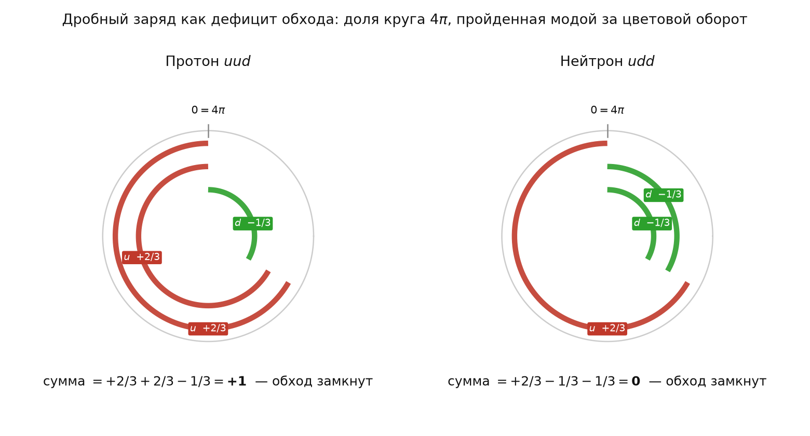

# 5.11 Дефицит обхода: откуда дробный заряд и как он выглядит

*[← Глава 5](05-cvet-i-adrony.md) · [Оглавление](index.md)*

## 5.11.0 Постановка: связывает ли что-нибудь дробный заряд с дрожанием

Прямой ответ на вопрос: **нет, дробный заряд из дрожания траектории не получается**, и это стоит сказать сразу, пока связь не показалась заманчивой. Дифференциальная отдача ([5.10](05-10-faza-protiv-polozheniya.md)) отвечает за другое — за то, чтобы два $u$-фокуса вообще были различимы. Заряд же определяется тем, **какую долю полного спинорного обхода мода успевает пройти**, и к деформации нити отношения не имеет.

Разделение обязанностей получается чистое:

| механизм | за что отвечает |
|---|---|
| дифференциальная отдача от $d$-моды ([5.10](05-10-faza-protiv-polozheniya.md)) | различимость двух $u$; без неё счёт паулиевских конфликтов ([5.9](05-9-konechnaya-skorost-cveta.md)) вырождается в пустоту |
| доля пройденного обхода (эта подглава) | дробный заряд и правило отбора адронов |

Ниже показано, что второй механизм связывает три подглавы, писавшиеся независимо — [5.2](05-2-drobnyy-zaryad.md), [5.3](05-3-dikvarkovyy-kern.md) и [5.9](05-9-konechnaya-skorost-cveta.md), — и что из их соединения выходит больше, чем закладывалось. Расчёты — `simulations/python/FractionalCharge.py`.

## 5.11.1 Знаменатель $3$ уже выведен — в подглаве 5.9

Ключевое наблюдение простое.

Полный спинорный обход солитона есть $4\pi$ ([2.1](02-1-rassloenie-hopfa.md)). Условие замыкания цветового контура при конечной скорости передачи цвета ([5.9](05-9-konechnaya-skorost-cveta.md)) даёт набег фазы на одно ребро

$$\delta\varphi = \frac{4\pi}{3}$$

Разделим одно на другое:

$$\frac{\delta\varphi}{4\pi} = \frac{1}{3}$$

**Одно ребро цветового контура есть ровно треть полного спинорного обхода.** Знаменатель $3$ в дробном заряде приходит не из подгонки под наблюдаемые $2/3$ и $1/3$, а из числа рёбер контура — оно же число цветов, оно же размерность пространства ([5.1](05-1-su3-iz-3d-geometrii.md)).

Это и есть искомый «дефицит обхода» в точной записи: мода, передавшая цвет соседу, прошла лишь треть круга и дальше идти не может — очередь следующей.

## 5.11.2 Почему у $u$ две трети, а у $d$ одна

Второй элемент — асимметрия мод, и она в модели уже есть, причём в двух записях, которые оказываются одним утверждением.

**Запись первая, геометрическая** ([5.2](05-2-drobnyy-zaryad.md)): $u$-мода вращается в двух ортогональных плоскостях из трёх, $d$-мода заперта в одной.

**Запись вторая, динамическая** ([5.3](05-3-dikvarkovyy-kern.md)): $\omega_d = \tfrac12\,\omega_u$.

Это одно и то же: мода, занимающая одну плоскость, набирает фазу вдвое медленнее моды, занимающей две. Полезно зафиксировать, что независимых допущений здесь **одно**, а не два.

Отсюда доля обхода за цветовой оборот и заряд:

$$Q = \pm\,\frac{N_{\text{плоскостей}}}{3}, \qquad Q_u = +\frac{2}{3}, \qquad Q_d = -\frac{1}{3}$$

Знак минус у $d$ — инвертированное направление **локальной** намотки, то есть обхода в плоскостях внутреннего репера, а не траектории общей нити ([5.2](05-2-drobnyy-zaryad.md), [5.1](05-1-su3-iz-3d-geometrii.md)).

## 5.11.3 Заряды адронов: ни одного подгоночного параметра

Дальше всё считается само. Ни нормировки, ни выбора — только сложение долей.

| адрон | состав | предсказание | опыт |
|---|---|---|---|
| $p$ | $uud$ | $+2/3+2/3-1/3 = \mathbf{+1}$ | $+1$ |
| $n$ | $udd$ | $+2/3-1/3-1/3 = \mathbf{0}$ | $0$ |
| $\Delta^{++}$ | $uuu$ | $\mathbf{+2}$ | $+2$ |
| $\Delta^{-}$ | $ddd$ | $\mathbf{-1}$ | $-1$ |
| $\pi^{+}$ | $u\bar d$ | $\mathbf{+1}$ | $+1$ |
| $\pi^{0}$ | $u\bar u$ | $\mathbf{0}$ | $0$ |

Расхождений нет. Особо отметим **нейтральность нейтрона**: она здесь не подставлена, а получилась — три доли обхода, две отрицательные, складываются в нуль.

## 5.11.4 Правило отбора: что вообще может существовать свободно

Здесь конструкция даёт больше, чем в неё закладывалось.

Свободное состояние обязано **замкнуть обход целиком**: суммарная доля должна быть целым числом кругов $4\pi$, иначе конфигурация остаётся незавершённой. Условие записывается как «полный заряд целочислен» и сводится к простой арифметике: при $Q = (2 n_u - n_d - 2n_{\bar u} + n_{\bar d})/3$ целочисленность равносильна

$$N_q - N_{\bar q} \ \equiv \ 0 \pmod 3$$

то есть **целому барионному числу**. Перебор:

| структура | $N_q - N_{\bar q}$ | обход |
|---|---|---|
| $q$ — одиночный кварк | $+1$ | **не замыкается** |
| $qq$ — дикварк | $+2$ | **не замыкается** |
| $qqq$ — барион | $+3$ | замыкается |
| $q\bar q$ — мезон | $0$ | замыкается |
| $qqqq$ | $+4$ | **не замыкается** |
| $qq\bar q\bar q$ — тетракварк | $0$ | замыкается |
| $qqqq\bar q$ — пентакварк | $+3$ | замыкается |

Правило разрешает ровно те четыре типа, которые наблюдаются, — барион, мезон, тетракварк, пентакварк, — и запрещает одиночный кварк, дикварк и четвёрку кварков, которых не наблюдают. Ни один из этих случаев в вывод не закладывался.

**Оговорка, без которой это переоценят.** Это правило **отбора**, а не механизм. Оно говорит, какие комбинации замыкают обход, и ничего не говорит о том, почему незамкнутая конфигурация не может существовать динамически. Механизм — эффект Пуассона в несжимаемом канале ([6.1](06-1-effekt-puassona.md)), и он здесь не задействован. Совпадение с наблюдаемой систематикой адронов приятно, но по содержанию это переформулировка условия «цветовой синглет», а не независимое достижение.

## 5.11.5 Как это должно выглядеть в симуляции

Правильная визуализация — не третья кривая на торе, а **счётчик доли обхода**. Полный круг на рисунке есть спинорный обход $4\pi$; дуга каждой моды — доля, пройденная ею за один цветовой оборот. Сумма дуг в протоне даёт ровно один полный круг, в нейтроне — ноль. Замыкание видно глазом.

**Два множителя заряда должны быть видны порознь.** Счётчик доли обхода показывает **результат** — что дуги складываются в круг, — но не показывает, откуда взялись сами доли. А их два независимых источника ([5.2](05-2-drobnyy-zaryad.md)):

$$|q| = \frac{n_\Pi}{D}, \qquad n_\Pi(u) = 2, \quad n_\Pi(d) = 1, \quad D = 3$$

и **знак**, задаваемый направлением локальной топологической намотки: у $d$-моды оно инвертировано относительно $u$-моды — та же операция, что различает электрон и позитрон. Речь именно о локальном обходе во внутренних плоскостях: общая нить у всех трёх фокусов одна, и её хиральность принадлежит бариону, а не отдельной моде ([5.2](05-2-drobnyy-zaryad.md)).

Отсюда правильная схема на рисунке: для каждой моды три ячейки по числу ортогональных плоскостей вращения, закрашенные — задействованные ($2$ у $u$, $1$ у $d$), и рядом стрелка направления намотки. Модуль читается как доля закрашенных, знак — по стрелке. Заодно становится наглядным утверждение [5.2](05-2-drobnyy-zaryad.md) о том, что цвет и заряд суть две стороны одного дефекта: **сколько** плоскостей задействовано — это заряд, **какие именно** — это цвет. Поэтому ячейки красятся цветовой фазой моды, и при цветовом обмене закрашенный набор скачком переходит к следующему.

Реализовано в `simulations/python/Proton_new.py`, верхняя панель. Оговорка обязательна: разделение «$u$ — две плоскости, $d$ — одна» есть **рабочая гипотеза** [5.2](05-2-drobnyy-zaryad.md)/[5.3](05-3-dikvarkovyy-kern.md), а не вывод (см. таблицу 5.11.6).

**Что для этого нужно поменять в трёхмерной анимации.** `Proton.py` рисует три моды как три полных обхода, и дробность в картинке никак не проявляется. Требуются две правки, обе выполнены в `simulations/python/Proton_new.py`:

1. **Рисовать не полную нить, а пройденную за цветовой оборот дугу.** У $u$-фокуса это $8\pi/3$ параметра, у $d$-фокуса — $4\pi/3$ в обратную сторону. Тогда незамкнутость каждой моды видна непосредственно: ни одна дуга не смыкается сама с собой.
2. **Показать сумму.** Отдельная дуга, накапливающая доли всех трёх мод, обязана замкнуться ровно в круг. Именно это и есть наглядный смысл конфайнмента: по отдельности не замыкается ни одна, вместе — замыкается точно.

Дуги в сцене растут от своих фокусов по мере цветового оборота, снабжены поперечными штрихами волнового фронта — как в сцене электрона — и разведены малыми радиальными сдвигами внутри трубки, чтобы не сливаться на общих участках нити. Неполнота обхода и сторона обхода читаются прямо: у $u$ дуга уходит вперёд и не доходит до замыкания, у $d$ — уходит назад и вдвое короче.

**Чего нарисовать нельзя, и это стоит сказать прямо.** Число задействованных плоскостей вращения ($2$ у $u$, $1$ у $d$) на нити не изображается никак. Фокус есть **точка**, а у точки нет ни обхода, ни направления обхода; всякая попытка пририсовать к фокусу собственную петлю или спираль вводит геометрию, которой в модели нет. Плоскости — свойство внутреннего репера ([5.2](05-2-drobnyy-zaryad.md), [5.1](05-1-su3-iz-3d-geometrii.md)), и честное место для них — отдельная схема со счётом плоскостей, а не объёмная сцена.

Отдельный признак: за один цветовой оборот цветовая фаза $u$-фокуса обязана пробегать **две трети** радужного круга, а $d$-фокуса — **одну треть в обратную сторону**. Если в анимации это не так, значит частоты в коде не отвечают заявленной геометрии.

**Что отсюда следует, и это не закладывалось.** Присвоим трём фокусам начальные цветовые фазы $0$, $1/3$, $2/3$ — то есть три цвета, разнесённые ровно на одно ребро контура (раздел 5.11.1). Прогон тех же долей $+2/3$, $+2/3$, $-1/3$ через целое число оборотов даёт

| оборотов | $u_1$ | $d$ | $u_2$ | набор цветов |
|---|---|---|---|---|
| $0$ | $0$ | $1/3$ | $2/3$ | $\{0,\tfrac13,\tfrac23\}$ |
| $1$ | $2/3$ | $0$ | $1/3$ | тот же |
| $2$ | $1/3$ | $2/3$ | $0$ | тот же |
| $3$ | $0$ | $1/3$ | $2/3$ | тот же, **тождественно** |

Набор цветов инвариантен на **каждом** целом обороте — это условие цветового синглета, — а исходное распределение восстанавливается ровно через **три** оборота. То есть цветовой обмен в модели есть циклическая перестановка триады порядка 3, и получается она из одного числа $\delta\varphi/4\pi = 1/3$, без отдельного допущения о структуре $SU(3)$.

**Требование непрерывности, и оно закрывает выбор.** Целых оборотов недостаточно: между ними цвета обязаны оставаться **попарно различными**, иначе два фокуса на мгновение несут один цвет и синглет распадается. Это исключает наивное прочтение, при котором каждая мода вращает свою цветовую фазу с собственной скоростью $+2/3$, $+2/3$, $-1/3$ за оборот: при таком движении $d$ совпадает по цвету с $u_1$ при $\tau = 1/3$ и с $u_2$ при $\tau = 2/3$.

Выход единственный, и он же снимает кажущееся противоречие. На трёхрёберном контуре

$$+\frac{2}{3} \ \equiv \ -\frac{1}{3} \pmod 1$$

то есть «два ребра вперёд» и «одно ребро назад» — **одно и то же смещение**. Все три фазы сдвигаются с общей скоростью, триада движется как жёсткое целое, взаимные зазоры тождественно равны $1/3$ в любой момент, и синглет держится непрерывно, а не только на целых оборотах.

Различие $u$ и $d$ тем самым лежит не в скорости и не в конечной точке, а в **намотке**: один и тот же конец пути достигается обходом вперёд на $2/3$ круга либо назад на $1/3$. Знаковая разность этих путей и есть заряд — ровно та величина, которую складывает счётчик обхода. Заряд оказывается свойством пути, а цвет — свойством конечной точки; отсюда и то, что цвет у адрона нейтрален, а заряд нет.

Проверено точной арифметикой дробей в `simulations/python/Proton_new.py`, пункт 6 отчёта: за три оборота при 121 отсчёте множество зазоров между цветами состоит из единственного значения $1/3$.

## 5.11.6 Может ли дефицит возникать из вращения триады?

Предположение естественное: триада вращается, отчего каждая мода получает сдвиг фазы, и потому ни одна не успевает пройти полный хиральный обход. Проверим — механизм в геометрии действительно есть, но нужного числа он не даёт.

**Эффект реален и считается.** Скорость продвижения по параметру вдоль намотанной нити не постоянна:

$$\left|\frac{d\mathbf{C}}{d\theta}\right| = \sqrt{\text{rad}^2 + \frac{r^2}{4}}, \qquad \text{rad}(\theta) = R + r\cos\frac{\theta}{2}$$

При $R = \sqrt3\,r$ эта величина пробегает от $0.887\,r$ у горловины до $2.777\,r$ на периферии — отношение $3.13$. Сигнал, идущий с постоянной скоростью, за одно и то же время покрывает **втрое разный** угол $\theta$ в разных местах нити. Полная длина обхода $4\pi$ равна $22.82\,r$.

**Но нужных долей не получается.** Пустим из трёх фокусов волны на одинаковую длину пути, равную трети полного контура:

| мода | $\Delta\theta$ | доля обхода $4\pi$ | требуется |
|---|---|---|---|
| $u_1$ | $3.141$ | $0.250$ | $+0.667$ |
| $d$ | $5.873$ | $0.467$ | $-0.333$ |
| $u_2$ | $6.054$ | $0.482$ | $+0.667$ |

Ни одно значение не совпадает с требуемым, и — что решает дело — **два $u$ получаются разными**: $0.250$ против $0.482$.

**Возражение, которое здесь напрашивается, и оно справедливо.** Модель квантует не топологией, а **резонансом**: нецелая конфигурация просто перестаёт резонировать и распадается. Так устроен разбор $\Delta$-изобары ([5.9](05-9-konechnaya-skorost-cveta.md), раздел 5.9.6): $\tau(\Delta)/T_{\text{цв}} = 0.638$, она не успевает замкнуть цикл и живёт меньше одного цветового оборота. Резонанс — законный механизм квантования: непрерывный параметр, дискретный отбор, как моды стоячей волны на струне. Требовать топологического источника **как единственно возможного** нельзя.

**Но резонанс не спасает именно этот механизм, и вот почему.** Условие замыкания — **одно** условие на конфигурацию в целом. Оно фиксирует **сумму** долей, а не долю каждой моды порознь. Метрический сдвиг оставляет двум $u$ разные доли ($0.250$ против $0.482$ выше); резонанс потребует лишь, чтобы сумма была целой, и такую конфигурацию не запретит.

Решает дело **универсальность**. Заряд $+2/3$ обязан быть один и тот же у $u$ в протоне, в $\pi^{+}$, в $\Delta^{++}$, в $\Sigma$ — во всех адронах, при том что геометрия у них разная и фокусы сидят на разных радиусах. Доля, зависящая от положения на намотке, универсальной быть не может: она менялась бы от адрона к адрону. Значит доля каждой моды обязана быть **целочисленным инвариантом**, а не отношением длин.

**Так что оба механизма нужны, и они не конкурируют.** Резонанс отбирает, какие конфигурации вообще существуют, — это его работа, и модель её уже использует. Величину же заряда даёт целочисленный счёт: сколько рёбер контура пройдено и сколько плоскостей вращения задействовано. Счёт плоскостей допускает точное определение — ранг корреляционной матрицы угловой скорости репера, — и оно приведено в [5.2](05-2-drobnyy-zaryad.md).

**Что от идеи остаётся, и это немало.** Сдвиг за счёт вращения действительно есть, но считать его надо **дискретно**, в рёбрах контура, а не в длинах. Именно это и делает [5.11.1](05-11-deficit-obhoda.md): условие замыкания даёт набег $\delta\varphi = 4\pi/3$ на ребро, то есть ровно треть обхода, и величина эта целочисленна по построению. Поворот керна на $4\pi/3$ за цветовой оборот ([5.10](05-10-faza-protiv-polozheniya.md), раздел 5.10.7) есть ровно одно такое ребро. То есть исходная догадка — «вращение сдвигает фазу, отчего обход неполон» — верна по сути, и модель её уже использует; неверен лишь способ счёта.

Расчёт — `simulations/python/ProtonColor.py`, функция `arc_length_deficit()`.

## 5.11.7 Что выведено, а что предположено

| Утверждение | Статус |
|---|---|
| $u$ занимает две плоскости вращения, $d$ — одну; знак намотки $d$ обратен | **предположено** — рабочая гипотеза [5.2](05-2-drobnyy-zaryad.md)/[5.3](05-3-dikvarkovyy-kern.md), не выводится |
| $\omega_d = \omega_u/2$ | не независимо: та же гипотеза в другой записи |
| Знаменатель $3$ | **выводится** из условия замыкания цветового контура ([5.9](05-9-konechnaya-skorost-cveta.md)): $\delta\varphi/4\pi = 1/3$ |
| $Q_u = +2/3$, $Q_d = -1/3$ | **выводится** из гипотезы плюс знаменателя |
| Заряды всех $u/d$-адронов, нейтральность нейтрона | **выводится**, подгоночных параметров нет |
| Правило отбора (барион, мезон, тетра-, пентакварк) | **выводится**; но это правило отбора, а не механизм |
| Дробный заряд из дрожания траектории | **нет**: дрожание отвечает за различимость мод, а не за заряд |
| Почему незамкнутая конфигурация невозможна динамически | не здесь — [6.1](06-1-effekt-puassona.md) |
| Тяжёлые ароматы ($s$, $c$, $b$, $t$) | **не охвачены**: у модели нет иерархии ароматов ([T-15](98-todo.md#t-15), [T-25](98-todo.md#t-25)) |

Главное, что даёт эта подглава, — не новые числа, а **сшивка**: знаменатель дробного заряда и знаменатель цветового контура есть одно и то же число, полученное из одного условия, хотя [5.2](05-2-drobnyy-zaryad.md) и [5.9](05-9-konechnaya-skorost-cveta.md) строились из разных соображений.

## Численная проверка

`simulations/python/FractionalCharge.py` (`python FractionalCharge.py`). Заряды считаются в точной арифметике дробей, без чисел с плавающей точкой; перебор комбинаций до пяти составляющих — полный.

---

*[⬆](05-cvet-i-adrony.md) · [🏠](index.md)*
