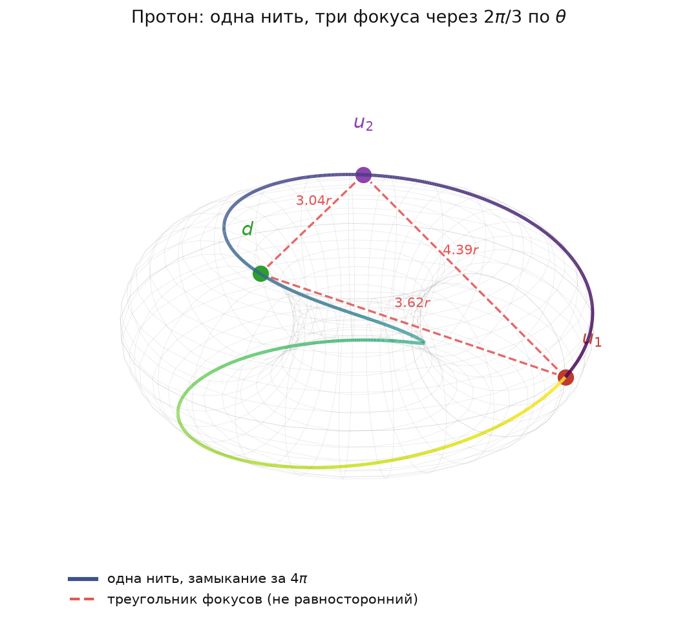

# 5.3 Спонтанное нарушение цветовой симметрии и дикварковый керн протона

*[← Глава 5](05-cvet-i-adrony.md) · [Оглавление](index.md)*

## Постановка: равноправие цветов и его нарушение упаковкой

На бумаге калибровочные цвета группы $SU(3)_c$ абсолютно равноправны, а вакуум КХД изотропен. Однако внутри конкретного стабильного солитона (протона $uud$) это абстрактное равноправие спонтанно нарушается геометрией упругой упаковки.

Нарушение здесь не связано с введением скалярного поля или дополнительного потенциала: источником анизотропии является сама конфигурация мод. Две из трёх мод тождественны ($uu$), третья ($d$) отличается знаком намотки и частотой, и упаковка трёх таких объектов в общем торе не может остаться симметричной.

## Фазовый развод $u$-пары на $180^\circ$

Два тождественных $u$-кварка под действием принципа исключения Паули — в упругой онтологии это давление одноимённых мод среды, см. трактовку принципа Паули как упругого предела нелинейной среды в подглаве [2.3](02-3-kvantovyy-princip-ekvivalentnosti.md) — разводятся ровно на $180^\circ$ **по фазе возбуждения**:

$$\Delta\psi_{uu} = \pi$$

Существенно, что разведено именно возбуждение, а не положение. Мёбиусовский шаг намотки — фаза набегает вдвое медленнее углового параметра,

$$\varphi = 0.5\,\theta$$

— то же соотношение $2:1$ между полоидальным и тороидальным обходами, которое отвечает за спин $1/2$ (см. [2.1](02-1-rassloenie-hopfa.md)). Но именно из-за него постоянная прибавка $\pi$ к $\varphi$ тождественна прибавке $2\pi$ к $\theta$, то есть полному обороту вокруг тора: кривая переходит сама в себя, и никакого нового пространственного расположения такой сдвиг не порождает (проверено численно с точностью $3.4\cdot10^{-15}$, см. [5.10](05-10-faza-protiv-polozheniya.md)). Утверждение о том, что противофазность автоматически переводится в пространственную ортогональность плоскостей, тем самым **не выполняется** и здесь не используется.

Корректная запись требует трёх независимых переменных, а не двух:

$$\theta \ (\text{положение вдоль нити}), \qquad \varphi = \tfrac{\theta}{2} \ (\text{намотка}), \qquad \psi \ (\text{фаза возбуждения})$$

Тогда запрет и геометрия разводятся по разным условиям:

$$\text{Паули:} \quad \Delta\psi_{uu} = \pi \qquad\qquad \text{Геометрия:} \quad \Delta\theta = \tfrac{2\pi}{3}$$

Принцип запрета фиксирует противофазность возбуждения и о расположении фокусов не говорит ничего; расположение задаётся отдельно — равномерным разнесением фокусов по тороидальному углу.

## Дикварковый керн

Два $u$-фокуса формируют высокостабильную пару — дикварковый керн (остов) протона. Свойства этой конструкции:

1. **Жёсткость — фазовая.** Пара удерживается не динамическим равновесием, а фазовым запретом: сближение мод по фазе возбуждения запрещено принципом Паули, поэтому разность $\Delta\psi_{uu}$ фиксирована и мягкой моды не имеет.
2. **Разнесение — по нити, а не «диаметрально».** Фазовый запрет положения фокусов не задаёт: они разнесены по тороидальному углу на $\Delta\theta = 2\pi/3$. Формулировка «фокусы расположены диаметрально относительно оси тора» была бы условием $\Delta\theta = \pi$ — совсем другим и в модели не выполняющимся (см. [5.10](05-10-faza-protiv-polozheniya.md)).
3. **Выделенная ось.** Керн задаёт в барионе выделенное направление, относительно которого и определяется движение третьей моды. Именно здесь цветовая симметрия перестаёт быть эффективной: две плоскости из трёх заняты жёстко, третья остаётся динамической.

Ещё одна поправка к наглядному образу: два $u$-фокуса не суть две отдельные нити. Замыкание конструкции наступает лишь при $4\pi$, поэтому одна замкнутая кривая выглядит как два вложенных зацепленных кольца, соединённых через горловину; это хопфовское зацепление одного слоя ([2.1](02-1-rassloenie-hopfa.md)), несущее топологический заряд, а не два объекта. Фокусов на нити три, нить одна.

Такая структура согласуется с данными экспериментов по глубоконеупругому рассеянию адронов: представление о барионе как о системе «компактный дикварк + отдельный кварк» независимо используется в феноменологии структурных функций и спектроскопии барионов. Модель получает эту двухблочную структуру не как подгонку, а как следствие упаковки.

## $d$-кварк как динамический маятник

Третья мода — $d$-кварк — оказывается онтологически неравноправна $u$-паре по двум причинам:

- **Инвертированный знак топологической намотки** (заряд $-1/3$, см. [5.2](05-2-drobnyy-zaryad.md));
- **Половинная пространственно-временная частота** относительно мод керна:

$$\omega_d = \tfrac{1}{2}\,\omega_u$$

Вследствие этого $d$-мода превращается в динамический маятник. Она непрерывно колеблется («дышит») в зазоре конфигурационного пространства, пролетая сквозь свободные фазовые зазоры между двумя $u$-плоскостями керна и обеспечивая непрерывный глюонный ток обмена.

Существенно, что маятник не является возмущением поверх статической конфигурации: он и есть механизм связи. Без непрерывного перекидывания $d$-моды между плоскостями керна обмен фазой между $u$-модами прекращается, и резонанс распадается на несвязанные фрагменты.

Отсюда следует и вид калибровочного баланса: равноправие цветов в протоне нарушено динамически — роли плоскостей упруго распределены калибровочным балансом, а не зафиксированы раз и навсегда. Усреднение по периоду колебаний $d$-маятника восстанавливает формальную симметрию описания, но в каждый момент времени конфигурация анизотропна.

Динамика самого проскальзывания $d$-моды через критическую точку сближения с $u$-плоскостью — с оценкой роли встречного вращения и накопленной энергии Черна — Саймонса — разобрана в подглаве [5.5](05-5-fazovoe-proskalzyvanie.md). Численная реализация этого закона движения (фазовый развод $u$-пары на $180^\circ$ плюс автоколебания $d$-моды с половинной фазовой частотой) описана в подглаве [10.1](10-1-chislennyy-eksperiment.md).

## Итоговые соотношения

$$\Delta\psi_{uu} = 180^\circ = \pi \qquad \text{(принцип Паули для тождественных мод: фаза возбуждения)}$$

$$\varphi = 0.5\,\theta \qquad \text{(мёбиусовский шаг намотки)}$$

$$\Delta\theta_{uu} = \tfrac{2\pi}{3} \qquad \text{(геометрическое разнесение фокусов по нити)}$$

$$\omega_d = \tfrac{1}{2}\,\omega_u, \qquad \operatorname{sign}(\text{намотка } d) = -\operatorname{sign}(\text{намотка } u)$$

$$\text{протон} = \underbrace{[uu]}_{\text{фазово-запертый керн}} + \underbrace{d}_{\text{динамический маятник}}$$

## Как это выглядит

Две поправки к чтению рисунка, обе разобраны в подглаве [5.10](05-10-faza-protiv-polozheniya.md).

**Первая: видимые «две зацепленные намотки» — это одна нить.** Замыкание наступает лишь при $4\pi$, поэтому кривая выглядит как два вложенных кольца, соединённых через горловину. Их зацепление и есть хопфовское зацепление одного слоя, несущее топологический заряд; приписывать каждое кольцо отдельному кварку нельзя.

**Вторая: $180^\circ$ — это фазовый развод, а не геометрический.** Символ $\varphi$ обозначает **полоидальный** угол (поперёк трубки), и сдвиг на $\pi$ переносит через сечение, оставляя тот же меридиан. Диаметральность относительно оси требовала бы $\Delta\theta = \pi$, то есть условия на **тороидальный** угол, — это другое и в модели не выполняется. Корректная запись требует трёх независимых переменных ($\theta$, $\varphi = \theta/2$, $\psi$), и отождествлять фазовый развод с ортогональностью плоскостей нельзя.

---

*[⬆](05-cvet-i-adrony.md) · [🏠](index.md)*
