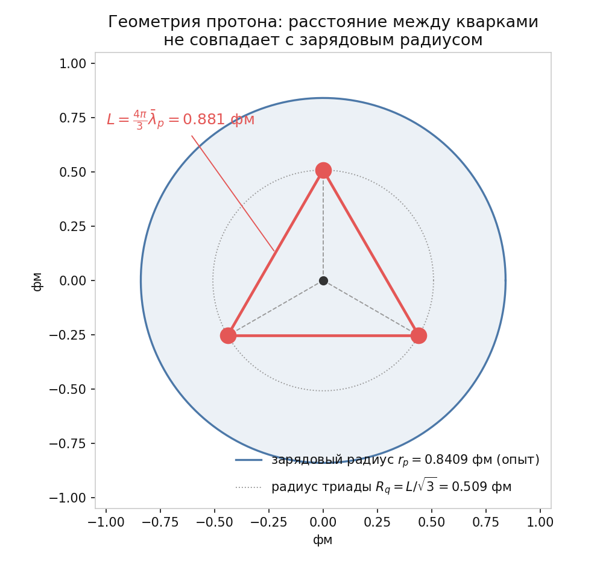

# 5.9 Конечная скорость цвета: принцип Паули как источник массы и расстояние между кварками

*[← Глава 5](05-cvet-i-adrony.md) · [Оглавление](index.md)*

## 5.9.0 Статус изложенного: рабочее предположение, а не постулат

Предыдущие подглавы главы 5 — дикварковый керн ([5.3](05-3-dikvarkovyy-kern.md)), $d$-маятник, дефицит размерности обхода ([5.2](05-2-drobnyy-zaryad.md)) — следует читать как **инструмент размышления о природе цвета**, а не как систему аксиом. Формулировка «дефицит хирального обхода различает лептон и кварк» была введена автором как рабочая гипотеза: способ задать вопрос «что такое цвет и что такое глюон в упругой среде», а не как выведенное утверждение.

Это важно зафиксировать явно, потому что в аудите главы 4 (подглавы [4.9](04-9-audit-podgonki.md)–[4.11](04-11-ontologiya-ekranirovaniya.md)) разделение на лептоны и кварки было записано в список «не выводится моделью». Такая запись по тону подразумевает невыполненное обязательство, что неточно. Точнее так:

> Разделение лептон/кварк в модели **не постулировалось и не выводилось**. Оно введено как условное предположение, поясняющее, откуда может браться цвет; статус этого предположения — гипотеза, подлежащая проверке, а не долг перед критиком.

Практическое следствие одно: результаты этой подглавы получены **внутри** гипотезы и вместе с ней стоят или падают. Это не ослабляет их проверяемость — гипотеза даёт числа, и числа сравниваются с опытом.

## 5.9.1 Принцип Паули как источник массы

Стандартный вопрос «откуда у протона $938$ МэВ, если сумма токовых масс кварков около $9$ МэВ» в КХД решается через энергию глюонного поля и конденсата. В настоящей модели предлагается более узкая формулировка того же ответа.

**Утверждение.** Масса адрона есть энергия непрерывно идущего процесса вытеснения запрещённых состояний, а не запас потенциальной энергии в статическом поле.

Механизм таков:

1. Внутри протона три моды циркулируют в общем торе. Две из них тождественны, и принцип запрета — в упругой онтологии это предел локальной плотности энергии, см. [2.3](02-3-kvantovyy-princip-ekvivalentnosti.md) — запрещает им совпасть по состоянию.
2. Среда не может разрядить это перенапряжение сжатием: модуль всестороннего сжатия бесконечен ($K \to \infty$, $\nu \to 0.5$; см. [1.1](01-1-uravnenie-lame.md)). Несжимаемость здесь не вводится ради данного вывода: к ней ведут три независимые мотивировки, среди них сама электродинамика, где $\nabla\cdot\mathbf{E} = 0$ есть $\nabla\cdot\mathbf{u} = 0$ (см. [1.6](01-6-mgnovennoe-pole-davleniya.md)). Единственный доступный канал релаксации — сдвиг, то есть **переориентация плоскости намотки**.
3. Переориентация плоскости намотки и есть глюон ([5.1](05-1-su3-iz-3d-geometrii.md), [5.7](05-7-vosem-glyuonov.md)).

Отсюда ключевой ход: перенапряжение по Паули **не снимается однократно**. Оно снимается непрерывно — система вечно пытается нарушить запрет и вечно выталкивает избыточные состояния наружу в виде квантов кручения. Энергия этого стационарного, никогда не завершающегося процесса и есть масса покоя.

Это переворачивает обычную логику: не «частицы имеют массу и потому связываются», а «связывание запрещено принципом Паули, и цена запрета есть масса».

## 5.9.2 Конечная скорость цвета

Второй элемент картины: цвет передаётся между кварками **не мгновенно**. Переориентация плоскости намотки — это возмущение упругой среды, распространяющееся по сдвиговой ветви ([1.1](01-1-uravnenie-lame.md)) — той же самой, по которой идёт свет ([3.1](03-1-vyvod-maksvella.md)).

Пусть три фокуса стоят в вершинах треугольника со стороной $L$. (Треугольник в модели заметно неравносторонний — см. [5.10](05-10-faza-protiv-polozheniya.md); на вывод это не влияет, поскольку в условие замыкания входит полная длина контура, и $L$ всюду ниже читается как **среднее ребро**.) Задержка передачи цвета вдоль ребра:

$$\tau = \frac{L}{v_c}$$

где $v_c$ — скорость передачи цвета. Ниже показано, почему для неё введено отдельное обозначение и почему это **не** синоним «локальной скорости света внутри протона».

### Локальная скорость света внутри протона от $c$ не отличается

Естественное возражение: солитон — это область сильной деформации среды, вблизи «массового ядра» скорость света могла бы просесть. Оценим поправку двумя независимыми способами.

**1. Гравитационная.** В модели гравитация есть размягчение модуля сдвига ([7.1](07-1-sbros-stressa.md)), и относительный сдвиг скорости равен обычному потенциалу:

$$\frac{\Delta c}{c} \sim \frac{\Phi}{c^2} = \frac{G M_p}{r_p c^2} = 1.48\cdot10^{-39}$$

Эквивалентно: гравитационный радиус протона $r_s = 2GM_p/c^2 = 2.48\cdot10^{-39}$ фм против $r_p = 0.84$ фм.

**2. Упругая (нелинейная).** Акустоупругая поправка к скорости сдвиговой волны пропорциональна отношению деформации солитона к предсжатию среды, то есть отношению плотностей энергии:

$$\frac{u_p}{u_{\text{Pl}}} = \frac{376.7 \ \text{МэВ/фм}^3}{2.89\cdot10^{81} \ \text{МэВ/фм}^3} = 1.30\cdot10^{-79}$$

Это ровно тот случай, ради которого в [1.5](01-5-struktura-sredy.md) фиксируется разделение масштабов в 23–24 порядка: адрон для планковской решётки — исчезающе слабое возмущение.

Точность настоящей главы — $6.7\%$ (расщепление $N$–$\Delta$) и множитель $2$ (вилка [T-23](98-todo.md#t-23)). Поправки лежат на 37 и 77 порядков ниже. **Локальная скорость света внутри протона неотличима от $c$**, и по этой причине отдельный термин не нужен.

### Но $v_c$ — это и не скорость света

Отдельное обозначение нужно по другой причине, и она не имеет отношения к свойствам среды. В формулу входит не скорость свободной волны в неограниченной среде, а **скорость распространения сигнала вдоль удерживающего канала**. Канал имеет конечное поперечное сечение, сравнимое с $L$ ([6.1](06-1-effekt-puassona.md)), а в любом волноводе осевая групповая скорость меньше скорости свободной волны:

$$v_c = \frac{c}{\chi}, \qquad \chi \ge 1$$

Фактор $\chi$ собирает два эффекта: извилистость пути (сигнал идёт зигзагом, а не по прямой) и волноводную дисперсию, $v_g = c\sqrt{1 - \omega_c^2/\omega^2}$ при поперечной частоте отсечки $\omega_c$. Оба — эффекты **геометрии канала**, а не среды, и оба порядка единицы, а не $10^{-39}$.

Вывод по терминологии: термин «скорость передачи цвета» сохраняется, но его смысл уточнён. Он означает не «скорость света, изменённую близостью к массе» (такого эффекта нет на 37 порядков), а «эффективную скорость сигнала в удерживающем канале», $v_c \le c$. Равенство $v_c = c$ — ведущее приближение, в котором ведётся весь дальнейший расчёт; отклонение от него — открытая величина, а не пренебрежимая поправка.

Цветовая конфигурация обязана быть бегущей волной: фокус $i$ в момент $t$ несёт цвет, отправленный фокусом $i-1$ в момент $t - \tau$. Циклическая перестановка трёх цветов замыкается за три шага, поэтому цветовое поле периодично с периодом

$$T_{\text{цв}} = 3\tau = \frac{3L}{v_c}$$

**Именно конечность $\tau$ и создаёт резонанс.** При $\tau = 0$ три фокуса были бы одним объектом: цвет успевал бы выравниваться мгновенно, и никакой внутренней динамики не возникло бы. Конечная задержка превращает тройку в резонатор с обратной связью — систему с запаздывающим взаимодействием, у которой существуют дискретные захваченные (locked) моды.

## 5.9.3 Условие замыкания и расстояние между кварками

Пусть внутренняя фаза моды набегает со скоростью $\omega$. За одно ребро набег составляет

$$\delta\varphi = \omega\,\tau = \frac{\omega L}{v_c}$$

Требуем, чтобы за **один** цветовой обход (три ребра) замкнулись обе фазы сразу: цветовая (автоматически, перестановка циклическая) и спинорная. Спинорное замыкание требует не $2\pi$, а $4\pi$ — это то же условие двулистного накрытия, которое в [2.1](02-1-rassloenie-hopfa.md) даёт спин $1/2$, а в [5.2](05-2-drobnyy-zaryad.md) — период лептонного цикла:

$$3\,\delta\varphi = 4\pi \qquad \Longrightarrow \qquad \delta\varphi = \frac{4\pi}{3}$$

Вся энергия покоя заключена в этой циркулирующей моде (другого хранилища в модели нет), поэтому

$$\hbar\omega = M_p c^2$$

Подставляя $\omega = M_p c^2/\hbar$ в $\delta\varphi = \omega L/v_c$:

$$\boxed{\ L \ = \ \frac{4\pi}{3}\cdot\frac{\hbar}{M_p c}\cdot\frac{v_c}{c} \ = \ \frac{4\pi}{3}\,\bar\lambda_p\,\chi^{-1}\ }$$

Численно в ведущем приближении $\chi = 1$ ($v_c = c$), при $\hbar c = 197.3270$ МэВ·фм и $M_p c^2 = 938.2721$ МэВ:

$$\bar\lambda_p = 0.2103089 \ \text{фм}, \qquad L = 4.18879 \cdot \bar\lambda_p = 0.8809 \ \text{фм}$$

Поскольку $\chi \ge 1$, это значение есть **верхняя граница**, а не оценка посередине диапазона:

$$L \ \le \ \frac{4\pi}{3}\,\bar\lambda_p \ = \ 0.881 \ \text{фм}$$

**Почему именно $4\pi/3$, а не $2\pi/3$ или $8\pi/3$.** Значение $\delta\varphi = 2\pi/3$ замыкает цвет, но спинорную фазу — только за два обхода; это допустимая, но не минимальная одновременная синхронизация, и она даёт $L = 0.4405$ фм. Значение $8\pi/3$ — следующая гармоника. Выбран минимальный набег, при котором цвет и спин замыкаются на одном и том же обходе. Никакого подбора под данные здесь нет: множитель фиксируется требованием одновременного замыкания, а не сравнением с экспериментом.

## 5.9.4 Это не радиус протона

Две величины следует различать буквально. Сторона треугольника $L$ — расстояние **между кварками**. Радиус кварковой триады (расстояние от барицентра до фокуса) есть радиус описанной окружности:

$$R_q = \frac{L}{\sqrt{3}} = \frac{0.8809}{1.7321} = 0.5086 \ \text{фм}$$

Сопоставление с зарядовым радиусом:

| величина | значение | что это |
|---|---|---|
| $L$ — сторона треугольника | $0.881$ фм | расстояние между кварками |
| $R_q = L/\sqrt3$ | $0.509$ фм | радиус кварковой триады |
| $r_p$ (CODATA 2022) | $0.8409 \pm 0.0004$ фм | зарядовый радиус |

$$\frac{R_q}{r_p} = 0.605$$

**Радиус триады ([5.10](05-10-faza-protiv-polozheniya.md)).** Формула $R_q = L/\sqrt3$ была бы верна для равностороннего треугольника, но при $R = \sqrt3\,r$ он неравносторонний (разброс сторон $36.7\%$). Расстояния трёх фокусов от оси тора равны $0.295$, $0.534$ и $0.653$ фм — различаются в $2.2$ раза. **«Радиус триады» как одно число не определён**; корректная запись есть диапазон $0.29\ldots0.65$ фм. Само $L = 0.881$ фм при этом сохраняется, поскольку в условие замыкания входит полная длина контура и $L$ читается как среднее ребро. Качественный вывод — все фокусы внутри зарядового облака — тоже остаётся в силе, причём с запасом: самый дальний фокус $0.653$ фм против $r_p = 0.8409$ фм.

Кварковые фокусы лежат **внутри** зарядового облака, занимая от $0.35$ до $0.78$ его радиуса. Это внутренне непротиворечиво: зарядовое облако есть зона разрежения решётки вокруг триады ([5.6](05-6-geometriya-adrona.md)), и оно обязано быть шире самой триады. Если бы хоть один фокус вышел за $r_p$, картина рухнула бы — этот тест модель проходит.

**Отдельно: числовое наблюдение, не являющееся выводом.** Экспериментальный зарядовый радиус выражается через комптоновскую длину протона почти точно целым числом:

$$\frac{r_p}{\bar\lambda_p} = 3.9984, \qquad 4\,\bar\lambda_p = 0.84124 \ \text{фм} \quad \text{против} \quad 0.8409 \pm 0.0004 \ \text{фм}$$

то есть отклонение $+0.040\%$, или $0.84\sigma$. Это ровно то же наблюдение, что зафиксировано в [T-8](98-todo.md#t-8) как «требуется делитель $3/2$, а не $\pi/2$»: $6\bar\lambda_p / (3/2) = 4\bar\lambda_p$. Новой информации оно не несёт и выводом не является — приводится, чтобы наблюдение не выглядело в двух местах как два независимых успеха.

## 5.9.5 Резонанс: период $d$-маятника равен времени цветового оборота

Подглава [5.3](05-3-dikvarkovyy-kern.md) независимо от всего предыдущего постулирует половинную частоту $d$-моды: $\omega_d = \tfrac12\omega_u$. Период маятника:

$$T_d = \frac{2\pi}{\omega_d} = \frac{4\pi}{\omega}$$

Время цветового оборота при $\delta\varphi = 4\pi/3$:

$$T_{\text{цв}} = 3\tau = \frac{3\,\delta\varphi}{\omega} = \frac{4\pi}{\omega}$$

$$\boxed{\ T_d \ \equiv \ T_{\text{цв}}\ }$$

$d$-маятник делает ровно один взмах за один цветовой обход. Численно $T_d = T_{\text{цв}} = 8.816\cdot10^{-24}$ с.

Оговорка о статусе: это **не второй независимый вывод**, а переформулировка условия $\delta\varphi = 4\pi/3$ — обе величины выражены через одну и ту же $\omega$, и тождество выполняется алгебраически. Ценность в интерпретации: условие замыкания, введённое как формальное требование, оказывается тождественно физическому утверждению «маятник синхронен с цветом». Механика, описанная в [5.3](05-3-dikvarkovyy-kern.md) и [5.5](05-5-fazovoe-proskalzyvanie.md) словами, здесь получает точную формулировку.

## 5.9.6 Проверка: $\Delta$ не успевает замкнуть цикл

Подглава [5.4](05-4-delta-izobara.md) утверждает качественно: $\Delta^{++}$ распадается «за один внутренний оборот». Теперь это проверяется числом.

$$T_{\text{цв}} = 8.816\cdot 10^{-24} \ \text{с}$$

$$\tau(\Delta) = \frac{\hbar}{\Gamma_\Delta} = \frac{6.5821\cdot10^{-22} \ \text{МэВ}\cdot\text{с}}{117 \ \text{МэВ}} = 5.626\cdot10^{-24} \ \text{с}$$

$$\frac{\tau(\Delta)}{T_{\text{цв}}} = 0.638$$

$\Delta$ живёт **меньше одного цветового оборота** — она разрушается прежде, чем конфигурация успевает впервые замкнуться. Протон, у которого $d$-маятник проскальзывает через критическую точку ([5.5](05-5-fazovoe-proskalzyvanie.md)), замыкается и потому стабилен. Утверждение [5.4](05-4-delta-izobara.md) подтверждается количественно, а не только по порядку величины.

## 5.9.7 Три оценки масштаба и их расхождение

Модель допускает три разных способа получить $L$, и они не совпадают. Честный итог — не одно число, а вилка.

| # | оценка | что предполагается | $L/\bar\lambda_p$ | $L$, фм |
|---|---|---|---|---|
| A | паулиевское запирание | три ультрарелятивистские моды заперты в области $L$: $3\hbar c/L = M_pc^2$ | $3$ | $0.631$ |
| B | цветовой резонанс (§5.9.3) | вся энергия в циркулирующей моде, $\delta\varphi = 4\pi/3$ | $4\pi/3 = 4.189$ | $0.881$ |
| C | равнораспределение ([5.6](05-6-geometriya-adrona.md)) | энергия поровну по $6$ каналам, $L = \hbar c/E_{link}$ | $6$ | $1.262$ |

Разброс ровно двукратный: $L_C/L_A = 2$. Оценки не независимы по духу — все три суть «комптоновская длина протона, умноженная на счётный множитель», — и различаются **только тем, как энергия покоя распределена по каналам**. Это и есть главный нерешённый вопрос данного блока; он вынесен как [T-23](98-todo.md#t-23) и поглощает [T-8](98-todo.md#t-8): проекционный фактор $\pi/2$ против $3/2$ есть частный случай того же неопределённого счёта.

### Условие $v_c \le c$ отсекает вариант C

Уточнение смысла скорости (§5.9.2) даёт неожиданное следствие. Перепишем каждую оценку через требуемый фактор извилистости $\chi = c/v_c$: из $L = \tfrac{4\pi}{3}\bar\lambda_p\,\chi^{-1}$ следует $\chi = (4\pi/3)/(L/\bar\lambda_p)$.

| оценка | $L/\bar\lambda_p$ | $\chi = c/v_c$ | $v_c/c$ | статус |
|---|---|---|---|---|
| A | $3$ | $1.396$ | $0.716$ | допустимо |
| B | $4\pi/3$ | $1.000$ | $1.000$ | предельный случай |
| C | $6$ | $0.698$ | $\mathbf{1.432}$ | **сверхсветовая передача — запрещено** |

Вариант C требует, чтобы цвет передавался между кварками в $1.43$ раза быстрее света. Внутри картины конечной скорости цвета это противоречие, а не малая неточность. Следовательно:

$$L \in \left(0,\ \tfrac{4\pi}{3}\bar\lambda_p\right] = (0,\ 0.881] \ \text{фм}$$

и оценка [5.6](05-6-geometriya-adrona.md) через равнораспределение по шести каналам **несовместима** с запаздывающим обменом. Это первое сужение [T-23](98-todo.md#t-23): вилка из трёхсторонней стала двусторонней, верхний край зафиксирован жёстко, а открытым остался только вопрос «насколько ниже $c$».

Что сказать можно уже сейчас: расстояние между кварками модель ограничивает сверху величиной $0.881$ фм, а рабочая оценка лежит в диапазоне $0.63\ldots0.88$ фм ($\chi = 1.40\ldots1.00$). Ни один из вариантов не подгонялся; вариант C отброшен доводом, а не сравнением с опытом.

## 5.9.8 Энергия связи и натяжение цветового канала

**Энергия на канал.** Двум вариантам счёта каналов отвечают два числа:

$$E_{link} = \frac{M_p c^2}{6} = 156.38 \ \text{МэВ} \qquad (\text{6 каналов, } 5.6)$$

$$E_{\text{ребро}} = \frac{M_p c^2}{3} = 312.76 \ \text{МэВ} \qquad (\text{3 внешних ребра})$$

Обе величины лежат на масштабе $\Lambda_{\text{КХД}}$ (для трёх ароматов в схеме $\overline{\text{MS}}$ около $332$ МэВ — величина схемозависимая, поэтому сравнение здесь только качественное). Модель не имеет собственного вывода $\Lambda_{\text{КХД}}$; утверждение состоит лишь в том, что энергия связи на канал получается **того же масштаба**, а не на порядок мимо.

**Натяжение канала.** Если уложить энергию покоя в струны, натяжение равно энергии на единицу длины. Для двух геометрий укладки (три ребра треугольника либо $Y$-струна в точку Ферма, суммарная длина $\sqrt3\,L$):

| оценка $L$ | треугольник, МэВ/фм | $Y$-струна, МэВ/фм | $Y$ / решётка |
|---|---|---|---|
| A ($0.631$ фм) | $496$ | $859$ | $0.94$ |
| B ($0.881$ фм) | $355$ | $615$ | $0.67$ |
| C ($1.262$ фм) | $248$ | $429$ | $0.47$ |

Решёточное значение натяжения струны $\sigma \approx 0.18$ ГэВ$^2 = 912$ МэВ/фм принято как ориентир (величина внешняя, не модельная).

**Как это читать.** Совпадение варианта A с решёточным значением на уровне $6\%$ **не следует считать успехом**: в расчёт заложено, что вся энергия покоя есть энергия струны, тогда как заметная её часть кинетическая. Модельное $\sigma$ поэтому есть завышенная оценка сверху, и «идеальное» попадание означает лишь, что завышение компенсировало недооценку $L$. Корректная формулировка: **натяжение цветового канала в модели укладывается в диапазон $0.47\ldots0.94$ от решёточного, то есть верно по порядку величины и с точностью до множителя $2$** — ровно та же точность, что и у самого $L$, и по той же причине.

## 5.9.9 Счёт паулиевских конфликтов: проверяемое следствие

Если масса есть цена запрета, она должна расти с числом запретов. Проверим буквально.

**Что считается «тождественным».** Не флейвор, а состояние моды: плоскость намотки, знак намотки, фаза. $d$-маятник протона ушёл в противофазу и на половинную частоту ([5.3](05-3-dikvarkovyy-kern.md)) — он из конфликта выведен. В состоянии со спином $3/2$ все три моды захвачены синфазно, и конфликтуют все три пары.

**Правило.** Каждая конфликтующая пара оплачивается одним квантом $E_{link} = M_p c^2/6$:

$$M = M_{\text{ядро}} + N_{\text{пар}} \cdot E_{link}, \qquad M_{\text{ядро}} = M_p - 1\cdot E_{link} = 781.89 \ \text{МэВ}$$

Свободных параметров нет: и $E_{link}$, и $M_{\text{ядро}}$ выражены через $M_p$.

| барион | синфазных мод | пар | предсказание, МэВ | опыт, МэВ | отклонение |
|---|---|---|---|---|---|
| $p$ ($uud$, $S=1/2$) | 2 | 1 | $938.3$ | $938.27$ | вход |
| $n$ ($udd$, $S=1/2$) | 2 | 1 | $938.3$ | $939.57$ | $-0.14\%$ |
| $\Delta^{++}$ ($uuu$, $S=3/2$) | 3 | 3 | $1251.0$ | $1230.9$ | $+1.64\%$ |
| $\Delta^{+}$ ($uud$, $S=3/2$) | 3 | 3 | $1251.0$ | $1232.0$ | $+1.54\%$ |
| $\Omega^{-}$ ($sss$, $S=3/2$) | 3 | 3 | $1251.0$ | $1672.45$ | $-25.2\%$ |

Ключевое число — расщепление:

$$M(\Delta) - M(N) \ = \ 2\,E_{link} \ = \ \frac{M_p c^2}{3} \ = \ 312.76 \ \text{МэВ}$$

против экспериментальных $293.08$ МэВ (по среднему нуклону), то есть $+6.7\%$. Эквивалентная запись предсказания: $M(\Delta) = \tfrac43 M_p$.

**Что здесь достигнуто:**

- вырождение $p$ и $n$ — предсказано точно, опыт даёт $+0.14\%$;
- вырождение всего $\Delta$-мультиплета ($\Delta^{++}$ и $\Delta^{+}$ на одном уровне) — воспроизводится, поскольку счёт не зависит от флейвора;
- расщепление $N$–$\Delta$ — $+6.7\%$ без единого подгоночного параметра.

**Что провалено:** $\Omega^-$ промахивается на $25\%$. Провал диагностичен и не случаен: счёт конфликтов по построению не видит флейвора, а $\Omega^-$ отличается от $\Delta$ именно странностью. Правило применимо только внутри $u/d$-сектора; распространение его на тяжёлые ароматы требует, чтобы у модели появилась иерархия ароматов, которой у неё пока нет (та же дыра, что и [T-15](98-todo.md#t-15) в лептонном секторе). Вынесено как [T-25](98-todo.md#t-25).

Оговорка о честности сравнения: $M_p$ входит как единственный размерный вход, поэтому строка протона — не предсказание, а нормировка. Предсказаний в таблице четыре, из них три попадают в пределах $1.7\%$ и одно промахивается на $25\%$.

## 5.9.10 «Пошаговое» движение кварков в симуляции

В анимации `simulations/python/Proton.py` кварки визуально движутся не плавно, а рывками — как если бы перескакивали дискретными шагами. Это не численный артефакт и не физический эффект решётки; это **биения наложенных мод**.

В коде на каждый фокус наложены три различные временны́е частоты:

- несущая намотка $u$-моды: $\varphi = 0.5\,\theta + \text{shift} - t$;
- несущая намотка $d$-моды: $\varphi = -0.5\,\theta + \text{shift} + 0.5\,t$ — вдвое медленнее и в обратную сторону;
- модуляция позиций на удвоенной частоте: `d_oscillation` $= 0.5\sin 2t$ и `u_recoil` $= (\pi/8)\cos 2t$.

Отношение частот несущей $d$-моды к частоте модуляции равно $0.5 : 2 = 1 : 4$. Кроме того, $z$-координата $d$-моды промодулирована пространственно: $z = r\sin\varphi\cdot\cos(0.5\,\theta)$. В точках, где огибающая $\cos(0.5\theta)$ проходит через нуль, видимая амплитуда обнуляется, и глаз воспринимает исчезновение и повторное появление узора как скачок.

Иными словами: рывки — это узлы огибающей при кратном отношении частот, стандартная картина фигур Лиссажу с рациональным отношением. Физически же рациональность отношения частот и есть условие фазового захвата: именно она делает конфигурацию устойчивой, а не квазипериодически расплывающейся. Визуальная «пошаговость» — прямое проявление того, что система захвачена, а не свободна.

## 5.9.11 Что отсюда следует и что остаётся открытым

**Получено:**

$$L \le \frac{4\pi}{3}\bar\lambda_p = 0.881 \ \text{фм} \ \ (\text{среднее ребро}), \qquad r_{\text{фокус}} = 0.29 \ldots 0.65 \ \text{фм}, \qquad T_{\text{цв}} = 8.82\cdot10^{-24} \ \text{с}$$

$$E_{link} = 156.4 \ \text{МэВ}, \qquad \sigma_Y = 615 \ \text{МэВ/фм}, \qquad M(\Delta) - M(N) = \tfrac13 M_p c^2 \ (+6.7\%)$$

**Открыто:**

- [T-23](98-todo.md#t-23) — распределение энергии покоя по каналам: от него зависит выбор между $3\bar\lambda_p$ и $\tfrac{4\pi}{3}\bar\lambda_p$; вариант $6\bar\lambda_p$ отсечён условием $v_c \le c$; поглощает [T-8](98-todo.md#t-8);
- [T-26](98-todo.md#t-26) — вычислить фактор извилистости канала $\chi = c/v_c$ из геометрии удерживающего «шланга»; он один определяет положение $L$ внутри оставшейся вилки;
- [T-24](98-todo.md#t-24) — вывести натяжение канала независимо от массы протона, чтобы сравнение с решёточным $\sigma$ стало проверкой, а не тавтологией;
- [T-25](98-todo.md#t-25) — распространить счёт паулиевских конфликтов за пределы $u/d$-сектора; сейчас правило ломается на $\Omega^-$.

## Как это выглядит

Единственный рисунок атласа [10.3](10-3-atlas-solitonov.md), содержащий посчитанные числа, а не иллюстрацию анзаца: сторона треугольника $L = 0.881$ фм, радиус триады $R_q = 0.509$ фм, экспериментальный зарядовый радиус $r_p = 0.8409$ фм. Рисунок построен в равностороннем приближении: с учётом [5.10](05-10-faza-protiv-polozheniya.md) сторону следует читать как среднее ребро, а единственное $R_q$ — как диапазон $0.29\ldots0.65$ фм.

## Численная проверка

Все числа этой подглавы пересчитываются скриптом `simulations/python/ProtonColor.py` (`python ProtonColor.py`). Каждая величина в выводе помечена провенансом: `[M]` — выведено в модели, `[E]` — экспериментальный вход (только $M_p$), `[C]` — эксперимент для сравнения. Подгоночных параметров в скрипте нет.
